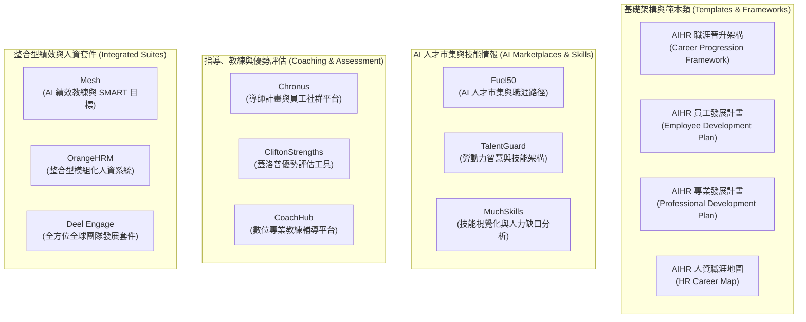

# 提升員工技能的 13 款最佳職涯發展工具：選商、導入與實務指南
> **原文網址**：https://www.aihr.com/blog/career-development-tools/  
> **原文作者**：Andrea Boatman  

---

## 📌 英文摘要 (Executive Summary in English)

Career development tools empower employees to understand their capabilities, discover growth opportunities, and proactively chart their long-term professional trajectories, directly curbing voluntary turnover. With HR leaders forecasting that 30% of employees risk resigning within six months due to insufficient employer career support, and 59% of workers reporting rare or nonexistent organizational backing for internal growth, modernizing career infrastructure has become a strategic necessity. This guide evaluates 13 industry-leading tools—ranging from structured progression templates and AI talent marketplaces to digital coaching and skills gap intelligence platforms. Successful deployment hinges on auditing legacy initiatives, securing leadership sponsorship, ensuring seamless HRIS/LMS integration, piloting with targeted cohorts, and balancing universal development access with tailored high-potential pathways to sustain an agile, learning-oriented organizational culture.

---

## 🔑 核心關鍵字與術語對照 (Key Terms & Glossary)

| 英文術語 (English Term) | 台灣人資繁中對照 (Traditional Chinese) | 實務簡要定義／應用情境 (Context & Definition) |
| :--- | :--- | :--- |
| **Career Development Tools** | 職涯發展工具 | 協助員工釐清自身職能優勢、探索組織內部機會並規劃長期晉升軌跡的平台、評測、架構與技術。 |
| **Career Progression Framework** | 職涯晉升架構 | 明確界定組織各職級（Job Levels）、職稱與晉升評估準則的階梯式制度藍圖。 |
| **Career Pathing / Career Mapping** | 職涯路徑規劃／職涯地圖 | 根據同仁個人現況與長期職涯目標，量身客製化橫向歷練與垂直升遷歷程的視覺化發展圖譜。 |
| **Internal Mobility** | 內部人才流動／內部轉調 | 促進人才在企業內部跨部門、跨專案或跨職能自由流動的機制，可顯著降低外部招募成本。 |
| **Talent Marketplace** | 內部人才市集 | 利用 AI 演算法媒合員工技能、發展意願與組織內部兼職專案（Gigs）、短期指派或全職職缺的動態平台。 |
| **Succession Planning** | 接班人計畫／接班梯隊規劃 | 系統化辨識、評估並培育組織核心關鍵職位後繼人選的策略性人才佈局。 |
| **Employee Development Plan (EDP)** | 員工發展計畫／個人發展計畫 | 員工與主管共同制定、記錄短期與中長期能力精進目標、具體行動步驟及完成指標的正式書面計畫。 |
| **Skills Taxonomy & Gap Analysis** | 技能分類體系與差距分析 | 結構化定義組織各崗位所需技能標準，並比對員工現有能力與未來需求差距的量化診斷方法。 |
| **High-Potential Employees (HiPo)** | 高潛力人才 | 展現超越同儕的敏捷學習力、領導潛能及承擔更大組織責任意願的關鍵核心成員。 |
| **Stretch Assignments** | 跨界歷練／具挑戰性的專案指派 | 超出日常職責範疇、具高度挑戰性且能加速培養新技能與領導經驗的實戰任務。 |
| **Digital Coaching** | 數位教練輔導 | 結合線上視訊與演算法媒合認證教練的現代化一對一領導力與職涯發展引導模式。 |
| **Workforce Intelligence** | 勞動力智慧／人才情報分析 | 整合人資系統數據、市場職能趨勢與內部技能圖譜，以數據驅動人力規劃與決策的分析體系。 |

---

## 📖 專業深度編譯 (In-Depth Translation & Insights)

### 1. 什麼是員工職涯發展工具？ (What are career development tools for employees?)
- **核心主張**：職涯發展工具並非單純的線上學習系統，而是涵蓋平台、評估工具、行動方案與輔導機制的完整生態系。其目的在於協助同仁深入了解自我技能與抱負、探索成長機會並規劃晉升路徑，同時協助人資落實培訓管理與職涯規劃。
- **關鍵本質區分（培訓工具 vs. 職涯工具）**：
  - **一般培訓工具 (General Training Tools)**：著眼於解決「當前或短期」的工作技能缺口與任務執行需求。
  - **職涯發展工具 (Career Development Tools)**：聚焦於「長期成長、職能演進與職涯藍圖規劃」，具備策略性與持續性。

### 2. 為什麼職涯發展工具至關重要？ (Why career development tools are important)
- **實務指標與數據**：
  - **30% 離職風險**：人資主管預測，組織內有高達 30% 的員工在未來六個月內可能因缺乏雇主的職涯發展支持而選擇求去。
  - **59% 發展孤島**：高達 59% 的在職員工反映，雇主「極少」或「從未」支持他們探索全公司範圍內的職涯成長機會。
- **三方共贏效益價值分析**：
  - **對員工 (Employees)**：建立明確成長目標、強化專業技能、提升工作掌握度與職涯信心，直接轉換為更高的工作投入度 (Engagement) 與工作滿意度。
  - **對人資團隊 (HR)**：大幅優化人才運作流程，包括精準推動接班人計畫 (Succession Planning)、活化內部人才流動 (Internal Mobility) 並顯著拉高頂尖人才留任率。
  - **對企業雇主 (Employers)**：培育具備前瞻性戰略技能的長期骨幹，強化多元平等共融 (DEIB) 推動成效，並透過內部晉升顯著降低昂貴的外部招聘成本。
- **中小企業資源受限時的專家建言（AIHR 心理測驗評估專家 Annelise Pretorius）**：
  - **聚焦 1~2 款核心工具**：優先選擇對齊近期發展目標的輕量工具，例如免費的職涯晉升架構範本或低成本的克里夫頓優勢評估 (CliftonStrengths)，結合主管一對正面談與定期檢核。
  - **融入日常管理常規**：將職涯地圖導入雙週或月度 1-on-1 會談，將發展計畫與季度目標 (OKRs/KPIs) 綁定，善用外部免費或低成本學習內容。
  - **活化非正式結構**：推行導師圈 (Mentoring Circles) 或同儕知識分享機制，這類低成本做法若能與同仁個人發展計畫深度結合，常能發揮超乎預期的發展成效。

### 3. 人資評選與推行職涯發展工具的 8 大關鍵步驟 (How HR can select and implement career development tools)
1. **盤點現有發展計畫 (Audit Current Programs)**：
   - 蒐集參與率、滿意度、完訓率等量化數據，評估既有方案對績效、留任與晉升的實質影響，精確標定員工與業務端未被滿足的痛點缺口。
2. **鎖定解決特定問題的工具 (Identify Tools to Solve Specific Problems)**：
   - 根據盤點結果與未來人才庫缺口，鎖定能解決核心痛點的功能，重點評估自評機制、客製化職涯路徑、進度追蹤、教練選項、LMS 整合與互動式回饋功能。
3. **推行對齊業務目標的工具 (Implement Tools That Support Business Goals)**：
   - 確保培育的技能直接挹注商業策略，向同仁清楚說明個人專業成長如何帶動公司目標達成，創造個人晉升與組織躍進的雙贏情境。
4. **與各部門主管緊密協作 (Collaborate with Department Heads)**：
   - 與前線領導人深度對焦，確保所選工具能滿足不同團隊的異質需求且操作直覺，並規劃與現行 IT/HRIS 系統的相容性及組織擴展性。
5. **爭取高階領導層支持 (Secure Buy-In from Leadership)**：
   - 及早讓高層參與，以數據佐證與成功案例展示職涯發展對業務成果的正向貢獻，將人才成長內化為企業文化不可或缺的核心價值。
6. **對全體員工進行清晰溝通 (Communicate Clearly with Employees)**：
   - 多管道宣導可用資源與操作方式，透過全員大會、實機展示電子郵件、主管考核面談說明，並鼓勵同仁公開分享內部成長故事。
7. **提供持續培訓與賦能支援 (Offer Training and Continuous Support)**：
   - 開設工作坊、線上課程與網路研討會；建立後續支持體系，透過導師機制、人資教練或內部 AI 諮詢機器人輔助同仁設定目標與追蹤進度。
8. **建立跨組織推動職涯發展的長期能量 (Build Systemic Career Development Capability)**：
   - 人資團隊自身需掌握現代人才流動與接班規劃的最佳實務，持續優化內部流動與潛力人才辨識機制。

### 4. 13 款精選職涯發展工具深度解析 (13 Best Career Development Tools)

#### (1) AIHR 職涯晉升架構 (AIHR’s Career Progression Framework)
- **核心機制**：透過結構化階層清楚定義組織內的各級職等（Job Levels）與職稱（Job Titles），公開載明晉級評估條件與能力標準。
- **實務價值**：將抽象的晉升機制轉化為可視化的階梯路徑，降低員工迷航感，顯著提高同仁投入自主發展計畫的意願。

#### (2) AIHR 員工發展計畫 (AIHR’s Employee Development Plan, EDP)
- **核心機制**：結構化的個人發展行動文件，定義提升現職表現與銜接未來目標所需的能力缺口與具體獲取步驟。
- **實務價值**：為主管與同仁建立透明的雙向當責（Accountability）基礎，使績效面談不再淪為空談。

#### (3) AIHR 專業發展計畫 (AIHR’s Professional Development Plan, PDP)
- **核心機制**：著重評估員工現有資歷、資格與潛能，配對最合適的培訓發展型態，並嚴格連結組織商業戰略目標。
- **實務價值**：避免盲目培訓，確保同仁投入技能精進的每一分時間皆能轉化為組織實質競爭力。

#### (4) AIHR 人資職涯地圖 (AIHR’s HR Career Map)
- **核心機制**：為人資專業人員專屬打造的視覺化職涯導航，橫跨薪酬、招募、人才發展、人資策略夥伴（HRBP）等多元子領域。
- **實務價值**：跳脫單一縱向升遷視角，提供具備全方位思維的橫向輪調與多元專業發展指引。

#### (5) Chronus 導師與社群媒合平台
- **核心機制**：運用智慧演算法自動媒合導師（Mentors）與學員（Mentees），並打造內部員工社群、活動規劃與參與樞紐。
- **實務價值**：破除部門穀倉，建立跨層級人脈網絡，促進同儕經驗傳承與心理歸屬感。

#### (6) Fuel50 AI 驅動內部人才市集
- **核心機制**：員工可上傳履歷並串接 LinkedIn 檔案，AI 自動解析技能水準、推薦發展行動與內部兼職專案（Gigs）或職缺。
- **實務價值**：以動態技能庫為核心，協助企業填補關鍵技能缺口，極大化人才內部流動率與組織敏捷度。

#### (7) TalentGuard 勞動力情報與技能架構平台
- **核心機制**：結合 AI 驅動的職務與技能分類體系（Taxonomy），將績效管理、接班人規劃與人才分析報表無縫串接。
- **實務價值**：提供員工基於技能的客製化學習推薦路徑，協助人資執行精確的策略性人力規劃（Strategic Workforce Planning）。

#### (8) OrangeHRM 職涯發展整合模組
- **核心機制**：為中小企業與開源架構愛好者提供涵蓋發展計畫擬定、技能缺口盤點、目標設定與歷程追蹤的完整功能。
- **實務價值**：打通個人發展與組織接班規劃的數據流，使分散的人資作業回歸單一平台。

#### (9) Mesh AI 績效管理與即時教練平台
- **核心機制**：結合 AI 助理引導員工設定 SMART 目標，並推動高頻率、持續性的一對一面談（1-on-1s）與即時回饋。
- **實務價值**：將年度績效考核的延遲痛點轉化為日常持續教練，提升個別同仁的核心業務與軟實力素養。

#### (10) CliftonStrengths 克里夫頓優勢評估
- **核心機制**：約 1 小時的標準化線上評測，產出個人前五大及三十四項天賦優勢報告。
- **實務價值**：以「優勢導向（Strengths-Based）」思維取代「補短」，激發同仁天賦，協助其在最合適的組織角色中發揮極致價值。

#### (11) Deel Engage 全球化職涯與培訓套件
- **核心機制**：專為分散式／跨國遠距團隊打造的職涯成長與敬業度軟體，自動化串接跨國團隊績效、學習與職涯路徑數據。
- **實務價值**：消除跨國跨區行政負擔，提供統一且客製化的跨國員工體驗與職涯進程追蹤。

#### (12) MuchSkills 技能視覺化與風險分析平台
- **核心機制**：具備技能差距與人才斷層風險分析、組織動態技能地圖、進度規劃及內部人才市集功能。
- **實務價值**：以直觀視覺化儀表板呈現全公司技能庫存，讓管理者能一眼辨識單點故障（Single Point of Failure）的人才風險。

#### (13) CoachHub 數位教練輔導平台
- **核心機制**：匯聚全球超過 3,500 位認證專業教練，提供個人、高階主管及 AI 輔助教練服務，並搭配個人化微學習（Micro-learning）內容。
- **實務價值**：跳脫內部主管輔導的局限，提供客觀、中立的第三者專業諮詢，全面激發領導者與關鍵骨幹潛能。

---

### 5. 高潛力人才 (HiPo) 與廣大人才庫的平衡策略（專家觀點）
- **核心挑戰**：在推行職涯發展工具時，如何避免資源過度向少數高潛力人才傾斜，而導致一般員工產生被剝奪感與不公平感？
- **AIHR 資深領域專家 Dr. Marna van der Merwe 建議之 5 大最佳實務**：
  1. **全員基礎享有 (Universal Access)**：將通用型的學習資源與發展工具開放給全體員工，確保每個人都能根據個人抱負追求成長。
  2. **分軌深化高潛力計畫 (Differentiated Paths)**：為高潛力同仁設計專屬軌道，包含高階領導力深造、跨界專案指派（Stretch Assignments）與高階主管導師制。
  3. **遴選標準高度透明 (Transparent Eligibility)**：向全員公開說明進階計畫的遴選標準與評估機制，破除黑箱疑慮，並將其與整體人才戰略對齊。
  4. **結合績效回饋進行個人化推薦 (Feedback-Driven Personalization)**：將日常績效回饋動態融入學習路徑建議，協助每位同仁量身定做進階方案。
  5. **營造全員學習文化 (Inclusive Development Culture)**：在全公司建立積極正向的職涯成長氛圍，讓所有人皆認同專業發展是組織賦予的珍貴福利。

### 6. 人資挑選最適職涯發展工具的 5 大決策維度 (Decision Dimensions)
1. **以員工真實回饋為起點 (Start with Employee Feedback)**：透過調查傾聽同仁最渴望的成長支持類型，避免人資閉門造車引進無人使用的昂貴系統。
2. **緊密對齊商業策略目標 (Align with Business Goals)**：依據技能缺口評估與未來業務藍圖挑選工具，特別著重具備接班人規劃連動能力的平台。
3. **評估整合性、擴充性與彈性 (Assess Integration, Scalability, and Flexibility)**：必須能與現行 HRIS 或 LMS 深度串接，杜絕資訊孤島（Data Silos）與重複建檔的行政負擔。
4. **優先考量數據與報表分析能力 (Prioritize Data & Analytics Features)**：具備即時監控參與度、學習進度與成效的分析儀表板，提供數據導向的決策依據。
5. **落實小規模前導試行計畫 (Test with a Pilot Program)**：在全面推行前挑選先導團隊進行 PoC 試行，收集第一線回饋並反覆調校參數。

---

## 📜 全文中文翻譯 (Full Traditional Chinese Translation)

### 前言

為員工導入職涯發展工具，不僅能促進個人的專業成長，更能為組織的整體成功做出貢獻，並有效降低人員離職率。

事實上，人資主管預測，組織內有高達 30% 的員工很可能會在未來六個月內離職，其主因正是雇主對其職涯發展缺乏足夠的支持。與此同時，有 59% 的員工表示，雇主「極少」或「從未」支持他們在全公司範疇內探索職涯成長的機會。

本文將深入探討職涯發展工具為何至關重要，評選出 13 款值得納入考量的優質工具，並針對如何為組織與員工選擇並推行合適的工具提供具體實務見解。

---

### 目錄
- 什麼是員工職涯發展工具？
- 為什麼職涯發展工具至關重要
- 人資如何評選與導入職涯發展工具
- 13 款最佳員工職涯發展工具精選
- 人資如何為員工挑選合適的職涯發展工具

---

### 什麼是員工職涯發展工具？

員工職涯發展工具涵蓋了各種平台、資源、評估測驗、行動方案與方法技術，旨在協助同仁更深入地理解自身的技能與抱負、發掘成長機會並規劃未來的職涯晉升軌跡。這些工具同時讓人資團隊能更具成效地推動與管理培訓工作及職涯路徑規劃（Career Pathing），進而大幅提升員工的敬業度與工作績效。

儘管員工職涯發展工具與一般的培訓工具有部分功能重疊，但兩者的核心初衷截然不同。一般培訓工具通常聚焦於滿足立即性或短期的學習需求；相較之下，職涯發展工具則更加著重於長遠的成長與宏觀規劃。

---

### 為什麼職涯發展工具至關重要

雖然員工職涯發展工具最直接的受益者是廣大工作者，但它們同時也為雇主與人資團隊帶來了顯著的策略優勢。這些工具所創造的價值涵蓋以下三個維度：

- **對員工而言**：當員工擁有自主管理成長所需的工具與組織支持時，他們能夠確立清晰的目標、鍛鍊關鍵技能，並對個人職涯前景抱持充沛的信心。這將直接轉化為更高的工作投入度與工作滿意度。
- **對人資而言**：支援職涯發展的工具能夠強化特定人資功能運作，包括簡化接班人計畫（Succession Planning）流程、提升人才留任率，以及擴大內部人才流動（Internal Mobility）。
- **對雇主而言**：投資於員工的成長，讓企業得以打造具備高度技能且長期穩定的勞動力隊伍。這不僅能促進多元平等共融（DEIB）成果與整體生產力，更能透過提高留任率與內部升遷，大幅降低外部昂貴的招募成本。

#### 專家諮詢：中小型企業在資源有限下該如何著手？
> **問題**：對於預算與資源有限、但仍希望導入職涯發展工具的中小型企業人資團隊，您有什麼建議？  
> **AIHR 心理測驗評估專家 Annelise Pretorius 指出**：  
> 「首先，挑選一到兩款與貴公司當前發展目標最緊密契合的工具作為起點。像是免費的架構範本（例如職涯晉升架構範本），或是低成本的自我評測工具（例如克里夫頓優勢評估 CliftonStrengths），都能為深具意義的職涯對話奠定堅實基礎，特別是在搭配主管面談培訓與定期檢核機制時成效尤佳。  
> 
> 接下來，將重心放在將所選工具融入日常的管理常規中。舉例來說，主管可以在一對一會談（1-on-1）中運用職涯地圖，將個人的發展計畫與季度業務目標相對齊，或是從免費或低成本的學習平台中策展內容，來支援團隊整體目標。此外，亦可善用導師圈（Mentoring Circles）或同儕主導的知識分享等非正式機制。這些方法往往未被充分利用，但一旦將它們與個人的發展計畫及共同目標連結起來，就能發揮極為強大的發展效益。」

---

### 人資如何評選與導入職涯發展工具

在組織內部挑選並引進職涯發展工具時，人資扮演著舉足輕重的推動角色。以下是人資團隊的核心關鍵職責與步驟：

#### 1. 盤點現行發展計畫 (Audit Current Development Programs)
全面檢視現有的培訓與發展方案，釐清哪些措施運作良好、哪些成效不彰。系統化蒐集同仁的參與度、滿意度與完訓率數據，並精準衡量這些計畫對工作績效、人才留任與職涯晉升的實質影響。藉此明確找出員工期待與業務需求尚未被滿足的缺口。

#### 2. 針對具體痛點鎖定合適工具 (Identify Tools to Solve Specific Problems)
立足於現況盤點結果與未來人才儲備需求，挑選能夠切實解決痛點的工具。在功能取捨上，優先評估自我評測機制、客製化職涯路徑、成長進度追蹤、教練輔導模組、學習平台（LMS）整合能力以及即時互動回饋等關鍵功能。

#### 3. 推行能夠支援商業目標的工具 (Implement Tools That Support Business Goals)
選用能夠引導員工鍛鍊組織核心戰略所需技能的工具。為了極大化工具的運用效益與實質影響，應向同仁清晰說明推進個人職涯將如何同步帶動公司經營目標的達成，為個人與企業雙方開拓全新的雙贏契機。

#### 4. 與各部門主管深度協作 (Collaborate with Department Heads)
與各事業單位主管緊密配合，確保所挑選的工具能夠滿足各個團隊的差異化需求，且介面設計友善直覺、易於上手。同時提前規劃該工具與既有系統的相容介接與未來擴展性，確保工具能長久保持實用價值，並在全公司順暢普及。

#### 5. 爭取高階領導層的支持與承諾 (Secure Buy-In from Leadership)
及早讓高階領導人參與評估與決策流程，以贏得高層的堅定支持。向經營團隊展示職涯發展如何賦能同仁成長並具體帶動商業績效提升。透過具體數據與標竿案例，向管理層強調唯有領導者以身作則，才能讓成長深植為企業文化的核心基因。

#### 6. 對員工進行透明且清晰的溝通 (Communicate Clearly with Employees)
向全體同仁詳細說明組織提供了哪些可用工具、具體操作指南，以及這些資源如何輔助個人的長期職涯發展。可善用團隊會議進行宣導、發送附帶操作示範的個人化電子郵件、促請主管在績效回顧面談中積極討論，並鼓勵同仁在內部社群或刊物中分享正向的成長案例。

#### 7. 提供紮實培訓與持續賦能支援 (Offer Training and Continuous Support)
規劃實務工作坊、線上自學課程與專業網路研討會，協助同仁熟練掌握各項工具的使用訣竅。後續建立常態化的支援管道，透過專屬教練、內部導師或智慧諮詢機器人，持續指引員工設定發展目標、檢索學習資源並追蹤推進進度。

---

### 13 款最佳員工職涯發展工具精選

以下整理了 13 款值得企業評估引進的員工職涯發展工具，協助提升全體同仁的能力素養、生產力、工作績效、滿意度與留任率：

#### 1. AIHR 職涯晉升架構 (AIHR’s Career Progression Framework)
職涯晉升架構詳盡描繪了員工在特定組織內部向上或橫向發展的完整路徑。該架構透過定義明確的職級（Job Levels）與職稱（Job Titles）勾勒出組織層級，並向同仁清楚揭示晉升或轉調時必須達成的各項評估準則。

透過視覺化圖表呈現專業前進的具體路徑，能讓職涯發展不再遙不可及，進而激發員工積極參與各項職涯發展活動的動能。

#### 2. AIHR 員工發展計畫 (AIHR’s Employee Development Plan, EDP)
員工發展計畫是一份正式的書面指引文件，系統化歸納員工如何深化知識與專業技能，藉以在現職中展現更優異的績效，並為未來的進階職務做好周全準備。計畫內容涵蓋同仁的成長目標、達成目標所需的必備能力，以及獲取這些能力的具體行動路徑。

為同仁量身記錄個人發展的推動歷程，能為員工及其直屬主管建立起清晰的推進架構與雙向當責（Accountability）機制。

#### 3. AIHR 專業發展計畫 (AIHR’s Professional Development Plan, PDP)
專業發展計畫是一套協助同仁在企業內部穩健發展的正規指引框架。它客觀記錄了員工現有的工作歷練與專業資格、短期與長期抱負、最適切的發展形式，以及達成目標所需的具體行動步驟。與此同時，該計畫必須與組織的整體商業目標緊密扣合。

透過推行專業發展計畫，能有效激勵員工持續精進技能並在組織內深耕發展，進而為企業帶來績效提升、敬業度深化與離職率下降的顯著效益。

#### 4. AIHR 人資職涯地圖 (AIHR’s HR Career Map)
職涯地圖是個人專業旅程的具象化呈現，清楚標示出職涯起點、最終終極目標，以及跨越各個里程碑所需的必備條件。相較於概括性描述晉升階梯的通用圖表，職涯地圖的最大特色在於高度貼合個人的獨特路徑。

針對人資領域所專屬設計的職涯地圖，能為有志於在人資專業各領域深耕與橫向拓展的夥伴提供豐富的脈絡、指引與成長啟發。

#### 5. Chronus 導師計畫與員工社群平台
Chronus 平台專精於協助企業建置規模化的導師輔導計畫（Mentorship Programs）與員工互助社群。該系統以演算法自動化導師配對流程，並為同仁參與社群活動、籌備交流會議提供了單一集中化的數位樞紐。

該平台有力促成了跨層級、跨部門的導師關係與社群交流，為同仁提供了珍貴的內部人脈網絡（Networking），使其能從資深同儕的實務經驗中汲取靈感、持續成長。

#### 6. Fuel50 AI 驅動內部人才市集
Fuel50 運用先進的 AI 技術打造動態內部人才市集，支援技能盤點、職涯規劃與路徑探索。系統能自動生成技能等級描述、推薦學習行動，並隨時動態維護組織的技能標準庫。

同仁可以透過上傳履歷或串接 LinkedIn 個人檔案，精準發掘組織內最合適的職涯成長機會與專案兼職（Gigs）。藉由將員工的技能精進方向與企業實際營運需求動態對齊，組織得以有效填補技能斷層、活化人才流動與留任率，並大幅強化勞動力敏捷度。

#### 7. TalentGuard 勞動力情報與人才管理平台
TalentGuard 是一款結合 AI 驅動技能架構與職務分類體系（Taxonomies）的勞動力情報平台，能大幅推進人資作業流程的自動化。在此基礎上，該系統顯著優化了績效管理、接班人規劃以及人才數據分析與決策報表。

平台根據技能現況為員工推薦量身打造的學習路徑與職涯規劃。在此同時，亦能輔助人資團隊推動精準技能提升（Upskilling）、職涯發展輔導與策略性人力規劃，確保人才供應無縫呼應企業發展步伐。

#### 8. OrangeHRM 整合型人力資源與職涯模組
OrangeHRM 提供了全方位的職涯發展功能模組，協助人資團隊全面支援同仁成長、職涯路徑設計與內部轉調。員工與主管能共同擬定發展計畫、標定技能缺口、設定階段性目標，並長期追蹤各項指標的推進歷程。

該平台進一步將日常職涯發展與企業整體人才戰略串聯，協助人資將個別員工的成長契機與宏觀的人力接班梯隊需求緊密契合。

#### 9. Mesh AI 績效管理與即時教練平台
Mesh 是一套以 AI 為核心的人才管理系統，主打透過持續性引導與教練反饋來驅動同仁個人的深層蛻變，進而大幅帶動組織績效躍升。主管可藉由此工具為部屬建立並追蹤任務目標，同仁亦能在 AI 輔助下設定合適的 SMART 目標並精進關鍵核心職能。

藉由將績效溝通轉化為組織內隨時隨地發生的常態管理文化，並輔以客製化的一對一引導，企業能夠推動更具成效且深具包容性的人才養成工程。

#### 10. CliftonStrengths 克里夫頓優勢評估
同仁可透過完成這份大約歷時 1 小時的標準化線上評測，深度探索自身的天賦優勢、潛在特質與成長動能。評測後產出的專屬報告將詳述個人的核心優勢面向，協助同仁在日常職涯中將長處發揮到極致。

當同仁對自身的獨特優勢具備高度自覺時，能更清楚自身能為團隊與企業帶來何種關鍵貢獻，進而能主動鎖定最能展現個人價值的職涯舞台。

#### 11. Deel Engage 全球化職涯發展與敬業度軟體套件
Deel Engage 是一套專為全球分散式團隊打造、由 AI 賦能的職涯發展軟體套件，整合了職涯成長、績效考核、學習與發展（L&D）以及全員敬業度管理。它將傳統分散的人才管理流程與數據自動化串接，為團隊繪製細緻的職涯進階路線，並妥善管理各項培訓資源。

此工具在化繁為簡、精簡跨國人資流程方面表現卓越。多維度功能的整併大幅提升了人資運作效率，使管理層能依託即時數據，針對人才戰略與培訓規劃做出更精準的決策。

#### 12. MuchSkills 技能管理與策略性人力規劃平台
MuchSkills 是一套兼具技能清盤與策略性人力規劃的專業解決方案，具備豐富的實用模組。其核心特色涵蓋技能缺口與人才斷層風險評估、人才深度情報與全員數據報表、員工成長歷程藍圖、即時組織動態架構圖，以及內部人才媒合市集。

企業能運用此系統將全體員工的技能現況完全視覺化，全盤掌握整體人力資本實力，進而精準辨識並規劃組織所需的關鍵技能再培訓與培育方案。

#### 13. CoachHub 數位專業教練輔導平台
CoachHub 是一套專業的數位教練輔導系統，提供個別指導、團隊教練、高階主管輔導以及 AI 智能教練等多樣化模式。其平台連結了全球超過 3,500 位獲得專業認證的頂尖教練，提供彈性且高度個人化的諮詢對話，並輔以客製化的微學習（Micro-learning）補充教材。

在主管日常的指導之外，引進客觀中立的第三方專業教練，能為同仁注入更多元、深刻的發展洞察與心理支持。CoachHub 所提供的高度客製化與個人化服務，能將此一效益發揮至極致。

---

### 專家觀點：如何在工具應用中兼顧高潛力人才與廣大同仁？

> **問題**：在推行各項職涯發展工具時，應如何平衡少數高潛力人才（High-Potential Employees, HiPo）與廣大整體同仁的不同需求？  
> **AIHR 首席領域專家 Dr. Marna van der Merwe 建議**：  
> 「讓員工能夠獲取並使用職涯發展工具，是激發員工敬業度與工作動能極為有效的方式。當企業在針對『一般同仁』與『高潛力人才』進行差異化資源配置時，首要之務在於維護整體組織的**公平感知（Perceived Fairness）**，並確保所有人都享有相應的發展途徑。以下是務必留意的幾項最佳實務原則：  
> 
> 1. **普遍性的成長機會必須對全員開放**：確保通用性的發展資源與工具對所有同仁一視同仁，並能緊密對齊個人的職涯抱負。  
> 2. **為高潛力人才打造客製化發展軌道**：為具備高度潛能的骨幹設計專屬進階計畫，例如深度領導力培訓、跨界任務歷練（Stretch Assignments）或高階導師指派。  
> 3. **透明公開差異化計畫的遴選門檻**：清晰且公開地溝通各項菁英計畫的參與資格與評估準則，確保這些計畫與整體人才戰略有機整合，杜絕黑箱質疑。  
> 4. **將績效回饋積極融入個人學習路徑建議**：動態結合日常績效評估的反饋，為每位員工量身推薦後續的學習路徑，落實真正的個人化發展。  
> 5. **在組織內部深耕人人共享的職涯成長文化**：在全公司建立健全的職涯發展氛圍，讓全體員工無論目前享有何種層級的資源，都能深刻體會到專業發展是組織重視員工的一項珍貴福利，且每個人都有參與並持續進步的機會。」

---

### 人資如何為員工挑選合適的職涯發展工具

為組織成功評選並順利導入最適切的職涯發展軟體與工具，關鍵在於敏銳洞察各項實務與策略維度。在評選決策時，建議依循以下五項核心考量：

#### 1. 以員工真實回饋為起點 (Start with Employee Feedback)
若缺乏員工的第一線真實聲音，任何發展計畫都難以成功。透過向團隊開展問卷調查，深入了解同仁對職涯晉升的真正渴望、期望獲得何種具體支持，將同仁的實際痛點納入工具評選的核心規格中。

#### 2. 將工具功能緊密對齊商業策略目標 (Align Tools with Business Goals)
充分運用技能評估與績效考核所產出的量化數據，精準標定組織內部現存的技能缺口。接著，依據企業當前與未來的關鍵技能儲備需求，挑選能填補缺口的工具。若平台本身能無縫支援接班人計畫，將能大幅提升推行效益。

#### 3. 全面評估系統整合度、擴展性與操作彈性 (Assess Integration, Scalability, and Flexibility)
挑選能夠與現有 HRIS（人力資源資訊系統）或 LMS（學習管理系統）順暢串接的工具，以串聯作業流程並極大化人才數據的策略價值。堅決避開彼此孤立、迫使人資手動重複輸入資料的孤島系統，以減輕行政負擔。此外，優先選擇介面直覺友善、能伴隨企業規模擴張而不損及成效的擴展型解決方案。

#### 4. 優先考量數據分析與報表產出能力 (Prioritize Data and Analytics Features)
所選工具必須具備健全的分析儀表板，能夠全程追蹤全員參與度、學習進度與具體成效，並自動產出視覺化報表。在持續調校與優化內部職涯發展策略時，這些數據將成為進行循證決策（Evidence-Based Decisions）不可或缺的堅實基礎。

#### 5. 透過小規模先導計畫進行驗證調校 (Test with a Pilot Program)
在全公司全面上線前，先在少數特定團隊或小規模受試群體中試行入選的候選工具。系統化蒐集前導試行小組的第一手實質回饋，以此作為最終微調與參數設定的依據，確保正式上線時工具具備高度實用性與衝擊力。

---

### 總結

開放且易於獲取的職涯發展工具與資源，賦予了員工自主規劃未來職業軌跡的強大動能。當同仁能夠清晰理解自身的強項、辨識成長缺口並設定契合的階段性目標時，他們便能對未來的自我專業蛻變建立充沛信心與願景。

作為人資團隊的一員，您的核心使命在於為企業挑選最適切的職涯發展工具，並透過周全的配套落實推進。這不僅能深耕積極主動的學習與成長型思維文化，更能為組織鑄造出一支具備強大競爭力、能深遠推動商業成功的卓越人才隊伍。
