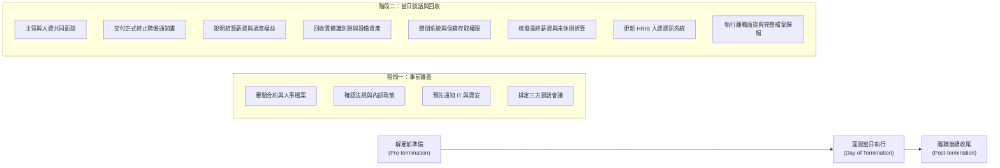

# 員工解雇與離職核對清單：人資專用離職流程指南
> **原文網址**：https://www.aihr.com/blog/employee-termination-checklist/  
> **原文作者**：Monique Verduyn  

---

## 📌 英文摘要 (Executive Summary in English)
Nearly 70% of employees report being dismissed without clear reasons, and 72% receive no prior warning, leading to severe team demoralization, cultural toxicity, legal exposure, and brand damage. Unlawful termination claims alone can cost organizations between $50,000 and $250,000 in legal expenses and settlements. Implementing a structured, customizable employee termination checklist across pre-termination, day-of-termination, and post-termination phases ensures legal compliance, consistent operational governance, smooth asset and IT access recovery, and compassionate offboarding. Ultimately, treating departing personnel with dignity, documenting every step factually, and communicating transparently with the remaining team safeguards organizational trust and the long-term employer brand.

---

## 🔑 核心關鍵字與術語對照 (Key Terms & Glossary)

| 英文術語 (English Term) | 台灣人資繁中對照 (Traditional Chinese) | 實務簡要定義／應用情境 (Context & Definition) |
| :--- | :--- | :--- |
| **Employee Termination** | 終止聘僱／解雇與離職 | 勞工與雇主之間正式結束僱傭關係之法定與行政程序，涵蓋自願與非自願形式。 |
| **Voluntary Termination** | 自願離職 | 員工主動提出辭職或屆齡退休，合約依員工意願終止。 |
| **Involuntary Termination** | 非自願離職／解雇與資遣 | 雇主基於業務緊縮、組織重組、預算削減或員工不能勝任工作、重大違紀等原因主動終止合約。 |
| **Employee Offboarding** | 員工離職流程／登出體驗 | 員工離職時所需執行的系統登出、資產盤點、業務交接與離職訪談等一系列完整行政與體驗流程。 |
| **Wrongful Termination** | 違法解雇／不當解僱 | 雇主未依法定程序、違反勞動法規或涉及就業歧視而逕行終止勞動契約，常伴隨高額訴訟賠償。 |
| **Severance Pay** | 資遣費／離職補償金 | 雇主依法或依聘僱合約，在非自願終止契約時支付給員工之經濟補償。 |
| **Notice Period** | 預告期 | 終止勞動契約前，依法令或契約約定必須提前告知對方的法定預告天數或替代之預告工資。 |
| **Real-time System Access Revocation** | 即時系統權限撤銷／即時斷網 | 在解雇談話進行或結束的當下，即時關閉電子郵件與核心系統權限，防止資安風險與商業機密外洩。 |
| **Outplacement Support** | 轉職轉介協助／轉職輔導 | 企業為被資遣或組織精簡之員工所提供的履歷健檢、求職面試輔導與職涯諮詢支援。 |
| **Exit Interview** | 離職面談 | 員工離任前人資進行之結構化深度訪談，蒐集員工體驗回饋以優化留才與組織流程。 |

---

## 📖 專業深度編譯 (In-Depth Translation & Insights)

### 1. 什麼是員工終止聘僱？ (What is employee termination?)
- **核心主張**：終止聘僱 (Employee Termination) 代表勞雇雙方正式結束勞動契約與工作關係。整體可分為兩大途徑：由員工主動發起的「自願離職 (Voluntary Termination)」（如辭職、退休），以及由企業端主導的「非自願離職 (Involuntary Termination)」（如績效不彰、重大違規、業務緊縮或組織重組）。
- **實務指標與法律成本數據**：
  - 根據調查，近 **70%** 的受訪員工表示自己在「未獲得明確原因」的情況下被解雇；高達 **72%** 的人在被解雇前「完全未收到任何預警」。
  - 倉促且粗糙的處置將直接重創團隊士氣、侵蝕組織文化，並帶來嚴重的法律訴訟與雇主品牌聲譽損害。
  - 在歐美與跨國實務中，單一違法解雇 (Unlawful Termination) 案件的訴訟抗辯費用與和解補償金，通常落在 **$50,000 美元至 $250,000 美元**（約合新台幣 160 萬至 800 萬元）之間。
- **人資策略關鍵**：人資團隊的角色不僅在於處理表單，更在於確保整體解雇流程具備程序正義、合法合規、兼顧同理心，並在關鍵談話中為第一線主管提供穩健的談話引導與留存完整佐證紀錄。

---

### 2. 為何終止聘僱有時是必然手段？ (Why is termination sometimes necessary?)
- **核心主張**：終止聘僱是組織維持運營紀律與經營效率的最後防線。常見原因包括：長期績效不適任、嚴重違紀行為（如職場霸凌、性騷擾、盜竊、洩密）、組織重組 (Restructuring)、業務裁減 (Redundancy)、預算削減 (Budget Cuts) 或定期合約到期。
- **關鍵決策情境**：
  - **績效不適任**：員工在獲得明確的回饋、具體改善目標及足夠的資源支援（如 PIP 績效改善計畫）後，仍持續無法達標，解雇即成為避免團隊整體績效與士氣被拖垮的必要決策。
  - **重大過失與違紀**：涉及騷擾、挪用公款或違反誠信原則，可構成即時解雇條件，但事前必須經過嚴謹內部調查與充分書面紀錄，以抵禦後續爭端。
  - **組織裁撤與預算緊縮**：當面臨營收壓力或業務轉型時，非直接產生營收之幕僚後勤職位（如 HR、IT、行政管理）或高薪階層往往成為最先受到波及的對象。
- **影響終止聘僱決策的五大關鍵維度 (Factors that Impact Employee Termination)**：
  1. **法規條例 (Legal Rules)**：包含法定預告期、資遣費計算、法定解雇事由及最終薪資結算時限。
  2. **聘僱契約類型 (Type of Contract)**：全職員工、約聘人員、部分工時人員與外包顧問之權利義務與解約條件皆有顯著差異。
  3. **工會與團體協約 (Union or Collective Agreements)**：受工會或團體協約保障之同仁，可能享有超越勞動法規的額外協商與保護程序。
  4. **公司政策與內部慣例 (Company Policies and Practices)**：內部處理標準須高度一致，避免同案不同判，維護程序正義與內部信任。
  5. **就業歧視風險 (Discrimination Risks)**：解雇事由必須基於客觀客觀紀錄與事實，嚴格排除年齡、性別、種族、宗教、身心障礙等受保護特徵，防杜歧視訴訟。

---

### 3. 遠距員工解雇的關鍵作業準則 (Key Steps for Terminating Remote Employees)
AIHR 首席領域專家 Dr. Marna van der Merwe 針對日益普及的遠端工作模式，歸納出六大標準作業程序：
1. **法規轄區盤點**：依據該遠距員工所在的當地勞動法規核對程序，並留存完整合約與通知存檔。
2. **跨時區後勤排程**：精準協調時區、預先規劃 IT 系統權限撤銷時間點，並安排公司硬體設備的寄送回收方案。
3. **視訊溝通兼顧同理心**：必須透過一對一視訊會議進行談話，清楚說明決策，並給予對方消化情緒與提問的充分空間。
4. **即時系統防護**：談話當下即刻同步關閉權限，落實機密數據保護。
5. **過渡期資源支援**：提供轉職轉介輔導 (Outplacement) 或員工協助方案 (EAP / 心理諮詢資源)。
6. **對內團隊妥善溝通**：以尊重且客觀的態度向留任團隊說明變更，迅速啟動業務交接，維繫團隊穩定性與信任感。

---

### 4. 員工解雇核對清單：三階段實務作業要項 (What to Include in a Checklist)

#### 階段一：解雇前準備 (Pre-termination)
- **核心主張**：在召開面談前，必須將法律合規、內部授權與後勤防護準備齊全。
- **步驟／行動建議**：
  - ✔ **審查勞動契約與人事檔案**：精準核對預告期、資遣費條款、競業禁止與保密協議規範。
  - ✔ **確認法規與公司政策一致性**：檢驗績效考核歷程是否具備足夠警告函、輔導紀錄與事實證據。
  - ✔ **通知 IT 與安全部門**：提前協調技術團隊，確認帳號凍結時刻表與資產清單。
  - ✔ **確認並預約面談會議**：由 HR、直屬主管與員工三方確認時間，預約不受打擾的私密會議室。

#### 階段二：解雇面談當日 (Day of termination)
- **核心主張**：面談應秉持簡潔、客觀與尊重原則，避免情緒化對抗，並完成權利義務交接。
- **步驟／行動建議**：
  - ✔ **舉行終止面談**：主管與人資務必共同出席，主管傳達組織決定，人資協助程序引導並保持客觀尊重。
  - ✔ **交付書面終止通知書 (Termination Letter)**：載明終止原因、最後工作日 (Last Working Day)、特休結算及各項應得權益。
  - ✔ **詳細說明後續配套**：明確告知最終薪資給付日期、健保退保時程、商業保險銜接與設備歸還期限。
  - ✔ **現場回收公司實體財產**：收回門禁卡、筆電、公務手機、鑰匙或制服，並簽署點交單。

#### 階段三：解雇後續收尾 (Post-termination)
- **核心主張**：關閉外部暴露風險，結清財務法定義務，並善用回饋作為組織改善之用。
- **步驟／行動建議**：
  - ✔ **即時撤銷系統權限**：停用企業信箱、內部 VPN、ERP/CRM 軟體權限，保障智慧財產權與資訊安全。
  - ✔ **結算並發放最終款項**：依法結算當期工資、未休年假折現、各項代扣款與資遣費。
  - ✔ **更新 HRIS 與薪資管理系統**：在人資系統中將狀態變更為離職，同步完成各項法定社會保險退保。
  - ✔ **適度進行離職面談 (Exit Interview)**：若情境允許，蒐集其對組織流程與工作體驗的真實回饋，作為招募與留任機制的改進依據。
  - ✔ **完整文件安全歸檔**：將警告信、考績紀錄、面談紀錄與離職簽收單留存於公司內部受控資料庫，以備日後勞檢或訴訟舉證。

---

### 5. 實務上最常被忽視卻至關重要的三大關鍵 (Three Commonly Overlooked Steps)
由 Dr. Marna van der Merwe 特別提醒人資夥伴注意：
1. **即時同步系統權限撤銷 (Coordinating Real-Time System Access Revocation)**：許多企業忽略了「談話中」與「斷網」的時間同步性，特別是遠端同仁，若未在談話當下立即中斷權限，極易引發機密外洩或惡意破壞風險。
2. **體貼且專業地與留任團隊溝通 (Communicating Thoughtfully with the Remaining Team)**：若缺乏及時且正式的溝通，辦公室將迅速充斥流言蜚語、恐慌與不信任感。人資應協助主管發布客觀專業的團隊公告，聚焦於「業務延續性」、「職責代理與移轉」及「對留任同仁的具體支持」。
3. **鉅細靡遺地保存完整作業歷程紀錄 (Documenting the Process Meticulously)**：不完整的書面紀錄是引發勞資糾紛與敗訴的元兇。從前期的績效輔導歷程、書面警告、解雇面談當日的問答要點到後續交接確認信，皆須妥善保存為紙本或不可篡改的數位佐證軌跡 (Audit Trail)。

---

### 6. 為何必須使用離職查核清單範本？ (Why Use a Checklist Template?)
- **省時並確保組織一致性**：提供全公司各部門跨團隊標準化操作指引，消弭因主管個人風格造成的處置偏差。
- **大幅降低違法解雇訴訟風險**：透過清單的強迫查核機制，防範人為疏失或漏掉法定程序。
- **靈活彈性適配多種離職型態**：可依自願離職、資遣、約滿不續聘或懲戒性開除快速微調。
- **新人資夥伴的實戰培育工具**：讓新進 HR 人員快速掌握規範，建立合規自信與標準作業素養。

---

### 7. 員工解雇實務：人資必備的 7 大實務心法 (7 HR Tips and Best Practices)
1. **事前充分演練與準備 (Plan ahead)**：事先調閱完整檔案、預備好談話要點 (Talking Points)、預約封閉安靜且具備隱私性的會議空間。
2. **高敏感案件及早諮詢法務或資深人資 (Involve legal or senior HR)**：遇有潛在法律爭議、嚴重違紀或受保護族群（如懷孕、育嬰留停、職災同仁），務必先由法務或人資高層審閱評估。
3. **保持冷靜、客觀與尊重 (Stay calm and respectful)**：直接清楚但不帶個人情緒攻擊，避免使用煽動性字眼，並預留時間傾聽與回答對方的疑問。
4. **堅持陳述客觀事實，切忌夾雜主觀評論 (Focus on facts, not opinions)**：無論是績效低落或組織重組，皆以可驗證的客觀事實為依據，嚴禁給予含糊不清的評語或個人道德評價。
5. **切勿選在週五進行解雇談話 (Never do it on a Friday)**：建議在「週初（週三之前）」啟動程序。讓離職人員能在週間即刻聯繫勞動諮詢、人資部門、心理諮商或轉職仲介資源，避免其在求助無門的週末陷入負面情緒孤立。
6. **當下立刻完成所有文字紀錄 (Document everything immediately)**：在面談結束後第一時間完成會議紀要、歸檔簽署文件與最終計薪單，建立法定紀錄。
7. **面談後務必發送書面確認摘要 (Follow up in writing)**：面談結束後，應以電子郵件或正式書面信函向當事人統整當日結論，清楚列出最後薪資發放日、福利延續說明及設備回收時程，杜絕認知落差。

---

## 📜 全文中文翻譯 (Full Traditional Chinese Translation)

### 前言
近 70% 的員工表示，他們在未獲得清晰具體理由的情況下遭到公司解雇，且約有 72% 的人在離職前完全沒有收到任何事先警告。倉促且草率的解雇處置，不僅會對離職員工造成心理傷害，更會嚴重挫傷留任團隊的士氣、破壞企業文化，並為公司招致巨大的法律訴訟風險與長遠的雇主品牌聲譽損害。

企業必須建立明確、標準化的終止聘僱流程。一份結構完整的員工解雇核對清單，能夠針對最終薪資文件、公司資產回收、法令遵循檢核以及後續步驟的清晰溝通，提供按部就班的操作指引。本文將深入探討如何專業處理員工解雇，並提供一套可自訂的員工解雇核對清單工具，協助您的組織落實嚴謹、具同理心的離職管理。

---

### 什麼是員工終止聘僱？ (What is employee termination?)
員工終止聘僱 (Employee termination) 指的是勞工在企業服務任期的正式結束。實務上通常分為兩種類型：
- **自願離職 (Voluntary termination)**：員工基於個人生涯規劃主動提出辭職或屆齡退休。
- **非自願離職 (Involuntary termination)**：雇主因工作績效不佳、嚴重違規違紀、組織整併裁撤或業務重組等客觀原因，主動終止雙方的聘僱契約。

在此流程中，人資部門的核心職責是確保整個解雇過程兼具公正性與法律合規性、周密協調各項離職交接任務、在棘手艱難的面談對話中全力支援前線主管，並妥善追蹤管理所有相關法定佐證文件（例如書面警告信、績效輔導歷程與最終薪資明細表）。

這是一項極度敏感的管理程序，一旦處置失當，代價極為高昂——在諸多不當解僱或違法解雇訴訟中，雇主往往得面臨高達 50,000 美元至 250,000 美元（約合新台幣 160 萬至 800 萬元）的律師訴訟費與法定和解補償金。建立透明公開的終止聘僱政策並搭配一套可靠的核對清單，是保護企業遠離各類法律爭端的堅實防線。

---

### 為何終止聘僱有時是必然手段？ (Why is termination sometimes necessary?)
在企業日常運營中，最常見的終止聘僱原因包括：工作表現持續不適任、重大違法或違紀行為、業務裁撤或組織結構重組、預算削減，或是定期僱傭合約期滿。

舉例來說，當某位員工即使在接受了明確的回饋指導與足夠的輔導資源後，仍反覆無法達到工作職責所要求的標準時，解雇往往成為維護團隊整體產能與公司運作秩序的唯一可行解方。

此外，嚴重的職場不當行為——諸如性騷擾、言語霸凌、盜竊公物、侵佔資產或公然違反企業行為準則——通常會直接觸發即時懲戒性解雇。然而，即便在此類嚴重情境下，人資與管理層仍必須落實詳盡的內部調查程序並保留完整的事實佐證紀錄，以保障所有涉案關係人的合法權益並確保程序正義。

組織業務重組往往會導致特定職能或職位變成多餘的冗員編制，進而引發非自願性的離職處置。預算縮減也可能伴隨組織重組而來，或是受到外部整體經濟環境財務緊縮所迫。在面臨此類情況時，非直接產生營收的幕僚支援部門（例如人資、資訊科技或行政總務部門），抑或是薪資成本偏高的資深職位，通常是最先面臨精簡裁撤的對象。

#### 終止遠距員工聘僱時，應採取哪些關鍵步驟？
針對遠端工作與混合辦公的同仁，AIHR 首席領域專家 Dr. Marna van der Merwe 建議遵循以下六項標準指引：
- **檢視地域法規與落實文檔化**：詳查員工居住所在地適用的勞動法令規章，並將所有溝通與處置歷程做成完整紀錄。
- **縝密規劃後勤作業**：預先協調雙方時區差異、排定 IT 系統存取權限的撤銷時刻，並安排好公司硬體配備的物流寄送與點收方案。
- **透過視訊保持清晰且富同理心的溝通**：堅持使用一對一視訊面談，清楚傳達決定，並在過程中給予對方提問與抒發情緒的空間。
- **維護系統資訊安全**：在談話告一段落時立即果斷關閉帳號權限，防堵企業機敏資料外洩。
- **提供實質過渡資源**：主動提供轉職轉介諮詢 (Outplacement) 或心理健康關懷支援等過渡資源。
- **審慎體貼地向團隊布達**：以客觀專業的方式向留任團隊說明異動，維護團隊同仁的信任感，並確保各項業務平穩交接。

#### 影響解雇決策的關鍵維度 (Factors that impact employee termination)
在規劃與執行終止聘僱作業時，應審慎評估下列五大面向：
- **法律法規**：當地勞動法令明確規範了預告期間、最終薪資給付期限、資遣費基準及正當解雇事由。請務必掌握最新法規動態，以保障公司免於違法抗辯風險。
- **合約類型**：每位同仁的僱傭契約條款直接影響處置規範。全職員工、部分工時人員、約聘人員或外包專案顧問在法律上享有的權利與終止程序截然不同。
- **工會或團體協約**：若員工受工會或團體協約保障，雇主在勞基法與內部規章之外，可能必須額外遵循工會預告、協商等專屬保護程序。
- **公司內部政策與慣例**：組織內部的離職標準與處置手法必須具備高度的一致性，確保人人平等待遇。這有助於鞏固員工信任、展現相互尊重，並維護優質的雇主品牌形象。
- **就業歧視風險**：必須確保每一個解雇決策皆有具體客觀的事實與考核數據作為支撐，絕不能涉及年齡、性別、種族、性傾向、身心障礙等受保護特徵，徹底排除任何就業歧視的爭訟空間。

---

### 什麼是員工解雇核對清單？ (What is an employee termination checklist?)
員工解雇核對清單是一套實用而標準化的管理工具，旨在協助組織以清晰、有條理且專業的方式處理同仁離職流程。它是一份涵蓋完整步驟的操作指引，詳列了從法規遵循、人事文件、利害關係人溝通，到公司財產設備回收與權限終止的每一項必備工作。

一份高成效的離職查核清單，必須完整兼顧：法定證明文件留存、直屬主管／員工／人資之間清晰透明的溝通計畫、法令合規保障、資產點交回收，以及資訊系統權限的即時移除。

---

### 解雇核對清單應包含哪些要項？ (What to include in an employee termination checklist)
無論是自行擬定內部專用清單或套用現成範本，一份合格的解雇查核清單都應涵蓋以下三大關鍵階段：

#### 一、解雇前準備階段 (Pre-termination)
在正式召開解雇面談會議之前，人資與主管必須確認已逐一完成下列準備工作：
- ✔ **審視員工聘僱契約與人事基本檔案**：特別留意合約中有關預告期、資遣費、競業限制或離職補償之特定條款。
- ✔ **複核法規遵循與內部政策合規性**：再次確認決策完全符合當地勞工法規要求與公司內規，避免衍生任何潛在勞資爭端。
- ✔ **知會 IT 資訊與安控部門**：提前通報相關技術單位，使其能精準就緒，在必要時刻立即阻斷系統存取並安排設備回收。
- ✔ **正式排定解雇面談會議**：由人資、部門主管與員工協調合適的時間與地點，預先保留具備私密性的會談空間。

#### 二、解雇面談當日 (Day of termination)
在正式執行解雇的面談當天，應嚴格落實以下執行程序：
- ✔ **召開終止面談會議**：員工本人、直屬主管與人資代表必須共同出席。由主管清楚說明組織決定，人資則以理性、客觀且具尊嚴的方式協助溝通。
- ✔ **正式送交終止聘僱通知書**：以正式書面形式向員工發出解雇通知書，明確記載終止契約之法定事由、最後工作日以及各項法定結算權益。
- ✔ **詳盡說明後續銜接配套**：逐一告知關鍵細節，包括最終薪資結算金額與發放日期、剩餘福利與保險過渡期，以及各項公物交還流程。
- ✔ **確實點交回收公司資產**：當面收回員工識別證、筆記型電腦、公務手機、門禁感應卡、鑰匙或公司制服等所有企業資產。

#### 三、解雇後續收尾階段 (Post-termination)
在離職員工離開公司之後，人資與相關單位必須完成各項行政收尾任務：
- ✔ **全面關閉系統權限**：立即撤銷該員工的公司電子郵件、內部內網、公用硬碟以及所有相關企業軟體的存取權限，確保公司資產與資料安全。
- ✔ **結算並核發最終款項**：如期發放最後一期工資、結算給付未休完的特別休假折算工資，並精確核對各項法定義務扣繳與資遣補償金。
- ✔ **同步更新 HRIS 人資資訊系統**：在人資核心系統中將員工狀態註記為離職，並同步更新內部計薪與團保福利各項紀錄。
- ✔ **執行離職面談 (Exit Interview)**：在情境適宜的狀況下進行離職訪談，蒐集該同仁對公司文化與員工體驗的真實心聲，作為日後改善新人到職導入流程與留才策略的參考。
- ✔ **妥善歸檔所有書面佐證資料**：將整起解雇作業的所有歷程文檔（含輔導歷程、警告信函、通知書與點交簽單）安全存入公司受控內部資料庫，以供內部稽核與法律抗辯查閱。

#### 解雇流程中最常被忽視卻至關重要的三大步驟
AIHR 首席領域專家 Dr. Marna van der Merwe 特別點出以下三個最容易被企業人資忽略但不可或缺的環節：
- **即時同步系統權限撤銷**：許多企業嚴重低估了精準掌握系統關閉時間點的重要性，在遠距員工身上尤為常見。未能於面談當下立即中斷系統權限，會讓組織暴露在極高的商業機密外洩與資料被刪改的風險中。務必在事前與 IT 單位達成默契，在面談進行中或對話剛結束的瞬間立即凍結所有帳號。
- **體貼且專業地與留任團隊溝通**：若未在第一時間向留下來的同仁進行清楚、正式的說明，團隊內部極易滋生謠言、焦慮甚至對管理層的不信任。主管與人資應及時向團隊布達客觀且相互尊重的說明，將溝通焦點放在維持組織運作的延續性、職位過渡期代理安排，以及為在職夥伴提供實質的後續支援。
- **鉅細靡遺地落實作業紀錄文檔化**：不完整、缺漏的書面歷程是導致法律敗訴的最常見弱點，尤其在具爭議的解雇案件中更為致命。請務必保留詳盡的客觀紀錄軌跡，包括績效輔導歷程、書面警告改善單、決策評估的策略性依據，以及當天解雇面談的關鍵問答要點與後續行動紀錄，以備日後勞檢或司法訴訟之舉證查核。

---

### 為何應導入員工解雇核對清單範本？ (Why use an employee termination checklist template?)
採用結構化的解雇核對清單範本，能為企業帶來以下四大核心效益：
- **節省行政時間並確保標準一致性**：現成範本為每次離職事件提供了標準化程序，省去每次重構流程的時間，並確保全公司跨部門、跨主管在處理員工離職時維持高度一致的作業水準。
- **將違法解雇的法律爭訟風險降至最低**：範本能提示經辦人依法進行完整紀錄並恪守法規與內規，大幅避免因人為疏漏跳過關鍵法定程序，為公司築起法律防護網。
- **具備彈性以適應不同離職型態**：無論是員工自願辭職、雇主非自願資遣解雇，抑或是定期合約期滿，一份優質的清單都能靈活彈性微調，同時確保合規要求無一遺漏。
- **簡化新人資人員的在職教育訓練**：清單是培訓新進人資專員的最佳實戰教材，讓新人資同仁能依循標準指引逐步操作，在每一步驟中建立專業執行自信。

---

### 員工解雇實務：人資必備的 7 大實務心法 (Employee termination: 7 HR tips and best practices)
在執行艱難的解雇工作時，建議人資同仁謹記以下七項黃金原則：
1. **未雨綢繆，做好萬全準備 (Plan ahead)**：在面談前全面調閱員工檔案、備妥所有通知書件與資遣明細，並預先演練談話要點 (Talking Points)。確保提前預約一間封閉且不受打擾的隱私會議空間，並對自己將要說出的每一句話瞭然於胸。
2. **遇敏感高風險案件，及早讓法務或資深人資介入 (Involve legal or senior HR in sensitive cases)**：若解雇涉及潛在勞資爭議、嚴重過失違紀，或該名員工屬於依法受特別保護的對象（如懷孕、育嬰留停或工傷醫療期），務必在第一時間尋求公司法務或資深人資主管的專業指導，以最合規、最謹慎的方式推進。
3. **始終保持冷靜、客觀與尊重 (Stay calm and respectful)**：面談時設定的基調至關重要。談話要直截了當，但切勿訴諸人身攻擊，堅決避免使用情緒化或挑釁性的字眼。同時，務必預留充足的時間讓對方提問，並以同理心給予清楚尊重的答覆。
4. **堅持陳述客觀事實，切勿夾雜個人主觀意見 (Focus on facts, not opinions)**：無論終止合約是源於績效長期未達標、嚴重違反工作規則或單純組織人力精簡，一切發言請務必嚴格圍繞客觀事實。切忌發表任何個人主觀價值判斷，避免給出模糊空泛的指責。
5. **切勿選在週五進行解雇談話 (Never do it on a Friday)**：解雇作業應安排在「週初（週三之前）」展開。這能讓當事人有足夠的週間上班日，立即聯繫人資洽詢福利、尋求心理諮商協助或洽辦就業輔導與求職機構，而不是在求助無門的孤立週末中陷入焦慮與絕望。
6. **當下第一時間完成完整紀錄 (Document everything immediately)**：面談過程中與結束後的各項決策與對話要點，請立即做成詳盡會議筆記。將終止通知書、最終計薪單簽收回執與各項交接表單一併列為正式法定檔案妥善歸檔。
7. **面談後務必以正式書面進行確認 (Follow up in writing)**：面談結束後，請以電子郵件或書面文件向所有與會者發送正式會議結論摘要。清楚列出最後薪資發放日、福利終止期程與設備歸還確認，以書面紀錄杜絕未來的認知爭議與混淆。

---

### 結語
作為人資團隊的一員，您的工作核心是以清晰的標準、同理心與相互尊重的態度，引導並完成每一次沉重且敏感的離職對話。一份完善的員工解雇核對清單能確保流程井然有序、步步合規；但切記，人性的關懷——您在整個過程中如何對待離職的夥伴——其重要性絲毫不亞於行政規章。

一套健全的書面離職管理政策至關重要。它能為各級主管與所有員工建立一致的認知基準，清楚明白公司在何種條件下採取何種處置及其背後緣由。這不僅能大幅消除迷惘焦慮、捍衛企業免受法律風險，更能深化組織內部的信任基石。而一套嚴謹實用的解雇核對清單，正是確保此一政策在實務中徹底落實的關鍵柱石。
