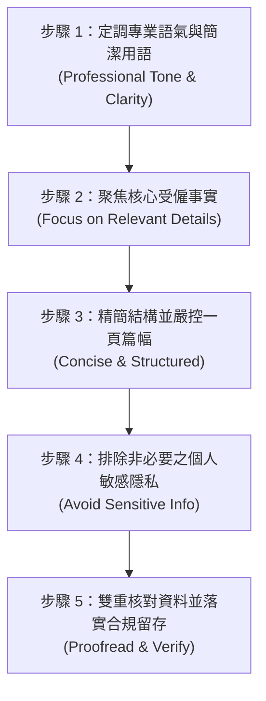

# 在職證明與離職證明範本及 7 種情境實務指南
> **原文網址**：https://www.aihr.com/blog/employment-verification-letter-template/  
> **原文作者**：Monique Verduyn  

---

## 📌 英文摘要 (Executive Summary in English)

An employment verification letter (also known as a proof of employment or VOE letter) is an official document issued by an employer to confirm an individual's job title, employment dates, and employment status. Human Resources commonly receives these requests from lenders, landlords, immigration authorities, government agencies, or prospective employers to support critical life events such as mortgage applications, property leases, or visa filings. Because the contents can directly determine whether an employee's application proceeds, HR must ensure absolute factual accuracy, prompt issuance, and strict confidentiality by only disclosing necessary information with the employee's explicit consent. Employing standardized templates and robust governance protocols safeguards employee privacy while protecting the organization's employer brand and legal compliance.

---

## 🔑 核心關鍵字與術語對照 (Key Terms & Glossary)

| 英文術語 (English Term) | 台灣人資繁中對照 (Traditional Chinese) | 實務簡要定義／應用情境 (Context & Definition) |
| :--- | :--- | :--- |
| **Employment Verification Letter** | 在職證明書／受僱證明書 | 由雇主正式出具之官方文件，用以客觀證明員工之職稱、在職起訖日、在職狀態等受僱事實。 |
| **Verification of Employment (VOE)** | 受僱資格查核／在職查核 | 金融機構、公家機關或租屋管理方為確認申請人信用與收入穩定性所發動的在職事實確認流程。 |
| **Proof of Employment Letter** | 工作經歷證明／在職身分證明 | 泛指所有向第三方出示、證明個人受聘於特定法人機構之證明文件。 |
| **Form I-9** | I-9 表格（美國就業身分查核表） | 美國雇主依聯邦法規審查並記錄新進員工合法工作資格之法定表單，不同於一般在職證明。 |
| **Reference Letter** | 推薦信／資歷評估信 | 著重於評估與陳述員工個人工作表現、專業能力與工作態度的信函，具主觀評價性質。 |
| **Employee Tenure** | 員工在職年資 | 員工於組織內自到職日起算之服務期間與年資長度。 |
| **Good Standing** | 離職紀錄良好／合規無違紀 | 表彰員工在任職期間遵守規章、離職程序合規且無重大違紀之專業狀態。 |
| **Misconduct Termination** | 懲戒解僱／因重大違紀解僱 | 員工因違反勞動契約或工作規則情節重大而遭雇主終止勞動契約之情形。 |
| **Third-Party Verification** | 第三方受僱查核照會 | 銀行、徵信機構、移民局或新雇主委託外部調查機構向現任或前任雇主核實員工資歷之照會。 |
| **Defamation** | 毀謗／妨害名譽法規風險 | 人資於回覆外部照會時，若揭露未經證實之負面評語或違法洩露隱私所衍生之民刑事法律責任。 |

---

## 📖 專業深度編譯 (In-Depth Translation & Insights)

### 1. 什麼是在職證明書？ (What is an employment verification letter?)
在職證明書（Employment Verification Letter，亦常稱為受僱證明書 Proof of Employment Letter 或在職查核信 VOE Letter）是一份由雇主出具的正式官方文件，用以確認現職員工或離職員工的客觀工作事實。

- **核心主張**：
  - 在職證明屬於純粹的**事實陳述文件**，旨在客觀證明受僱關係，而非評估工作績效。
  - 文件通常由人資部門以公司專用信頭信紙（Company Letterhead）開立，並以員工主動申請為原則。
  - **重要區隔**：
    - 與美國就業身分查核表（Form I-9）不同：Form I-9 是美國雇主依法用以確認新進人員身分與合法工作權的強制性法定文件。
    - 與推薦信（Reference Letter）不同：推薦信包含對員工表現、潛力與特質的主觀評價；而在職證明書僅陳述客觀真實的受僱歷史。
- **標準揭露項目**：
  1. 職稱 (Job title)
  2. 到職日與離職日 (Employment start and end dates，呈現其在職年資 Tenure)
  3. 受僱型態 (Employment status，如全職 Full-time、兼職 Part-time、定期契約 Contract 等)
  4. 薪酬資訊 (Salary，僅在員工書面授權同意時方可列入)

---

### 2. 在職證明書的核心用途與照會情境 (What’s the purpose of an employment verification letter?)
第三方機構出於風險控管或法規要求，需要獲得具有公信力的受僱確認。由於不同機構關注的重點差異甚大，人資必須先釐清「用途目的」，以提供恰到好處的資訊：

- **常見的五大申請情境**：
  1. **移民與簽證申請 (Immigration and visa applications)**：
     - *情境*：申請綠卡（親屬移民或職業移民）或辦理商務／旅遊簽證。
     - *實務重點*：移民當局要求證明申請人具備經濟自立能力，或證明申請人與本國具備穩固的受僱連結（以降低逾期滯留風險）。
     - *內容要求*：通常較一般證明更為嚴謹，常需額外附加**簡要職責描述 (Short description of job duties)** 及目前職位是否持續存續之說明。
  2. **新職求職與資歷查核 (New job opportunities)**：
     - *情境*：員工轉職時，新雇主對求職者進行受僱背景調查 (Background Check)。
     - *實務重點*：核實其工作年資、專業職稱與經歷真實性。
     - *隱私控制*：**此情境極少需要揭露薪資細節**；非經員工特別書面要求，嚴禁主動載明薪資。
  3. **金融貸款與房屋貸款審核 (Loan or mortgage application)**：
     - *情境*：向銀行或金融機構申貸各類信用貸款或不動產抵押貸款。
     - *實務重點*：確保貸款人具備穩定現金流與持續還款能力。
     - *內容要求*：多數金融機構皆會明確要求載明薪資金額（年薪或月薪）、發薪頻率（Pay frequency）及受僱穩定度。
  4. **房屋租賃申請 (Property rental applications)**：
     - *情境*：房東或物業管理公司在簽訂租約前進行承租人信用徵信。
     - *實務重點*：確認租客具備按月支付租金之經常性所得。通常需要職稱、到職日、聘僱型態及薪資。
  5. **政府福利與公部門補助 (Government benefits and assistance)**：
     - *情境*：員工申請托育補助、育嬰津貼、公共住宅或特定救濟津貼。
     - *實務重點*：主管機關確認所得與工時是否符合特定門檻。許多官方機構有其專屬制式表格（Verification Form），人資應先審視該機構規範，依表填列。

#### 專家深度觀點：雇主能否拒絕出具在職證明？ (Can an employer refuse to issue an employment verification letter?)
AIHR 資深人力資源解決方案顧問 Suhail Ramkilawan 指出：
- **法規層面**：視各地勞動法規而定。在多數司法管轄區（如台灣勞動基準法第 19 條），勞動契約終止時，勞工請求發給服務證明書，雇主不得拒絕。
- **雇主品牌與風險層面**：無故刁難或拒發在職證明將對企業造成重大負面影響，包括損害企業聲譽、破壞雇主品牌（Employer Brand），甚至引發勞工指控不公平待遇或歧視之法律紛爭。

---

### 3. 在職證明書應包含的核心要素 (What to include in an employment verification letter)
為兼顧核發效率、標準化與法律遵循，標準範本應涵蓋以下六大要素：

1. **員工基本資訊 (Employee details)**：全名、任職職稱、所屬部門。確保身分識別無誤。
2. **雇主法定資訊 (Employer details)**：公司法定全稱、營業地址、人資部門官方聯繫方式（電話與官方 Email），以利第三方後續照會查核。
3. **收件者資訊 (Recipient details)**：若有明確要求單位（如特定銀行分行、簽證處），直接抬頭指定受文者；若用於多重管道，則使用通用稱謂「To Whom It May Concern（敬啟者）」。
4. **受僱條件明細 (Employment details)**：到職日（離職員工加註最後在職日）、聘僱型態（全職／兼職／定期約聘），以及**經員工書面同意列入之薪資細節**。
5. **開立目的說明 (Purpose of the letter)**：明確載明此信函專為「辦理簽證」、「房屋貸款審核」或「租賃申請」開立，避免文件被挪作他用，降低組織法律風險。
6. **簽署人職銜與公司用印 (Signature and company stamp)**：由具備授權的人資主管親筆或電子簽署，加註簽署人姓名、職銜、開立日期，並加蓋公司官方印鑑或關防。

---

### 4. 標準排版格式與製作規範 (Employment verification letter format)
在職證明書應遵循標準商業書信格式，篇幅嚴格控制於**一頁以內**：

```
[公司信頭 Logo 與企業名稱、法定地址、聯繫電話與 Email]
────────────────────────────────────────────────────────────
發函日期 (Date: YYYY-MM-DD)

受文者資訊 (Recipient Name / Address) 或 "To Whom It May Concern,"

主旨：關於 [員工姓名] 之受僱事實查核證明 (Re: Employment verification for [Employee Name])

第一段（首句開門見山）：
確認該名員工任職於本公司之事實、職稱、所屬部門及受僱起訖日。

第二段（受僱條件與權限限定）：
詳述聘僱型態（全職/兼職），必要時說明核定之薪資；載明本證明僅陳述事實，不涉績效評估。

第三段（開立目的與照會窗口）：
說明開立之特定用途，並提供人資窗口聯絡方式以供進一步查證。

敬禮與簽署欄 (Closing & Signature)：
簽名、印刷體姓名、簽署人職稱、公司名稱、官方用印。
```

- **格式實務細節規範**：
  - **字型與排版**：採用標準商務字型（如 Arial 或 Calibri），字級大小 10 至 12 pt，採單行間距。
  - **檔案交付格式**：嚴禁發送可編輯之 Word 檔案，**必須轉為具數位簽章之防偽 PDF**，避免內容遭竄改。
  - **簽署形式查核**：事前向員工確認受文單位是否接受電子簽章（Electronic Signature）；部分外國移民機關或公證單位嚴格要求必須由授權人資主管以藍黑鋼筆親筆簽署（Wet Signature）並加蓋實體印鑑。

---

### 5. 撰寫在職證明書的五大關鍵步驟 (How to write an employment verification letter in 5 steps)



- **步驟 1：使用專業嚴謹語氣，文字精確無歧義**  
  維持商務公文的正式體例，避免口語化或非正式用語，以維護組織專業形象與公信力。
- **步驟 2：聚焦關鍵工作事實，薪資揭露落實雙重確認**  
  僅列出到職日、職稱、聘僱型態等必要欄位；若需列入薪資，必須確認有受文單位的正式照會要求與員工本人的書面簽名授權。
- **步驟 3：精簡結構，篇幅不得超過一頁**  
  段落層次分明，切入主題，避免過多繁複說明與冗贅修辭。
- **步驟 4：嚴格過濾敏感個資與主觀評語**  
  **絕不可**包含員工個人醫療病史、請假紀錄、個人私生活、員工離職之真實內部理由，亦不得加入個人對其工作表現之主觀褒貶。除官方指定表單明文要求外，身分證字號或社會安全碼（SSN）應盡可能隱蔽或遮蔽。
- **步驟 5：發函前嚴謹校對並存檔**  
  仔細查證員工姓名拼音、職稱歷程、受僱起迄日精確到日，由資深人資主管審核簽署後，**將副本歸檔於人資資訊系統 (HRIS) 或個人人事檔案 (Personnel File)**。

---

### 6. 七種常見實務情境範本架構解析 (7 Sample Employment Verification Letters)

1. **基礎通用型在職證明 (Basic Employment Verification Letter)**：  
   適用於各類未指定特定用途的一般性查核。內文聲明「本函僅確認受僱事實，不包含薪酬與績效資訊」。
2. **在職員工提出辭呈後之新職資歷查核 (Outgoing Employee Applying for a New Job)**：  
   適用於員工已提離職、處於交接預告期之情形。載明到職日與預計離職日（Last Working Day），可依組織政策客觀加註「在職期間克盡職守」，但避免過度主觀保證。
3. **離職員工之經歷查核 (Former Employee Applying for a New Job)**：  
   針對已離職員工出具之服務證明。載明服務起迄年月與職稱，並註明「該員離職手續合規完備 (Left the company in good standing)」，明示本信函非為工作能力背書之推薦信。
4. **現職員工申請信用貸款／房屋貸款 (Loan or Mortgage Application)**：  
   載明到職日、職稱、受僱型態，並在員工授權下列明其經常性年薪與給薪週期（每週／雙週／每月），並載明指定申貸銀行機構。
5. **在職員工申請簽證或移民居留 (Visa Application / Immigration Request)**：  
   在職狀態加註「目前持續在職且工作穩定」，並簡述 2 至 3 項核心業務職責（Key Responsibilities），符合移民官員對於工作真偽與收入穩定性之審查要求。
6. **在職員工租屋審查證明 (Property Rental Application)**：  
   提供租賃管理業者所需之職稱、在職穩定度、稅前總年薪（Gross Annual Salary）與發薪週期。
7. **政府公費補助與社會福利申請 (Government Benefits Application)**：  
   配合福利機關資格審查，詳細載明平均每週工作時數（Average Hours Per Week）、時薪或薪資總額，以及近幾個月的薪資毛額累計。

#### 專家實務指南：遭懲戒解僱 (Misconduct Termination) 之員工申請證明時，人資應對三守則
當因違反紀律而遭解僱的員工要求開立離職／在職證明時，Suhail Ramkilawan 提出三項行動準則：
1. **檢視組織政策與法定強制義務 (Check policy & legal obligations)**：確認企業內部人事規章，並確認當地勞動法令是否強制要求雇主必須出具服務證明書（例如台灣勞基法第 19 條規定雇主不得拒絕發給服務證明書）。
2. **免除誹謗與民事侵權風險 (Avoid defamation)**：在無司法裁判或法律強制規定下，**不要在證明書中主動載明重大過失或懲處原因**。僅客觀記載任職期間與職稱，以避免引發妨害名譽（Defamation）或就業歧視訴訟。
3. **維持制度處理的一致性 (Handle requests consistently)**：若法令允許企業在特定條件下拒發，必須依既定規章公平處理；如無強制規範且內部政策有明確排除條款，組織可在徵詢法務後審慎評估是否婉拒。

---

### 7. 人資處理受僱查核照會之最佳實務 (Best Practices for Handling Requests)

- **密切掌握勞動法規與隱私權規範 (Stay updated on labor laws & privacy regulations)**：  
  各國與各州法規日趨嚴格（如美國多州立法禁止詢問或揭露求職者過去薪資歷史，台灣個人資料保護法對個人特徵、財務與工作資料嚴密保護）。涉及敏感個案時，務必先行會商法務或法遵部門。
- **嚴格驗證第三方照會者身分 (Be mindful of third-party requests)**：  
  接獲陌生來電或外部信件要求查證員工身分時，嚴禁直接於電話中回覆。必須確認其為合法受託機構，要求其提供具備員工本人親筆簽名之「個資查核同意書」，並要求所有在職證明皆需由員工透過內部人資服務流程提出申請。
- **建立完善之文件留存追蹤機制 (Keep a secure record of the letter)**：  
  開立之所有在職證明書，必須保留核定簽署本之電子副本，存入人資管理系統 (HRIS) 之員工檔案，確保日後稽核、爭議追溯或法律訴訟時有據可查。
- **恪守員工隱私與資料保密防線 (Protect employee confidentiality)**：  
  杜絕任何非正式的口頭洩密。落實「未見授權同意書、絕不提供薪資與個資」的鐵律。

---

## 📜 全文中文翻譯 (Full Traditional Chinese Translation)

### 在職證明書（受僱證明信）範本與 7 種情境範例

在職證明書（Employment verification letter）是一份正式文件，由雇主出具以確認個人的職稱、在職日期與受僱狀態。這份文件也被稱為「工作證明信」（Proof of employment letter）或「受僱查核信」（Verification of employment / VOE letter）。

通常，當貸款機構、房東、移民當局或未來的潛在雇主提出要求時，人資部門便會開立此類信函以資證明。部分申請需求亦會要求提供薪資細節。由於這封信函可能直接決定員工的貸款審核、租賃簽約或簽證核發能否順利通過，因此內容必須維持百分之百的準確性並準時送達。同時，該信函必須在獲得員工正式同意的前提下，僅分享審查單位所需之必要資訊。

本指南將詳盡說明在職證明書應包含哪些要素、標準排版與撰寫方式，以及如何專業地處理各類查核申請。文中亦提供七個實用範例信函供人資專業人員參考。

### 核心重點摘要 (Key Takeaways)
- 在職證明書用於確認關鍵受僱細節，例如職稱、任職起訖日、聘僱狀態，以及經正式授權之薪資資訊。
- 信函內容應根據特定用途量身打造。貸款機構、房東、移民當局、政府機關與潛在雇主所要求的資訊各有不同。
- 人資應藉由查證請求方的合法真實性、取得員工妥善授權，且僅揭露必要資訊，以全力保護員工的隱私權。
- 採用標準化範本並在發函前落實複核所有細節；務必將副本歸檔留存於該名員工的人事檔案中。

---

### 什麼是在職證明書？ (What is an employment verification letter?)

在職證明書是一份官方文件，用以確認現職員工或離職員工的客觀工作事實。它通常包含下列項目：
- 職稱 (Job title)
- 到職日與離職日，用以呈現員工的在職年資 (Employment tenure)
- 受僱狀態，例如全職、兼職或約聘 (Full-time, part-time, or contract)
- 經員工正式授權後所列入的薪資資訊 (Salary)

人資通常會在員工主動提出申請後，使用公司正式信頭信紙（Company letterhead）開立此信函。常見的外部請求單位包括金融放款機構、房東或物業管理公司、移民局、政府福利機關，以及進行背景調查的未來雇主。在不同場合中，它也可能被稱為受僱確認函（Letter of employment / Employment confirmation letter）或員工查核函（Employee verification letter）。

在職證明書與美國新進員工就業資格審查表（Form I-9）不同，後者是美國雇主專門用來核實新進員工法定身分與工作許可之法定表單。它亦不同於推薦信（Reference letter），推薦信通常涉及主管對員工個人工作績效的主觀評價。在職證明書僅陳述純粹客觀的受僱事實。

---

### 在職證明書的目的與用途為何？ (What’s the purpose of an employment verification letter?)

在職證明書為第三方機構提供了特定人員受僱事實的官方確認。由於各種類型的要求者通常需要略有差異的細節，因此掌握背後用途有助於人資在信函中提供恰如其分的資訊。

以下是人資部門最常接獲的申請情境：

#### 1. 移民與簽證申請 (Immigration and visa applications)
在申請親屬移民或職業移民綠卡時，申請人必須提出財務能力證明，證實自己具備經濟自立能力，或證明保證人具備充分資力以提供扶養。在職證明書可確認當事人的工作穩定性與收入水準，從而強化申請案件之可信度。

許多國家在審核工作簽證、觀光簽證或商務簽證時，亦要求出示受僱證明。在職證明書有助於向簽證官證明申請人在其母國擁有穩固的職業牽絆，大幅減輕非移民旅客逾期滯留的疑慮。相較於其他情境，移民審查信函通常需要更詳盡的說明，例如加註簡短的工作職責描述。

#### 2. 新工作轉職與新職錄取機會 (New job opportunities)
潛在的新雇主常會向應徵者之前任雇主發出受僱事實查核照會，藉此確認其過往工作職銜、所屬權責與任職年資。這能作為應徵者工作經歷的第三方佐證，對於需要特定專業深度與工作經驗的關鍵職位尤其重要。在此情境下，極少需要提供薪資資訊，因此除非該員工主動授權，否則人資不應揭露薪資。

#### 3. 信用貸款或房屋抵押貸款申請 (Loan or mortgage application)
銀行與各類金融放款機構在審核個人信用貸款或房貸案件時，往往需要正式的受僱證明。該信函能為放款機構提供保證，證實申請人具備穩定的收入來源，因而具備履行按期還款義務之財務能力。貸款機構通常會要求載明薪資數額、發薪頻率與聘僱型態。

#### 4. 不動產租賃承租審查 (Property rental applications)
房東或物業管理公司在正式簽署租約之前，常會要求租客提供在職證明，藉以核實申請人的就業穩定度與所得狀況。其核心目的在於確保租客具備按月如期支付租金的經濟實力。房東通常希望了解承租人的職稱、到職日、聘僱型態與薪資水準。

#### 5. 政府公共福利與社會補助 (Government benefits and assistance)
承辦公共福利與社會救助津貼的政府主管機關，常要求申請人提供受僱與所得證明以判定其審查資格。部分機關備有專屬的制式查驗表單，因此人資在著手撰寫公文前，務必先行確認該主管機關之填表說明與格式規範。

---

### 在職證明書應包含哪些要素 (What to include in an employment verification letter)

使用標準化範本撰寫在職證明書，能在確保格式一致性與精準度的同時，大幅加速行政作業流程。一份健全完善的在職證明書應當涵蓋以下核心元素：

#### 員工基本資訊 (Employee details)
此區塊涵蓋受查核員工的基本身分資訊，通常包括：
- 員工法定全名 (Employee’s full name)
- 專業職稱 (Job title)
- 所屬部門 (Department，若適用)
列入這些細節有助於請求方精確核對當事人身分與相符之工作資訊。

#### 雇主機構資訊 (Employer details)
信函中必須清楚記載被查核企業的官方資訊，包含：
- 公司正式全稱 (Company name)
- 公司登記通訊地址 (Company address)
- 官方專責聯絡資訊（人資部門之電話號碼及／或電子郵件地址）
提供完整透明的雇主資訊有助於確立信函之真實公信力，並便於審查機構在必要時進行後續照會查證。

#### 受文者資訊 (Recipient details)
若已知悉特定受文機構或審核專員，應將信函抬頭直接指定給該特定人士或組織（例如某特定銀行審查部或駐外使領館）。若此信函預計用於多個潛在機構，則可使用通用尊稱「敬啟者」（To Whom It May Concern）。

#### 受僱條件明細 (Employment details)
此區塊完整勾勒出該名員工在組織中的受聘條件，包括：
- 到職日（若為離職員工，則須載明離職生效日）
- 聘僱型態（全職、兼職、定期約聘契約等）
- 薪資資訊（**嚴格限制**：唯有在請求方有明確要求、且員工已出具書面同意書之情況下，方可列入）
這些細節為外部機構提供了該名員工在組織中的角色定位與聘僱架構之全貌。

#### 開立目的聲明 (Purpose of the letter)
明確陳述開立本證明書之專屬用途。常見用途包含：
- 移民與簽證身分核定（綠卡、工作簽證、觀光簽）
- 信用貸款或房屋貸款審查
- 應徵新雇主之受僱資歷查核
- 住宅租賃合約審核
- 政府社會救助與公共福利資格審查
詳加敘明用途有助於確保該文件符合請求機構的特定規範，並有效避免文件遭濫用或反覆修改退件。

#### 簽署與公司印鑑 (Signature and company stamp)
為賦予該文件法律證明力與正式公信力，信函必須由出具公司之人資代表或經正式授權之主管簽署。內容應包含：
- 函件發行日期 (Date the letter is issued)
- 授權主管親筆簽名 (Signature from the relevant party)
- 簽署人之正楷印刷姓名與職務頭銜 (Printed name and designation of the signer)
- 公司官方印章或正式關防戳記（若法規或對方有明確要求）
具備完整簽署與用印之文件，大幅提昇了權威信度，使其成為正式合規之商務證明文件。

#### 專家深度解析：雇主可以拒絕開立在職證明書嗎？
> 「這取決於具體情境與各地的勞動法令。在某些國家或特定法律條件下，雇主在法律上負有開立在職／服務證明的強制義務，例如在勞動契約終止時。
> 
> 在實務上，只要員工提出請求，順利配合出具在職證明通常最符合雇主的整體利益；無故拒絕核發往往會衍生負面後果，包含損害企業聲譽、破壞雇主品牌，並可能在員工心中留下組織待遇不公或具歧視性之不良觀感。」  
> —— **Suhail Ramkilawan**，AIHR 資深人力資源解決方案顧問 (Senior HR Solutions Advisor)

---

### 在職證明書之標準格式 (Employment verification letter format)

在職證明書採用標準商業公文信函架構。篇幅應以一頁為限，並依循下列順序編排：
1. **公司專用信頭 (Company letterhead)**：公司標誌 Logo、法定名稱、通訊地址與聯繫管道。
2. **日期 (Date)**：信函正式開立之年月日。
3. **收件者 (Recipient)**：受文機構名稱與地址，或通用稱謂「敬啟者」（To Whom It May Concern）。
4. **主旨欄 (Subject line)**：例如「事由：關於 [員工姓名] 之受僱事實查核證明」。
5. **啟始陳述 (Opening statement)**：以精簡之一句話，直接確認該員之受僱事實。
6. **受僱條件明細 (Employment details)**：職稱、在職起訖日期、聘僱型態，以及經授權之薪資。
7. **開立目的 (Purpose)**：明確說明本函之特定用途（如申請房貸或辦理簽證）。
8. **後續查核聯繫窗口 (Contact line)**：提供後續徵信照會專用之人資聯絡窗口。
9. **結尾敬辭與簽署 (Closing and signature)**：簽署、印刷體姓名、職級頭銜，以及公司印章（若需）。

幾項關鍵排版技巧有助於讓信函在首次送審時即獲核准：
- 使用標準公務字型，如 Arial 或 Calibri，字級設為 10 至 12 級點，採單行行距。
- 一律以完成數位簽章的 PDF 格式發送，杜絕文件遭到擅自竄改或編輯之風險。
- 事先確認審查機構是否採納電子簽名（Electronic signatures）；部分特定國家的移民機關仍嚴格要求親筆簽署（Handwritten signature）。

---

### 撰寫在職證明書的 5 個標準步驟 (How to write an employment verification letter in 5 steps)

依循以下五個步驟，協助人資撰寫出一封清晰、精準且完全合規的在職證明書：

#### 步驟 1：採用專業莊重的語氣與直白易懂的用語
整封信函應維持正式且專業的基調。避免使用過度口語化的隨興文字，以免損及組織之專業威信。同時，遣詞用字必須直截了當、語意明確，這有助於外部審查人員快速理解，大幅降低溝通困惑與作業延宕。

#### 步驟 2：聚焦於客觀受僱事實，審慎處理薪資揭露
僅陳述關鍵受僱細節，包含員工法定姓名、職務頭銜、任職部門、受僱起始日（若適用則加註離職日），以及受僱類型（全職、兼職、約聘等）。唯有在外部機構正式要求、且員工已事先簽署書面授權同意的前提下，才能列入薪資金額。

#### 步驟 3：保持行文簡潔精練，嚴守架構規範
整份文件應經過良好組織，長度不得超過一頁。簡易的受僱證明書無須冗長繁複，應力求短小精悍、直切核心。依循標準公文架構，並透過簡明的分段來強化可讀性與閱讀體驗。

#### 步驟 4：嚴密排除非必要的個人私密資訊
絕對不可收錄任何涉及員工個人隱私或敏感範疇之資訊。這包含個人的就醫病史、請假細節、自請離職或解僱離職的內部原因，以及主管對其在職表現的個人主觀評論。即使某些離職原因看似攸關背景，但除非法律明文強制要求，否則絕不可擅自填寫。除非外部申請機構的專用表格指名要求，否則亦應隱去身分證字號或社會安全碼（SSN）。

#### 步驟 5：送出前嚴謹校對並完成雙重查核
全面複核員工姓名拼音、職稱歷程、受僱期間與薪資數字（若有）。微小筆誤都可能導致員工之貸款或簽證遭到駁回，甚至招致法律糾紛；因此在正式發送前，務必由具授權資格之人資專員完成最終審核校對。

---

### 7 種情境實務在職證明書範本 (7 Sample Employment Verification Letters)

以下提供七種針對不同實務情境所設計的在職證明書範本：

#### 範本 1：標準基礎在職證明書 (Basic employment verification letter)
> **[公司信頭抬頭]**  
> [公司名稱]  
> [公司通訊地址]  
> [發文日期]  
> 
> **敬啟者：**
> 
> 本信函旨在確認 [員工英文全名] 現受聘於 [公司名稱]，於 [部門名稱] 擔任 [職稱] 一職。[員工姓名] 自 [到職日期] 起於本公司服務，聘僱型態為 [全職／兼職／定期約聘]。
> 
> 本信函僅作為受僱基本資訊之事實確認，內容不包含薪資待遇或個人工作績效評估。以上資訊於本函開立之日均屬真實無訛。
> 
> 如需進一步查證相關資訊，歡迎透過 [人資部門聯繫電話與 Email] 與我們聯繫。
> 
> 敬禮，  
> [簽名欄]  
> [簽署人姓名]  
> [簽署人職稱]  
> [公司名稱]  

---

#### 範本 2：即將離職員工因應求職需求之在職證明書 (Outgoing employee applying for a new job)
> **[公司信頭抬頭]**  
> [公司名稱]  
> [公司通訊地址]  
> [發文日期]  
> 
> **敬啟者：**
> 
> 本信函茲確認 [員工英文全名] 自 [到職日期] 起即受聘於 [公司名稱]。[員工姓名] 目前於 [部門名稱] 擔任 [職稱]，並於提出離職預告後，預定於 [最後工作日] 正式完成離職交接程序並終止勞動契約。
> 
> [選填段落：在職服務期間，[員工姓名] 始終克盡職守，表現高度專業。] 雖然我們對其離職深感惋惜，但仍樂意開立此受僱證明，以利新雇主進行相關背景審查。
> 
> 若貴單位需要更進一步之資訊，請隨時透過 [人資部門聯繫電話與 Email] 與本公司聯繫。
> 
> 敬禮，  
> [簽名欄]  
> [簽署人姓名]  
> [簽署人職稱]  
> [公司名稱]  

---

#### 範本 3：已離職前員工因應求職需求之服務經歷證明書 (Former employee applying for a new job)
> **[公司信頭抬頭]**  
> [公司名稱]  
> [公司通訊地址]  
> [發文日期]  
> 
> **敬啟者：**
> 
> 本信函茲證明 [前員工英文全名] 曾於 [公司名稱] 任職，受僱期間自 [到職日期] 至 [離職日期] 止。在任職於本公司期間，其於 [部門名稱] 擔任 [職稱] 一職。
> 
> 我們確認 [前員工姓名] 離開本公司時離職程序完備且紀錄良好（Left the company in good standing）。請注意，本信函僅純粹證明其受僱經歷事實，不作為個人工作績效之保證或推薦依據。
> 
> 如需進一步細節查核，歡迎透過 [人資部門聯繫電話與 Email] 與我們聯絡。
> 
> 敬禮，  
> [簽名欄]  
> [簽署人姓名]  
> [簽署人職稱]  
> [公司名稱]  

---

#### 範本 4：現職員工申請金融貸款或房屋貸款之證明書 (Current employee applying for a loan or mortgage)
> **[公司信頭抬頭]**  
> [公司名稱]  
> [公司通訊地址]  
> [發文日期]  
> 
> **敬啟者：**
> 
> 本信函茲確認 [員工英文全名] 之受僱現況。該員自 [到職日期] 起即受聘於 [公司名稱]，目前擔任 [職稱] 一職，受聘身分為 [全職／兼職／定期約聘] 員工。
> 
> 其目前核定之全年度薪資總額為 [年薪金額]，並依公司制度按 [每週／雙週／每月] 給付薪資。本受僱證明係應 [承貸銀行／放款機構名稱] 之徵信審查要求開立，專門用於處理其個人貸款／房屋貸款之申請作業。
> 
> 若貴行需要任何進一步之確認，請聯繫 [人資部門聯繫電話與 Email]。
> 
> 敬禮，  
> [簽名欄]  
> [簽署人姓名]  
> [簽署人職稱]  
> [公司名稱]  

---

#### 範本 5：現職員工申請簽證或移民居留之在職證明書 (Current employee applying for a visa)
> **[公司信頭抬頭]**  
> [公司名稱]  
> [公司通訊地址]  
> [發文日期]  
> 
> **敬啟者：**
> 
> 本信函茲確認 [員工英文全名] 自 [到職日期] 起即任職於 [公司名稱]，目前擔任 [職稱] 職位。該員受僱型態為 [全職／兼職]，每年受領支薪總額為 [年薪金額]。在該項職務中，[員工姓名] 主要負責 [條列 2 至 3 項核心業務職責]。
> 
> 本證明書專門用以支持其辦理 [簽證申請／移民居留申請／工作許可核發]。[員工姓名] 目前維持正常在職狀態，本公司目前預期此受僱狀態不會發生任何變更。
> 
> 如有任何進一步資訊需求，請逕洽 [人資部門聯繫電話與 Email]。
> 
> 敬禮，  
> [簽名欄]  
> [簽署人姓名]  
> [簽署人職稱]  
> [公司名稱]  

---

#### 範本 6：員工申請不動產租賃之在職與所得證明書 (Employee applying to rent a property)
> **[公司信頭抬頭]**  
> [公司名稱]  
> [公司通訊地址]  
> [發文日期]  
> 
> **敬啟者：**
> 
> 本信函茲作為 [員工英文全名] 之受僱事實證明。該員目前受聘於 [公司名稱]，在 [部門名稱] 擔任 [職稱]。[員工姓名] 自 [到職日期] 起即於本公司服務，其受僱狀態為 [全職／兼職／定期約聘]。
> 
> 截至本信函出具之日，其稅前經常性年薪總額為 [年薪金額]，給薪週期為 [每週／雙週／每月] 發放。本信函係應其要求出具，專供其辦理住宅租賃簽約審查之用。
> 
> 若需進一步查核受僱事實，請隨時聯繫 [人資部門聯繫電話與 Email]。
> 
> 敬禮，  
> [簽名欄]  
> [簽署人姓名]  
> [簽署人職稱]  
> [公司名稱]  

---

#### 範本 7：員工申請政府福利津貼之在職與所得查核證明書 (Income verification letter for government benefits)
> **[公司信頭抬頭]**  
> [公司名稱]  
> [公司通訊地址]  
> [發文日期]  
> 
> **敬啟者：**
> 
> 本信函茲查證 [員工英文全名] 之在職與所得狀況。該員自 [到職日期] 起受聘於 [公司名稱]，目前擔任 [職稱]，聘僱型態為 [全職／兼職／季節性短期僱用]。
> 
> [員工姓名] 之薪資核算基準為 [時薪費率／全年度年薪]，每週平均工時約為 [時數] 小時。薪資發放頻率為 [每週／雙週／每月]，且在過去 [數字] 個月內，其稅前薪資毛額累計為 [累計總額]。
> 
> 本項資訊係應 [員工姓名] 本人之請求並取得其正式授權後出具，專供其提出 [公共計畫／補助項目名稱] 之申請資格判定。本文件所列之各項數據在開立當日均屬確實無誤。
> 
> 若貴機關需要進一步之查核資訊，歡迎洽詢 [人資部門聯繫電話與 Email]。
> 
> 敬禮，  
> [簽名欄]  
> [簽署人姓名]  
> [簽署人職稱]  
> [公司名稱]  

---

#### 專家深度指引：若因重大違紀而遭解僱的前員工索取在職證明，人資應當如何處置？
AIHR 資深人力資源解決方案顧問 Suhail Ramkilawan 提出下列三大行動步驟建議：
- **釐清組織內部政策規範與法定法規義務**：優先檢視公司內部是否有既定之規章指導原則，並務必確認當地勞動法令是否存在強制開立證明之法定義務（例如部分國家法規要求，不論解僱原因為何，勞工均有權取得僅載明任職期間與職稱之工作經歷證明）。
- **徹底防杜任何法律誹謗與名譽損害風險**：在未有法令強制要求之情況下，信函中應直接省略違反紀律之具體事由，避免主動提及違紀情事，以防止衍生民事侵權爭議或勞資訴訟。
- **確保所有照會申請皆維持制度性之一致原則**：所有人資團隊成員必須依循相同的客觀標準與程序處理各類查核要求，避免因個別主管之主觀好惡造成差別待遇。

若經法務審查確認組織在法律上並無強制核發證明的義務，且公司內部既定政策亦有明確排除條款，雇主方可審慎考慮予以婉拒；但此舉必須完全建立在完備的內部制度與當地法規評估之上。

---

### 處理受僱查核照會之最佳人資實務 (Best practices for handling employment verification requests)

身為專業的人資工作者，處理來自內外部的在職查核申請，需要高度注重細節、展現專業素養並嚴格恪守法律遵循底線。以下四大人資最佳實務能確保每一封信函都能精準且安全地達成其目的：

- **隨時掌握勞動法規與個人資料隱私權規範的最新脈動**  
  確保組織作業完全合乎當地勞動基準與個資保護法令。現行已有越來越多國家與行政區立法嚴格限制雇主在未獲明確同意下揭露過往薪資歷史或解僱終止原因。在處理高敏感或具潛在爭議的個案時，人資應於開立前主動諮詢公司法務或法規遵循團隊。
- **對來自第三方的照會申請保持高度警覺**  
  在開立或簽署任何信函前，必須嚴格查核請求單位的真實合法性。若對第三方機構的身分存有疑慮，應立即與該名員工進行雙重確認，並要求所有員工一律必須透過公司內部人資專用管道提出正式查核申請。
- **建立滴水不漏的文件檔案歸檔機制**  
  每一份正式核發的在職證明書，皆應完整留存一份副本於該名員工的專屬人事檔案中。這不僅有助於未來的內部稽核、符合勞檢法令規範，更是組織在面對潛在勞資糾紛或法律爭訟時極為關鍵的免責保護憑據。所有檔案均應妥善存放於具資安防護的人資資訊系統（HRIS）資料庫中。
- **全方位守護員工個人資料之絕對隱私**  
  當透過電話或電子郵件接獲口頭照會時，必須極為謹慎。絕對不可輕易在電話中口頭洩露員工個資；在出具任何涉及隱私或財務之書面證明前，必須確認已取得員工本人親自簽署之正式授權申請書。

---

### 總結 (To Sum Up)
在職證明書的開立看似日常例行作業，實則高度仰賴嚴謹的準確性、全體一致的作業標準，以及對員工機密個資的嚴格把關。建立一套標準化、透明且合規的申請與處理作業流程，將能協助人資團隊在日常行政中迅速回應，兼顧作業效率、員工權益與組織法令遵循防線。
