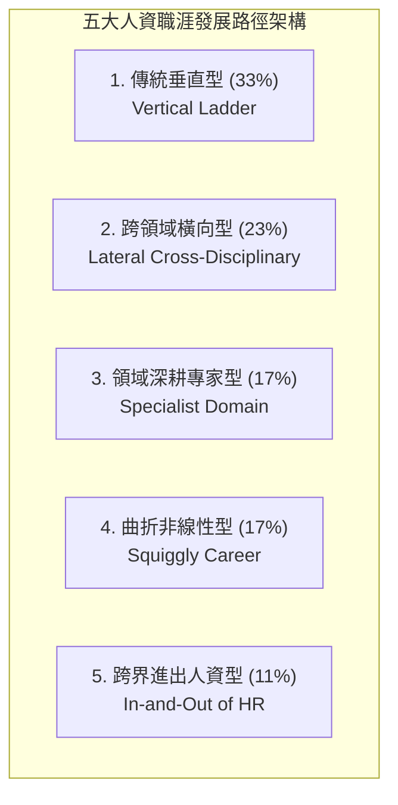
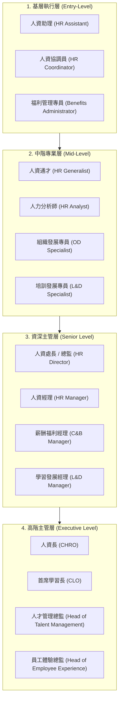

# 人資職涯路徑全解析：發展類型、階層地圖與實務案例
> **原文網址**：https://www.aihr.com/blog/hr-career-path/  
> **原文作者**：Dieter Veldsman  

---

## 📌 英文摘要 (Executive Summary in English)

Modern HR careers have evolved from predictable, title-driven ladders into multidirectional, impact-driven journeys that demand robust business acumen, data literacy, and digital capabilities beyond operational proficiency. Although 83% of HR professionals report high confidence in transactional tasks, only 64% feel equipped to align strategy with financial and workforce data, highlighting a critical need to transition toward strategic business partnership. Based on empirical analysis, five distinct career paths exist—traditional vertical (33%), lateral across disciplines (23%), specialist domain-driven (17%), squiggly (17%), and in-and-out of HR (11%)—demonstrating that non-linear and cross-functional trajectories can effectively lead to executive roles such as Chief Human Resources Officer (CHRO). To future-proof their careers in a disrupted environment, HR professionals must adopt a skills-first development model and cultivate a T-shaped competency profile through intentional career reflection and continuous upskilling.

---

## 🔑 核心關鍵字與術語對照 (Key Terms & Glossary)

| 英文術語 (English Term) | 台灣人資繁中對照 (Traditional Chinese) | 實務簡要定義／應用情境 (Context & Definition) |
| :--- | :--- | :--- |
| **Traditional Vertical Career Path** | 傳統垂直職涯路徑 | 以單一向上晉升為特徵，從基層職位逐步晉升至高階領導職，重視職稱、管理職責與組織既定層級。 |
| **Specialist Domain-Driven Career Path** | 專業領域深耕型職涯路徑 | 專注於人資特定利基專業（如薪酬福利、人力分析、勞資關係），以追求領域精通、專業權威與技術深度為導向。 |
| **Lateral Career Move / Moving Across Disciplines** | 跨領域橫向職涯歷練 | 在人資內部不同功能範疇（如從召募轉向訓練、再轉向人資系統）平行歷練，累積跨功能整合視角與通才能力。 |
| **In-and-Out HR Career Path** | 跨界進出人資職涯路徑 | 在非人資業務領域（如營運、業務、客服）與人資部門之間來回歷練，具備廣闊業務視野與高度可轉移技能。 |
| **Squiggly Career Path** | 曲折型／非線性職涯路徑 | 跨專案、跨組織與跨部門高度流動，由個人價值觀、好奇心與多元實驗驅動，打破固定職涯框架的發展軌跡。 |
| **Strategic Business Partner (HRBP)** | 策略性人資業務夥伴 | 能深入理解公司營運模式與獲利驅動力，將業務挑戰轉化為精準人才介入方案的顧問型人資角色。 |
| **Center of Excellence (CoE)** | 卓越中心／專家中心 | 專注於研發全公司人資策略、專業制度、創新工具與政策指引的深度專業部門（如組織發展 CoE、召募 CoE）。 |
| **Shared Services Center (SSC)** | 人資共享服務中心 | 集中處理高標準化、高重複性之營運與交易型行政作業（如薪資核算、考勤管理、基礎諮詢）的營運單位。 |
| **HR Value Chain** | 人資價值鏈 | 人資從人才吸引、選拔、入職、培育、績效、留任到離職各環節串聯，為企業帶來端到端商業價值的完整流程。 |
| **T-shaped Competency** | T 型人資職能 | 橫向具備跨領域廣泛認知（商業敏銳度、數據素養、數位科技應用），縱向具備某一特定人資次領域深度專業。 |
| **Transferable Skills** | 可轉移技能 | 在不同職務、部門或產業間皆可通用且能創造效益的核心能力，如專案管理、利害關係人溝通、問題拆解。 |
| **Workforce Planning** | 人力資源規劃／勞動力規劃 | 結合企業策略預測未來人才需求與技能缺口，確保關鍵人才規模與素質到位的策略性規劃流程。 |

---

## 📖 專業深度編譯 (In-Depth Translation & Insights)

### 1. 現代人資職涯發展趨勢 (The Modern Career Path for HR)

- **核心主張**：
  傳統將人資職涯視為單向攀爬的階梯（由人資助理一路升至人資長），如今已徹底被多元化、非線性的職涯網絡所取代。現代人資角色不論層級，皆需轉型為「數據驅動」與「策略導向」。人資專業人員不能僅精通薪酬福利 (Compensation & Benefits, C&B)、人才招募 (Talent Acquisition) 或學習與發展 (Learning and Development, L&D)，更必須具備完整的商業敏銳度 (Business Acumen)，深刻理解企業的營運流程、服務交付模式與核心獲利驅動力。
- **實務指標與數據**：
  - **41%** 的人資從業人員曾考慮過徹底離開人資領域，但絕大多數人最終仍選擇留下，展現出人資作為具長遠影響力職涯的潛在吸引力。
  - **83%** 的人資對處理營運與行政交易型事務感到高度自信。
  - 僅有 **64%** 的人資有信心將企業策略轉化為人資優先方案，並善用財務數據來輔助人資決策。這顯示人資職涯發展必須大幅從「行政交易」轉向「策略性商業夥伴」。
- **傳統與現代人資職涯路徑對比表**：

| 維度 (Dimension) | 傳統職涯路徑 (Traditional Path) | 現代職涯路徑 (Modern Path) |
| :--- | :--- | :--- |
| **發展方向 (Direction)** | 線性、單向朝高階管理層級晉升 | 彈性、多向度路徑（包含垂直晉升、橫向輪調與跨功能歷練） |
| **成功的定義 (Success)** | 取得高階職銜（如人資總監、人資長） | 創造實質業務影響力、建立話語權與專業能力；管理職僅是多元成果之一 |
| **技能焦點 (Skill Focus)** | 高度側重營運性與行政交易型專業 | 平衡人資專業核心，兼備商業、數據分析與策略決策技能 |
| **業務接觸面 (Business Exposure)** | 甚少接觸人資以外的核心業務營運 | 積極參與核心業務運作、獲利驅動力與組織績效改善 |
| **數據運用 (Data Utilization)** | 數據主要用於例行報表產出與法規遵循 | 數據用於驅動商業策略、影響高階決策並指導人才佈局 |
| **職涯流動性 (Mobility)** | 晉升機會高度受限於單一組織內部的既有職缺 | 跨部門、跨產業、跨專案與跨組織的流動極為普及且備受鼓勵 |
| **學習與發展 (L&D)** | 學習多集中於職涯早期，通常與晉升考核綁定 | 貫穿全職涯的持續技能升級 (Upskilling)，特別強化分析、財務與策略思維 |
| **組織定位 (HR Role)** | 被視為行政支援或後勤輔助單位 | 擔任策略性商業夥伴，為高階主管提供建言並形塑商業成果 |

---

### 2. 如何開啟人資職涯之路 (How to Start a Career in HR)

- **核心主張**：
  研究顯示僅有 **8%** 的人資從業人員是一開始就進入人資領域，其餘多數人均是從行政、教育、客服或社會工作等跨界轉型而來。入行門檻往往缺乏結構化規劃，因此在入行前建立紮實的基礎知識與核心職能至關重要。
- **四大落地實施步驟與行動建議**：
  1. **建立教育與培訓基礎 (Build Education and Training)**：
     - *學歷背景*：人資、企業管理、心理學等科系最具優勢。
     - *短期精進*：透過招募甄選、員工關係 (Employee Relations)、績效管理、勞動法令或組織行為等短期專題研習快速補足專業知識。
  2. **累積並轉移相關經驗 (Gain Relevant Experience)**：
     - *能力轉移*：將過往在行政、客服、前線營運或基層人員管理中累積的溝通協調、問題解決、專案追蹤及機密維護能力，明確對應到人資實務產出。
     - *主動參與*：在現職中積極爭取跨組參與招募面試、新進人員入職引導 (Onboarding) 或內部培訓專案。
  3. **取得專業證照與認證 (Get Certified)**：
     - 考取初階人資認證（如 HR Coordinator 或 HR Generalist 證照），並持續跟進市場需求升級數位與分析職能。
  4. **鎖定合適的初階職位應徵 (Apply for Entry-Level HR Roles)**：
     - 以人資助理 (HR Assistant)、人資協調員 (HR Coordinator) 或召募專員 (Recruiter) 為主要切入點，亦可考慮混合型或專案導向的合約職位作為跳板。

---

### 3. 理解現代人資職涯晉升脈絡 (Understanding HR Career Progression)

- **核心主張**：
  人資職涯不再是單一路徑的階梯，而是由一系列「具實質意義的經驗」串聯而成。隨著福祉 (Wellbeing)、數位轉型 (Digital Transformation) 與永續發展 (ESG / Sustainability) 等新興職責的崛起，晉升非高階人資主管的途徑已大幅拓寬。例如：目標成為人資長 (CHRO) 的專業人士，完全可以從人資資訊系統分析師 (HRIS Analyst) 起步，歷練人資營運經理 (HR Ops Manager) 與共享服務經理 (Shared Services Manager)，最終晉升高階領導職。
- **實務指標與市場趨勢數據**：
  - 人資管理經理 (HR Manager) 職缺預估在 10 年內成長 **5%**（高於所有職業平均），在美國市場中位數年薪起點超過 **$140,000 美元**。
  - 人資專員 (HR Specialist) 預估未來 10 年每年將釋出 **81,800 個職缺**。
  - 美國人資從業人員的整體失業率長期低於全美勞動市場平均水準。
- **發展策略**：
  從業人員必須跳脫狹隘的單一專項，發展能跨角色轉移的「通才核心職能」，建構具備抗震度與未來適應力 (Future-proofing) 的競爭優勢。

---

### 4. 五大現代人資職涯發展路徑 (Types of HR Career Paths)

研究指出，**37%** 的人資從業者將「將業務需求轉化為具實質影響力的人才介入方案」視為個人最熱愛的工作任務。AIHR 實證歸納出五大人資職涯路徑：

#### (1) 傳統垂直職涯路徑 (Traditional Vertical Career Path)
- **占比與動機**：占 **33%**；主要受更高的管理職責、領導地位、組織聲譽與薪酬回報驅動。
- **實務模式**：在單一組織或透過外部跳槽線性晉升（例如：人資協調員 ➔ HRBP ➔ 資深 HRBP ➔ 人資處長 ➔ 人資副總 ➔ 人資長）。
- **優缺點剖析**：
  - *優勢*：晉升步調明確迅速，權責、能見度與薪酬同步顯著提升。
  - *風險*：高壓工作易導致過勞 (Burnout)；企業可能給予「虛高職稱」卻未伴隨實質能力成長，造成職能與職務期待脫節。

#### (2) 專業領域深耕型路徑 (Specialist Domain-Driven Career Path)
- **占比與動機**：占 **17%**；受專業精通、學術/技術深度與領域聲譽驅動，熱愛人資背後的科學原理與技術機制。
- **發展重點**：深耕於薪酬福利 (C&B)、人才分析 (People Analytics) 或組織發展 (OD) 等專門學門，追求不可替代的利基優勢。
- **優缺點剖析**：
  - *優勢*：在少數人才池中具備極高稀缺性，利於跨產業平移。
  - *風險*：容易形成專業孤島 (Siloing)，在單一組織內的內部流動性較低，職務彈性受限。

#### (3) 人資次領域橫向輪調路徑 (Moving Across Disciplines within HR)
- **占比與動機**：占 **23%**；受多元性、廣泛歷練與跨領域好奇心驅動，厭惡長期重複單一工作內容。
- **發展重點**：在人資各次領域間輪調（如 OD 助理 ➔ 召募 ➔ HRIS 分析師 ➔ 敏捷人資 Scrum Manager ➔ 營運經理 ➔ 員工體驗總監），逐步建立全方位通才思維。
- **優缺點剖析**：
  - *優勢*：深刻理解人資各功能間的串聯與價值鏈交互影響，整合與綜觀全局能力強。
  - *風險*：需要極高可轉移技能，且短期內較難向組織證明具備深度的單項專業貢獻。

#### (4) 跨界進出人資路徑 (In and Out of HR)
- **占比與動機**：占 **11%**；受強烈好奇心、跨部門整合渴望與事業廣度驅動。
- **發展重點**：在非人資職能（如前線業務、客服、營運經理）與人資管理職之間來回流轉，藉由第一線業務經歷反哺人資決策。
- **優缺點剖析**：
  - *優勢*：擁有極強的商業實戰視野，能以管理階層的真實痛點設計人資方案。
  - *風險*：履歷可能被外界誤判為缺乏職涯定性或頻繁「跳槽 (Job Hopping)」。

#### (5) 曲折型非線性路徑 (Squiggly Career Path)
- **占比與動機**：占 **17%**；由個人核心價值觀、自主自由度與探索精神驅動。
- **發展重點**：高度仰賴短期專案、外包顧問任務、跨界調動與專業認證，遊走於公關、行銷、多元共融 (DEIB) 與人資專案管理之間。
- **優缺點剖析**：
  - *優勢*：高度契合個人多元抱負與生活型態，保持新鮮感與高度創新力。
  - *風險*：容易出現職業認同混淆、缺乏體制內既定認可，長期處於不確定性下易面臨精力耗竭。

---

### 5. 實戰晉升軌跡案例剖析 (HR Career Path Examples from Practice)

- **案例一：從行政人員晉升至金控人資長（Andrea，歷時 20 年）**
  - *軌跡*：採礦業人資行政 (HR Administrator) ➔ 金融服務業人資通才 (HR Generalist) ➔ 電信業資深業務夥伴 (Senior HRBP) ➔ 電信跨國購併人資副總 (VP of HR) ➔ 公共組織人資長 (CHRO) ➔ 跨國大型銀行首席人資長 (Senior CHRO)。
  - *關鍵能力積累*：掌握 ATS、CRM、HRIS 及數據分析工具，藉由購併 (M&A) 歷練高階策略夥伴能力，最終掌管 30,000+ 員工規模的企業級人資轉型。
- **案例二：從外聘顧問晉升至跨國製造業人資長（Michael，歷時 14 年以上）**
  - *軌跡*：保險業人資顧問 ➔ 業務人資夥伴 (HRBP) ➔ 卓越中心人才招募主管 (Head of TA) ➔ 組織發展與培訓經理 (Manager for OD and Learning) ➔ 物流業集團組織發展總監 (Group OD Executive) ➔ 人資共享服務副總 (VP of Shared Services) ➔ 全球製造業人資長 (CHRO)。
  - *關鍵能力積累*：從專案執行切入，歷練利害關係人管理、CoE 策略研發，進而掌握全球大型 HR Tech 系統導入與共享服務交付。
- **案例三：從組織設計助理晉升至跨國企業組織發展總監（Lucy，歷時 12 年）**
  - *軌跡*：金融業組織設計助理 (OD Assistant) ➔ 人資業務夥伴 (HRBP) ➔ 卓越中心組織發展專家 (OD Specialist) ➔ 組織發展總監 (Head of Organizational Development)。
  - *關鍵能力積累*：從專案數據支援奠定基底，透過 HRBP 了解業務脈動與員工生命週期，再回歸 CoE 負責端到端專案架構，最終主導全組織 OD 策略藍圖。

---

### 6. 人資各階層職稱與職能地圖 (HR Job Titles by Career Level)

---

### 7. 如何選擇最適的人資職涯路徑：四維自我反思架構 (How to Choose Your HR Career Path)

- **核心主張**：
  選擇職涯不應盲目追求職稱，而必須採取「技能優先 (Skills-First Approach)」導向。透過自我提問，釐清個人特質與長遠目標：
  1. **問題一：我是誰？我現在身處何處？(Who am I and where am I?)**
     - 盤點過往學歷、工作經驗、核心能力、已取得之認證，以及個人當前的人生階段與責任（如育兒責任對職涯選擇的實質影響）。
  2. **問題二：我想要什麼？為什麼想要？(What do I want and why do I want it?)**
     - 釐清工作動機：追求高薪與地位，或是追求內在成長與自主性？若對特定路線感到受限，應考慮更具彈性的非線性路徑。
  3. **問題三：我要如何達成目標？(How will I get there?)**
     - 盤點現況與理想職位之間的技能缺口，評估是否需要進修、考證照，或藉由特定過渡職位作為踏腳石。
  4. **問題四：我未來想要成為什麼樣的人？(What will I want or who do I want to be?)**
     - 定義個人專屬的成功指標，將人資職涯與整體人生價值目標充分整合。

---

## 📜 全文中文翻譯 (Full Traditional Chinese Translation)

### 前言：人資職涯路徑全面解析
無論你剛剛跨入人力資源領域，或是已經擁有多年深厚經驗，清晰的人資職涯路徑都能將你的專業技能與熱忱轉化為具備方向性的實質成長。儘管調查顯示有高達 41% 的人資從業人員曾考慮過徹底離開人資領域，但絕大多數人最終依然找到了持續深耕的理由。這充分展現了人資作為一門深具影響力之專業，其所蘊含的長期吸引力與發展潛能。

本文將深入探討構建人資職涯所需的各項關鍵要素、可供選擇的各類職涯路徑，並透過三個真實人資晉升實務案例為你帶來實務啟發。

---

### 核心重點摘要 (Key Takeaways)
- 現代人資職涯已高度轉向策略導向與數據驅動，除了傳統人資專業任務外，更要求具備商業敏銳度、數據素養，以及數位與 AI 應用技能。
- 人資職涯的晉升與發展，多半建立在跨角色與跨功能的豐富經驗累積之上，絕非只有單一升遷階梯可走。
- 人資職涯路徑類型涵蓋傳統垂直晉升型、專業領域深耕型、人資內部跨次領域型、跨界進出人資型，以及曲折非線性型。
- 持續不斷的技能學習、高度適應力以及跨功能多元職能，是確保人資專業人員在面對未來變局時立於不敗之地 (Future-proofing) 的核心關鍵。

---

### 第一章：現代人資職涯路徑演進 (The Modern Career Path for HR)
過去，人們普遍將人資的職涯路徑視為通往最高成功頂點的一連串升遷階梯——這個頂點通常意味著高階策略領導職位。典型的人資晉升軌跡通常是從人資助理 (HR Assistant) 起步，升至人資經理 (HR Manager)，最終掌管全團隊成為人資總監 (HR Director) 或人資長 (Chief Human Resources Officer, CHRO)。然而在當今環境下，人資的職涯軌跡遠比以往更加多元且富有彈性。

如今，各個層級的人資角色都經歷了深刻演變，變得更具策略性且高度仰賴數據驅動。一名成功的人資專業人員，不能只具備薪酬與福利 (Compensation and Benefits)、人才招募 (Talent Acquisition) 以及學習與發展 (Learning and Development) 的深厚專門知識，還必須透徹理解企業的日常營運，包含生產製造流程、服務交付模式以及企業的核心獲利驅動力。

然而調查數據顯示，高達 83% 的人資從業人員表示對處理營運與行政交易型任務感到高度自信；相反地，僅有 64% 的人表示有信心將企業策略轉化為人資具體行動、對齊人資工作優先順序，並靈活運用財務數據進行人資決策。現代人資職涯發展路徑的重心，必須徹底從日常營運與行政交易，轉型為真正的策略性人資業務夥伴 (Strategic Business Partner)。

#### 傳統 vs. 現代人資職涯路徑比較
人資職涯路徑已從過去可預測、職稱驅動的單一晉升，轉變為更加彈性、以商業為核心的職涯旅程，優先考量組織影響力、策略職能與持續性的技能發展。以下是現代人資職涯路徑的演進對比：

- **職涯發展方向**：傳統上屬於朝向高階管理職位的線性垂直向上晉升；現代則是高度彈性、多元方向的路徑，包含垂直晉升、橫向轉調與跨功能歷練。
- **成功的定義**：傳統上以獲得高階職稱（如人資處長或人資長）作為成功標竿；現代則以建立業務影響力、話語權與核心能力為核心，領導職位僅是多種可實現成果的其中之一。
- **技能發展焦點**：傳統高度聚焦於營運與交易型人資專業知識；現代則要求平衡兼顧人資專業深度與商業營運、數據分析及策略決策能力。
- **商業接觸廣度**：傳統甚少接觸人資範疇以外的核心業務營運；現代則積極深度參與業務營運流程、利潤驅動要素與全組織績效改善。
- **數據運用程度**：傳統僅將數據用於日常例行報表產出與合規審查；現代則運用數據驅動商業策略制定、說服高階決策階層並指導全盤勞動力決策。
- **職涯流動性**：傳統晉升機會高度受制於單一企業內部釋出的現有職缺；現代跨功能、跨產業、跨專案以及跨企業的多元流動極為普遍且受到正面鼓勵。
- **學習與專業發展**：傳統學習多半集中於職涯早期階段，且往往與職位升遷考核掛鉤；現代則強調貫穿整體職涯的持續技能升級，尤其在分析、財務與策略領域不間斷學習。
- **人資在組織中的定位**：傳統上人資主要被視為行政支援與後勤輔助單位；現代人資則擔任真正的策略夥伴，為高階管理層提供建言並直接形塑業務成果。

---

### 第二章：如何開啟人資職涯之路 (How to Start a Career in HR)
在正式展開人力資源專業生涯前，建立深厚的基礎知識與核心職能是不可或缺的。以下四個具體步驟能協助你順利啟航：

#### 1. 建立教育與專業培訓基礎 (Build Your Education and Training)
透過正規學位教育與短期學習課程（如專題證照）互相搭配，奠定人資基礎知識。
- *實務建議*：擁有主修人力資源、企業管理、心理學或相關領域的學位相當有幫助。此外，針對招募甄選、員工關係 (Employee Relations)、績效管理、勞工法規或組織行為學等主題修習短期進修課程，能進一步快速拓寬專業視野。

#### 2. 累積並轉化實務經驗 (Gain Relevant Experience)
將你在非人資領域（例如行政總務、客戶服務、第一線營運或基層團隊管理）所累積的寶貴經驗，靈活轉移套用到人資的情境中，並在現職中主動支援各項與人資相關的事務與專案。
- *實務建議*：明確將你在其他工作中所具備的核心技能（如口語溝通、專案協調、問題分析解決、保密意識）與人資實務產出進行連結。此外，積極爭取跨部門影子學習、內部轉調或以專案成員身分參與員工甄選、新人到職培訓與內部培訓規劃。

#### 3. 取得人資專業認證 (Get Certified)
報考並取得初階人資認證（例如 HR Coordinator 或 HR Generalist 證照），並隨著組織與市場需求的轉變持續更新技能。
- *實務建議*：優先鎖定能為你當前渴望爭取的職位、以及未來目標人資職責帶來實質加分效果的專業認證。

#### 4. 積極應徵基層人資職位 (Apply for Entry-Level HR Roles)
當你已經累積了具說服力的可轉移技能、工作經驗與專業知識後，便可開始投遞基層人資職位。
- *實務建議*：最常見的切入職務包含人資助理 (HR Assistant)、人資協調員 (HR Coordinator) 或召募人員 (Recruiter)。此外，混合型或專案導向的合約職缺也是踏入該領域的重要敲門磚。

---

### 第三章：理解現代人資職涯晉升脈絡 (Understanding HR Career Progression)
人資職涯的選擇空間不僅正在改變，更在持續擴大。國際勞動力市場研究顯示，自 2000 年代初期以來，多數西方國家的人資職缺皆呈現穩定成長態勢。在各類職能中，人資經理 (HR Manager) 的職缺預估在 10 年內成長率將達到 5%（高於全體職業平均水準），中位數年薪起點更超過 140,000 美元。人資專案專家 (HR Specialist) 在未來十年間，平均每年亦將釋出多達 81,800 個工作機會。事實上，在美國勞動市場中，人資專業從業人員的失業率長期低於全體從業人員的平均失業率。

隨著全方位員工福祉 (Wellbeing)、數位轉型 (Digital Transformation) 以及企業永續經營 (ESG / Sustainability) 等新興職責的快速崛起，如今湧現了大量非傳統的人資職涯晉升機會。人資專業人員在不同職位與不同企業之間切換調動的頻率比過往更高，這讓同仁能透過承擔截然不同的職務經歷，最終依然能達成相同的職涯終極目標。

這意味著，假設你的最終目標是成為企業的人資長 (CHRO)，你不再需要按照傳統既定路徑依序從人資助理、專員、人資經理再爬升到人資總監。如今你完全可能從人資資訊系統分析師 (HRIS Analyst) 起步，隨後內部轉調為人資營運經理 (HR Ops Manager)，接著晉升為共享服務中心經理 (Shared Services Manager)，最終成功接掌 CHRO 的領導大任。

你在人資領域中的職涯晉升，本質上就是一系列「具備實質意義之專業經驗」的總和。每當你接下一個新職務，你就會獲取一套全新技能與核心職能，全面帶動你的個人成長與專業發展。

這些累積的技能也將為你在未來的職涯道路上賦予更強的晉升動能。必須記住的是——不同規模、組織架構與產業類型的企業，對於同一個職稱往往有著截然不同的技能組合、核心職能與管理範疇要求。這代表職涯的可能性是無窮無盡的。

然而，這也同時意味著你必須跳出原本單一人資專門範疇的舒適圈，積極培養更多可廣泛跨職能平移的一般性人資核心職能。這些通用型職能不僅能讓你跨部門有效協作與推動創新，更能讓你在瞬息萬變的工作環境中具備高度彈性，在面對全球各類顛覆性變局時確保職涯的長遠競爭力。

---

### 第四章：五大人資職涯發展路徑 (Types of HR Career Paths)
你知道嗎？事實上只有 8% 的人資從業人員是一開始就進入人資領域就業的。絕大多數人都不是。許多人資人員最初是從非商業領域或基礎行政職務起步，例如行政秘書、學校教師或社工人員。踏入人資領域的過程通常是非結構化且缺乏預先規劃的，這也往往影響了初階人資人員的就職準備度、工作動機與基本專業技能。

那麼，為什麼這些人最終會選擇轉向人資領域？研究指出，許多人之所以渴望轉戰人資，是因為他們內心期望能對企業經營與同仁福祉產生實質正面影響。事實上，在接受調查的人資從業者中，有高達 37% 的人表示「將商業需求轉化為具實質影響力的人才介入方案」是他們心目中最熱愛的工作任務。

接下來，我們將深入剖析五種主要的人資職涯發展路徑，包含各自的具體樣貌、驅動動機，以及潛在的優點與挑戰：

#### 1. 傳統垂直職涯路徑 (Traditional Vertical Career Path)
- **路徑樣貌**：以清晰的線性晉升為特徵，通常從基層職位出發，透過縱向晉升逐步邁向責任更重、層級更高的職務。
- **核心動機**：追求承擔更大管理職責、發揮組織領導力、獲取更高的社會地位與專業肯定。
- **關鍵能力**：若要循此路徑向上攀升，必須建立紮實的 functional skills（功能性專業技能）、學習如何高效管理人脈與團隊，並具備前瞻性的策略視野以引領組織前進。晉升機會往往受限於組織內部既有職缺，但也常伴隨著跳槽至外部企業擔任更高階職位。
- **優缺點分析**：
  - *主要優點*：從基層到高階職位的晉升途徑相對清晰快速，常伴隨著管理權限、組織能見度與薪酬水準的顯著提高。
  - *潛在缺點*：為了追求不斷往上爬，常引發過度加班與高壓競爭，大幅提升同仁職業倦怠 (Burnout) 的風險。此外，有些企業會在員工專業技能或歷練尚未成熟前給予過高的空洞職稱，導致實際職能與職務期待產生嚴重脫節。
- **市場比例**：調查顯示約有 33% 的人資選擇循此路徑發展。
- **實務案例**：Serena 最初以人資協調員 (HR Coordinator) 的基層角色踏入人資圈。隨後她內部晉升為人資業務夥伴 (HRBP)，進而擢升為資深人資業務夥伴 (Senior HRBP)，持續擴大管理職責與領導範疇。不久後，她被拔擢為人資總監 (HR Director)，接著升任人資處長 (Head of HR)，最終成功登上該組織的人資長 (CHRO) 寶座。

#### 2. 專業領域深耕型職涯路徑 (Specialist Domain-Driven Career Path)
- **路徑樣貌**：將焦點專注於人資內部單一特定利基領域，並在該專業深度持續精進深造。
- **核心動機**：渴望在特定領域達到專業大師境界，累積高度專業權威、卓越專精技能與無可取代的專業資歷。選擇這條路線的人通常非常熱愛工作背後的科學原理與技術機制。
- **關鍵能力**：需要長期的終身學習、領域能見度與專業聚焦。每一次的職涯流動皆緊密圍繞在特定的專業學門上，例如薪酬福利 (Compensation & Benefits)、人力分析 (People Analytics) 或組織發展 (Organizational Development)。
- **優缺點分析**：
  - *主要優點*：投入大量心血鑽研專業並取得進階資格認證，讓你在特定技術領域成為極少數不可替代的專業人才，大幅提升你在該領域的就業優勢與跳槽身價，能輕易跨足不同產業或工作環境擔任同類型專家。
  - *潛在缺點*：容易導致專業孤島效應 (Siloing)，在同一家公司內部的橫向轉調流動性較低，且職務發展空間容易受限於單一專業框架。
- **市場比例**：研究顯示約有 17% 的人資從業者屬於此種類型。
- **實務案例**：Ranahjai 在大學攻讀法律專業，畢業後先在大學擔任法學講師，隨後轉入企業人資部門擔任勞資關係專家 (Industrial Relations Expert)。透過在勞動法規與勞資協商上的深厚專業累積，他順利升任勞資關係執行總監 (Industrial Relations Executive)，如今在維護並改善公司與勞工間的互信夥伴關係中扮演不可或缺的關鍵決策角色。

#### 3. 人資次領域橫向輪調路徑 (Moving Across Disciplines within HR)
- **路徑樣貌**：亦被稱為橫向平行調動 (Lateral Move) 或非線性人資路徑。
- **核心動機**：受到工作多樣性與新鮮感驅動，若長期拘泥於單一領域容易感到枯燥。他們喜歡接觸廣泛多樣的不同次領域，在工作中累積寬廣多元的歷練。
- **關鍵能力**：若要在此路徑上取得成功，必須具備極為深厚的功能性基礎與可轉移技能 (Transferable Skills)，讓自己在踏入一個全新次領域時能迅速站穩腳步並展開貢獻。職涯的流動能兼顧組織內部機會與跨組織轉職，彈性遠高於傳統單一路徑。
- **優缺點分析**：
  - *主要優點*：在廣泛涉獵人資內部眾多次領域與部門的過程中，累積了極為豐富的經驗、知識與通才技能，能深刻看清人資各營運板塊之間如何相互交織與串聯。
  - *潛在缺點*：對可轉移技能的高度要求非常嚴苛；在不同領域切換初期可能需要花較長時間才能展現深度績效影響力；且需要足夠機會廣泛接觸各大次領域才能健全發展。
- **市場比例**：估計約有 23% 的人資專業人員選擇此路徑。
- **實務案例**：Janelle 最早擔任組織發展行政助理 (OD Administrator)，隨後橫向轉調到更具通才性質的人資協調員 (HR Coordinator)。在此期間她完成了特定專業進修，順利轉型為人資系統分析師 (HRIS Analyst)。在此部門任職一段時間後，她渴望能更直接地培育與引導同仁，於是再度進行橫向歷練並升任敏捷人資經理 (HR Scrum Manager)。她非常熱愛敏捷協作，但進一步想挑戰營運管理，因而爭取到人資營運經理 (HR Operations Manager) 的職缺。整合過往所有深厚技能與跨界經歷後，Janelle 最終被拔擢為企業的員工體驗總監 (Head of Employee Experience)。

#### 4. 跨界進出人資職涯路徑 (In and Out of HR)
- **路徑樣貌**：涉及從非人資職能跨界進入人資，隨後再跨出人資領域歷練業務營運，日後可能再次回歸人資。
- **核心動機**：受強烈求知慾、跨界整合渴望以及全方位事業廣度所驅使。
- **關鍵能力**：必須純熟掌握並運用跨界通用技能，並在差異懸殊的人資與非人資職務間建立起深刻、有意義的戰略連結。其職涯調動往往由外部各類機遇驅動，不受單一企業組織邊界限制。
- **優缺點分析**：
  - *主要優點*：能接觸到更寬廣多元的外部市場機會，同時在真實業務營運與人資職能兩端皆獲取不可或缺的跨界歷練。
  - *潛在缺點*：履歷上可能呈現出較不明確的職涯主線，容易被部分保守雇主質疑為缺乏定性或頻繁跳槽 (Job Hopping)。
- **市場比例**：研究發現約有 11% 的人採取此路徑。
- **實務案例**：Luca 最初在客服中心擔任電話客服人員 (Call Center Agent)，但對重複單調的工作內容感到疲憊。他善用出色的溝通協調技能爭取到初階人資職位，擔任培訓發展行政專員 (L&D Administrator)，憑藉優異表現迅速晉升為培訓發展專員 (L&D Specialist)，隨後更升任為培訓發展經理 (L&D Manager)。此時 Luca 渴望跨入下一個職涯里程碑，但原企業暫無適當高階職缺，於是他跨出人資領域，跳槽至另一家企業擔任非人資的區域營運經理 (Regional Manager)，在該職位歷練數年以深度磨練領導與營運管理實力。隨後，他帶著豐沛的第一線營運經驗回歸人資領域，接掌該集團的區域人資負責人 (Regional HR Head)。

#### 5. 曲折型非線性職涯路徑 (Squiggly Career Path)
- **路徑樣貌**：在不同部門、甚至頻繁進出人資領域之間來回切換，由眾多橫向、跨界與專案式歷練交織而成。
- **核心動機**：受自主自由度、勇於實驗的精神以及個人核心價值觀深刻驅使。
- **關鍵能力**：必須積極累積多方涉略、持續不斷為自己技能升級，並迅速對齊下一個目標職位所需的核心關鍵要求。此路徑的流動往往透過專案任務、短期委外合約、專案派任與專業證照轉換來達成。
- **優缺點分析**：
  - *主要優點*：能夠高度忠於個人在不同人生階段變化的價值追求與抱負，並徹底避免職業倦怠與工作倦怠感。
  - *潛在缺點*：若缺乏良好調適，可能迅速引發精力過度消耗；在傳統評價體系中可能較難獲得制式升遷認可，甚至產生職涯專業認同混淆。
- **市場比例**：約有 17% 的人資從業者擁有此類曲折職涯軌跡。
- **實務案例**：Aoife 原先是一名自由接案的時尚造型顧問，在業務減少後決定轉戰人資領域，從初階的人才招募研究員 (Talent Researcher) 做起。她表現卓越並迅速升任為獵才專員 (Headhunter)。在完成多元共融培訓認證後，她順從個人熱情轉任多元平等共融專員 (DEIB Officer)，不久再度晉升為 DEIB 資深專家。數年後她感覺職涯面臨瓶頸，毅然做出重大轉折跨出人資，轉戰公關傳播領域擔任公關主管，隨後升任企業公關長 (Head of Comms)。三年後，她再度決定回歸人資專業，成功拿下資深人資專案經理 (Senior HR Project Manager) 的高階領導職位。

---

### 第五章：實務案例解析 (HR Career Path Examples from Practice)
為了更清楚具體地展示人資職涯在真實職場中的展開方式，以下彙整三位資深人資領袖的真實職涯歷程（經當事人授權引用並隱匿真實姓名）：

#### 案例一：從人資行政人員攀升至跨國銀行人資長（Andrea，歷經 20 年）
Andrea 在取得人資通才學位後，展開了長達 20 年的跨界人資旅程：
1. **起點**：最初在該國最大的採礦巨頭擔任人資行政人員 (HR Administrator)。這段歷練奠定了深厚基礎，她不僅純熟掌握了召募管理系統 (ATS)、客戶關係管理 (CRM)、人資資訊系統 (HRIS) 及人資數據分析工具，更對端到端的人資價值鏈擁有了全面宏觀的認知。
2. **通才累積**：兩年後她轉戰金融服務業擔任人資通才 (HR Generalist)，深入掌握召募甄選、薪資核算、薪酬福利與法規遵循等多維度運作細節。
3. **策略夥伴**：多元彈性的技能讓她能主導多項重大專案，進而轉戰電信業擔任資深人資業務夥伴 (Senior HRBP)。在此角色中，她與核心業務單位並肩推動策略倡議，協同各專業 CoE 專家領導長期改革專案。
4. **高階歷練與購併**：四年後她迎來人生首個高階管理職，轉任另一家處於企業購併 (M&A) 整合階段的電信企業擔任人資副總裁 (VP of HR)，掌管最核心的企業服務業務線，善用強大的人資工具箱與領導經驗全力輔佐高階主管度過購併震盪。
5. **接掌公部門與跨國銀行**：三年半後，她跨足公共組織接掌人資長 (CHRO)，大刀闊斧領導人資功能轉型；如今，她更擔任該國最大跨國銀行之一的高階人資長 (Senior CHRO)，掌管超過 30,000 名同仁的全盤人才策略規劃與組織變革方案。

#### 案例二：從外聘顧問轉戰實務界晉升至全球製造業人資長（Michael，歷經 14 年以上）
Michael 的職涯展現了顧問思維與企業實務深度的完美結合：
1. **顧問啟蒙**：最初在保險產業擔任人資顧問 (HR Consultant)，負責支援總部群體服務團隊在全公司各事業群推動各項人才介入措施，深度累積了主導大型組織變革的實戰經驗。
2. **業務對齊與 CoE 深化**：發現自己熱衷於深入業務端後，他轉任 HRBP，深度培養利害關係人管理與策略業務夥伴的核心技能。隨後因招募戰功卓著，他被延攬進卓越中心 (CoE) 擔任人才招募負責人 (Head of Talent Acquisition)，主導人才策略、績效管理與接班人計劃 (Succession Planning)。
3. **擴大範疇至組織發展**：隨後他進一步接管 L&D 業務，晉升為組織發展與學習經理 (Manager for OD and Learning)，具備了組織架構設計與打造大型培訓體系的頂尖實力。
4. **跨產業躍升與科技賦能**：14 年後他轉戰物流產業擔任集團組織發展執行總監 (Group OD Executive)，專注於高層策略諮詢；這份歷練為他鋪平了晉升人資共享服務副總裁 (VP of Shared Services) 之路，全權負責開發、導入與優化企業人資科技解決方案，淬鍊出全球系統建置與服務交付最佳化的宏觀格局。目前，他已正式成為一家跨國製造巨頭的人資長 (CHRO)。

#### 案例三：從組織設計基層助理深耕至跨國集團組織發展總監（Lucy，歷經 12 年）
Lucy 展現了專業深耕與橫向融合如何造就卓越的領域領導人：
1. **基層起步**：在跨國金融服務巨頭擔任組織設計助理 (OD Assistant)，專注於支援業務單位執行組織診斷與介入措施，打下紮實的組織設計原理、專案管理以及人資數據分析與報表產出基礎。
2. **跨出象牙塔擔任 HRBP**：隨後她轉任 HRBP，親身了解人資該如何第一線貼近業務、為業務創造獲利價值，並在宏觀層次深化對員工生命週期 (Employee Life Cycle) 各階段的理解。
3. **回歸 CoE 擔任專家**：四年後她回歸卓越中心 (CoE) 出任組織發展專案專家 (OD Specialist)，精進了策略需求評估、專案執行督導與端到端方案架構設計的專業能力。
4. **接掌領導帥印**：最終她順利出任組織發展總監 (Head of Organizational Development)，全權統籌全企業的 OD 業務體系，主導組織架構與變革策略的長遠方向。

---

### 第六章：各階層人資職稱與職責地圖 (HR Job Titles by Career Level)
在規劃個人職涯路徑時，清楚掌握人資角色在不同資歷階層的定位能提供極佳的導航參考。雖然各組織職稱略有出入，但普遍可劃分為四大層級：

#### 1. 基層執行層 (Entry-Level)
- **人資助理 (HR Assistant)**：處理同仁人事檔案維護、每月出勤與薪資作業支援，以及各階段甄選招募等行政例行事務。
- **人資協調員 (HR Coordinator)**：支援核心人資作業流程，包括新進招募、入職引導培訓、團體保險與福利作業及基礎人事行政。
- **福利管理專員 (Benefits Administrator)**：專責維護並執行各項員工福利制度，確保同仁充分理解並享受其法定義務與公司福利方案。

#### 2. 中階專業層 (Mid-Level)
- **人資通才 (HR Generalist)**：支援全方位人資運作，兼顧日常人事管理、規章制度宣導執行與跨組協調任務。
- **學習發展專員 (L&D Specialist)**：規劃並製作專業教材，主導各項培訓專案，以支持員工自我成長並強化企業核心組織職能。
- **人力分析師 (HR Analyst)**：運用人資與勞動力數據分析技術產出洞察，深入挖掘人才流動趨勢，為策略性人才決策提供客觀數據支援。
- **組織發展專員 (OD Specialist)**：推動組織設計調整與各項變革管理專案，致力於優化組織架構、權責清晰度與整體營運績效。

#### 3. 資深主管層 (Senior Level)
- **人資經理 (HR Manager)**：綜理公司內部人資部門運作，確保全體員工獲得充分支援，並監督人資各項專案與企業策略目標精準對齊。
- **薪酬福利經理 (C&B Manager)**：主導規劃具有外部競爭力與內部公平性的薪酬福利架構，包含固定薪資、變動獎金、股權激勵、退休金計畫與多元獎酬。
- **學習發展經理 (L&D Manager)**：統籌企業整體訓練策略規劃、組織關鍵技能需求評估，並以數據客觀量化評估培訓效益與成效。
- **人資處長／總監 (HR Director)**：掌管特定事業群或區域之端到端人資服務交付，確保在整個員工生命週期中的一致性、法規合規性與卓越服務品質。

#### 4. 高階決策層 (Executive Level)
- **首席學習長 (Chief Learning Officer, CLO)**：制定引領企業未來的終身學習願景與接班領導梯隊培育計畫，打造具未來適應力的組織技能庫並驅動內部良性流動。
- **人資長 (Chief Human Resources Officer, CHRO)**：擔任人資最高決策領袖，制定緊密對齊商業目標的組織人才優先策略，透過人才儲備、企業文化塑造與策略性勞動力規劃確保企業長遠成功。
- **人才管理總監 (Head of Talent Management)**：規劃並推行全球級人才管理戰略，全力支持組織商業願景，營造高績效與高投入度 (Engagement) 的卓越文化。
- **員工體驗總監 (Head of Employee Experience)**：繪製並持續優化員工在企業生命週期中各關鍵時刻 (Moments that Matter) 的接觸點體驗，全方位拉升員工滿意度、向心力與留任率。

---

### 第七章：如何挑選最適合你的人資職涯路徑 (How to Choose Your HR Career Path)
面對如此多元的人資職稱與路徑，該如何做出最佳抉擇？

第一步是充分熟悉前文所述的五大職涯類型與各階層定位，在掌握全局可能性的前提下做出有自覺的理性規劃。

第二步是花時間深度進行自我反思，透過以下「四大引導式問題」釐清自我定位與實現路徑：

#### 問題一：我是誰？我現在身處何處？(Who am I and where am I?)
回顧塑造你當前職涯的所有要素：
- 過往哪些專業興趣引導你走到今天？
- 你具備何種教育背景與專業資歷？
- 你累積了哪些實務工作經驗（包含志工與全職經歷）？
- 你最強大的核心技能與專業職能為何？
- 你是否曾修習特定專業課程或取得關鍵認證？
- *考量個人現況*：同時務必客觀評估個人當前的人生階段與家庭責任。舉例而言，需要兼顧幼童照顧的職業父母，在規劃職涯路徑時的權衡取捨，自然與單身且無需負擔繁重家庭責任的人大不相同。

#### 問題二：我真正渴望什麼？為什麼渴望？(What do I want and why do I want it?)
將目光拉回當下，審視個人的真實抱負：
- 你目前的熱情與工作興趣究竟落在哪裡？這些興趣與人資的哪些次領域高度契合？
- 在工作環境中，驅動你的核心動力是什麼？你是更受薪資報酬與社會地位激勵，還是更容易受到內在專業成長與自我實現感召？
- 作為人資專業人員，你希望從這段職涯中獲得什麼成就？
- *行動建議*：廣泛閱讀產業分析、專業論壇與徵才頁面，精準掌握不同職缺在市場上的真實定位與雇主期待。若傳統單向垂直的晉升路徑讓你感到受限與窒息，那麼更具彈性的非線性曲折路徑可能更符合你的追求。

#### 問題三：我要如何抵達目標？(How will I get there?)
一旦鎖定了心目中最具吸引力且合適的目標路徑，下一步就是具體評估抵達彼岸所需的技能與經驗缺口：
- 當前阻礙你邁進的阻力是什麼？你該如何克服這些障礙？
- 你是否需要進修更高階學歷、報名專業課程，或是考取高含金量認證來讓自己在眾多候選人中脫穎而出？
- 在你的私人生活圈或專業人脈網中，是否有能提供寶貴建言與指引的導師 (Mentor)？
- 是否有特定的中間職位，可以作為你通往終極夢想職位的堅實踏腳石？

#### 問題四：我未來想要成為什麼樣的人？(What will I want or who do I want to be?)
最後一步是前瞻未來，設定長遠願景：
- 如果你當前尚未具備無比明確的終極目標，這完全沒有關係——多數人一開始都沒有。若你處於此狀態，不妨聚焦於你能清晰看見的最遠前方。
- 舉例而言，若你同時對人資的兩個次領域感到高度興趣且難以取捨，那麼先爭取擔任人資通才 (HR Generalist) 或人資行政職位，能讓你同時探索兩個領域；等到累積更豐富的實戰經驗後，再做出深思熟慮的決定。
- 設定清晰的目標與符合個人價值觀的期待。記住，每個人心目中對「成功」的定義都截然不同。在做決策時，務必將工作與個人生活、健康及家庭全面整合考量。

探索人資職涯絕對沒有放諸四海皆準的唯一標準答案。然而，採取「技能優先 (Skills-First Approach)」的發展策略已成為業界共識——尤其是在發展數據分析、數位科技以及人工智慧 (AI) 應用技能上更是刻不容緩。人資專業人員不能僅著眼於追求特定頭銜的晉升，更必須建立持續自主技能升級的常態機制，方能創造長遠的職涯價值。

---

### 結語：行動指引
作為人資專業從業人員，你需要具備全方位的綜合技能庫，方能將當前與未來的各項挑戰轉化為個人成長的契機。本文深入介紹了人資的各大職能面向以及在不同角色類型中的多樣化職涯路徑選項。每一種角色類型皆需要特定的核心職能與功能專業組合，並由各項具體技能與行為指標所構成。

然而，理解自身需要哪些技能與行為指標只是第一步。緊接著最關鍵的下一步，是精準評估自己當前的技能水準，找出個人的核心技能缺口 (Skills Gap)，並著手規劃專屬的技能升級與 T 型職能培育路徑，穩健推動你的現代人資職涯大步向前邁進。
