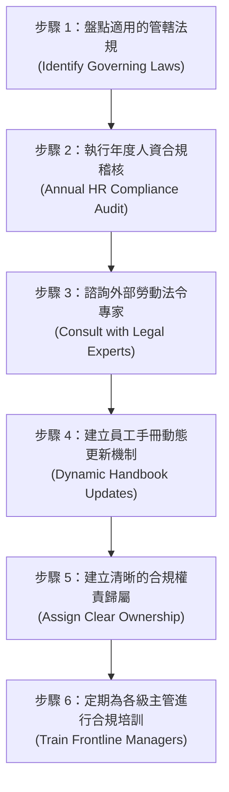

# 人資團隊必備的 21+ 項勞動法規與合規守則：全方位指引與實務防範
> **原文網址**：https://www.aihr.com/blog/hr-rules-and-regulations/  
> **原文作者**：Neelie Verlinden  

---

## 📌 英文摘要 (Executive Summary in English)

HR rules and regulations constitute the indispensable legal and ethical framework governing how organizations manage their workforce, ensuring fair compensation, safe working environments, equal opportunity, and data privacy. Navigating compliance across multifaceted domains—such as workplace anti-discrimination (Title VII, ADA, ADEA), wage and hour standards (FLSA, EPA), employee benefit administration (ERISA, ACA, COBRA), statutory leave entitlements (FMLA), occupational safety (OSHA), and emerging AI employment governance (ADS and AEDT regulations)—is critical to shielding companies from catastrophic litigation, steep regulatory fines, and brand erosion. Because frontline managers serve as the primary point of legal exposure, compliance cannot remain a static policy exercise; it demands proactive operational governance. To maintain robust legal defense, HR departments must establish comprehensive regulatory inventories, conduct annual compliance audits, formalize clear domain ownership, engage employment counsel, and deliver continuous scenario-based training to frontline leadership.

---

## 🔑 核心關鍵字與術語對照 (Key Terms & Glossary)

| 英文術語 (English Term) | 台灣人資繁中對照 (Traditional Chinese) | 實務簡要定義／應用情境 (Context & Definition) |
| :--- | :--- | :--- |
| **HR Compliance** | 人資法令遵循／人資合規 | 確保組織內部各項人事管理政策、日常營運流程與主管行為，完全符合各級勞動法規與倫理標準的管理實踐。 |
| **Reasonable Accommodation** | 合理調整／合理便利措施 | 雇主在不造成組織「過度困境 (Undue Hardship)」的前提下，為主動或已知具身心障礙、特定宗教信仰的員工調整工作環境或流程之法定作為。 |
| **Exempt vs. Non-Exempt Employees** | 免除適用工時者 vs. 適用工時者（責任制 vs. 領加班費員工） | 美國《公平勞動標準法》(FLSA) 對職位之法定分類；Non-exempt 員工每週工時超過 40 小時必須依法受領 1.5 倍加班費，職位誤分類為常見重大違法行為。 |
| **Overtime Misclassification** | 加班費資格誤分類／職位身分判定錯誤 | 雇主將依法應支領加班費的非免除員工誤列為免除人員（或誤列為獨立承攬人），導致勞工未獲法定加班費而面臨主管機關補發工資與懲罰性損害賠償。 |
| **Intermittent Leave** | 分段請假／斷續差假 | 依據《家庭與醫療假法》(FMLA)，員工因慢性病、突發醫療需求或定期回診，以小時或單日形式彈性請休之法定帶職休假，人資需嚴謹追蹤以防阻妨礙休假之指控。 |
| **Non-Discrimination Testing (NDT)** | 非歧視測試 | 美國國稅局 (IRS) 強制規定，旨在檢驗雇主提供的稅負優惠員工福利或退休金計畫，是否公平嘉惠基層員工，而非僅獨厚企業業主、高階主管或高薪人員。 |
| **OSHA Incident Log (Forms 300/300A/301)** | 職業災害與傷病紀錄表單 | 美國職業安全與健康管理局 (OSHA) 規範雇主必須逐筆登錄、年度彙總並即時呈報的法定職場工作傷害與職業病官方日誌。 |
| **Biometric Information Privacy** | 生物辨識資訊隱私規範 | 規範雇主在採集員工指紋、掌形或臉部掃描用於打卡或門禁時，必須事前書面告知用途與保存期限、簽署同意書，並嚴禁出售或租賃之嚴格隱私法規（如伊利諾州 BIPA）。 |
| **Automated Employment Decision Tools (AEDT)** | 自動化就業決策工具 | 運用機器學習或演算法針對人才招募、篩選、評量或晉升提供自動化評分與推薦之技術系統，現受地方立法（如紐約市第 144 號地方公法）強制要求年度獨立偏見稽核。 |
| **Automated Decision-Making Systems (ADS)** | 自動化決策系統 | 在懲戒、考核或解僱流程中運用演算法進行評斷的自動化系統；最新立法趨勢要求強制配置真人覆核監督（Human Oversight），嚴禁全權委由 AI 作出不利人事處分。 |
| **HR Compliance Audit** | 人資合規稽核／法令遵循查核 | 定期系統化檢核企業招募、薪酬、出勤、福利、安全與離職政策是否切合最新中央、地方各級法定標準的內部控制機制。 |

---

## 📖 專業深度編譯 (In-Depth Translation & Insights)

### 1. 人資法規與合規守則的本質與重要性 (What Are HR Rules and Regulations?)
在人力資源管理的實務領域中，法令規範或許看似生硬且缺乏變革話題的光鮮亮麗，但卻是組織運作最重要的基石。所有的人資政策、制度與日常作業，無一不深深植根於法律與監管規範之中。一旦踩中法規紅線，組織面臨的代價將極度沉重：包括高額主管機關行政罰鍰、巨額民事訴訟賠償、員工對管理層信任瓦解，以及難以抹滅的雇主品牌聲譽損害。

- **核心定義**：人資法規（HR Rules and Regulations）涵蓋聯邦（中央）、州（省）與地方層級所制定的各項法規體系，旨在確立組織以合乎法律與商業倫理的方式管理全體工作者，並在員工福利、勞動薪酬、職業安全與職場行為等維度確立最低法定基準。
- **違法代價**：違規行為不僅會直接損害勞工權益（如不公平待遇、工資積欠、險惡的工作環境或隱私遭侵害），更會使雇主直接暴露於集體訴訟、重度罰金與商譽危機之中。企業適用的法令範疇，會因公司規模（員工人數）、地理營運據點及所屬產業特性而有所不同。
- **人資的角色與當責性**：人資團隊是企業法令遵循的主要當責者（Primary Owners）。高效能的人資團隊絕不將合規視為一次性的檢查清單，而是將其融入日常維運的持續性機制——動態追蹤立法修正、定期稽核作業流程，並深入培訓前線主管，在潛在風險惡化為正式勞資爭議或民事索賠前及早拆彈。

---

### 2. 人資團隊必須掌握的 7 大關鍵法規領域 (HR Rules and Regulations HR Teams Must Follow)

以下為人資團隊在日常治理中必須嚴格把關的法規面向（以美國聯邦標準為核心，並延伸州與地方各級法定要求）：

#### (1) 職場反歧視法規 (Workplace Discrimination Laws)
聯邦反歧視法明文禁止雇主在招募、錄用、考評、調派與離職等**所有雇用階段**，基於法定受保障特徵對員工施以差別或不公待遇：
- **《民權法案》第七章 (Title VII of the Civil Rights Act)**：嚴禁因種族、膚色、宗教信仰、性別（包含懷孕、性別認同與性傾向）及國籍產生之雇用歧視。
- **《美國身心障礙者法》(ADA)**：保障身心障礙者免於日常工作歧視，並強制雇主為合格之應徵者與在職員工提供**合理調整 (Reasonable Accommodations)**。
- **《反就業年齡歧視法》(ADEA)**：保障 40 歲（含）以上之在職員工與求職者免受年齡歧視。
- **執法主管機關**：平等就業機會委員會 (EEOC) 負責法規執行與員工申訴調查。企業必須白紙黑字制定「平等就業機會政策 (EEO Policy)」並貫徹執行。
- **判例警示**：2015 年美國最高法院著名判例 *EEOC 訴 Abercrombie & Fitch Stores*。穆斯林女性 Samantha Elauf 因佩戴希賈布 (Hijab) 頭巾面試未獲錄取，該服飾品牌辯稱頭巾違反其內部服裝儀容規定。最高法院裁定雇主敗訴，確立一項重大原則：**即便員工或求職者未正式開口提出「合理調整宗教習慣」的要求，雇主仍負有主動考量並予以適應之法定責任**，雇主必須主動檢視內部規範，避免無意間歧視特定宗教實踐。

#### (2) 工資與工時法規 (Wage and Hour Laws)
美國工資與工時法規的核心為《公平勞動標準法》(FLSA)，牽動所有雇主的薪資發放標準：
- **法定基準**：
  - 聯邦最低時薪基準為每小時 7.25 美元（但許多州與城市自訂更高的時薪標準，雇主必須從優適用）。
  - 適用工時規範之員工 (Non-exempt employees)，每週工時超過 40 小時之部分，雇主必須給付至少 **1.5 倍之常態工資 (1.5x regular rate)** 作為加班費。
  - **職位誤分類 (Misclassification)**：將原本應享有加班費的基層職缺誤判定為「免除工時規範之責任制 (Exempt)」，或誤列為外部獨立承攬人 (Independent Contractors)，是人資實務中發生率最高、追償罰金最慘重的違規盲點。
- **文件保存年限要求**：
  - 出勤打卡單、工時表與工作排班等基礎工時紀錄：必須妥善保存至少 **2 年**。
  - 綜合薪資冊 (General payroll records)：必須完整封存至少 **3 年**。
- **其他工資法規**：
  - **《同工同酬法》(Equal Pay Act of 1963)**：禁止在同一工作場所中，對從事需要實質相當技能、心力與責任且工作環境相似職務的男女員工，給予差別待遇之薪酬歧視。
  - **《消費信用保護法》第三章 (Consumer Credit Protection Act, Title III)**：嚴格限制外部債權人因勞工個人債務，而直接自其工作薪資扣押強制執行 (Wage Garnishment) 的最高扣除比例。
- **判例警示**：2023 年，美國勞工部工資與工時處 (WHD) 針對家族連鎖超市 Supermercado Carrera 展開執法，替 49 名基層員工追討回高達 **399,851 美元**（近 40 萬美元）的積欠工資與懲罰性損害賠償。調查發現該超市不僅在員工單週工時超過 40 小時時僅給付原時薪，更將部分員工誤列為「獨立承攬人」，藉此惡意剝奪其請領加班費的法定權利。

#### (3) 員工福利監管法規 (Employee Benefits Regulations)
雇主所規劃提供的退休金與團體醫療保障，受到多項嚴謹的聯邦法規約束：
- **《員工退休所得保障法》(ERISA)**：為私營企業自願設立的退休養老金與健康醫療福利計畫訂定最低法定義務與受託人責任。
- **《平價醫療法案》(ACA)**：規定達法定門檻之大型雇主 (Applicable Large Employers, ALEs) 必須為全職員工及其受撫養人提供具備最低保障價值且員工負擔得起的健康保險。
- **《綜合預算調節法》(COBRA)**：保障勞工與其家屬在遭遇特定「合格生活事件」（如非自願性離職、被解僱、因公失能、死亡或離婚）致喪失原有團體醫療保障時，得以自費形式在限期內持續延續原團體醫療計畫。
- **《健康保險可攜性與責任法》(HIPAA)**：嚴格規範員工個人敏感醫療與健康資訊的保護，禁止人資部門或福利方案管理者在未取得員工書面同意下向外部揭露。
- **非歧視測試 (Non-Discrimination Testing, NDT)**：美國國稅局 (IRS) 強制推行的法定檢測機制，定期審查雇主所贊助的各項租稅優惠福利與退休金制度，確保其福利結構公平涵蓋廣大基層員工，嚴禁將超額福利向公司高層、關鍵持股人或高薪主管過度傾斜。
- **判例警示**：*Disberry 訴 Colgate-Palmolive 員工關係委員會及 Alight 公司案*（紐約南區聯邦地方法院）。高露潔退休行銷副總裁 Paula Disberry 指控雇主及其退休福利委外服務商管理疏失，導致網路身分盜竊者輕易竄改其帳戶安全認證，將其個人帳戶內逾 **75 萬美元** 的養老退休金提領一空。法院裁定雇主與委外機構違反了 ERISA 法定之受託人謹慎責任。此案為所有人資部門敲響警鐘：**在 ERISA 架構下，雇主保護員工養老金與個人資料的法定責任，已正式全面延伸至企業資訊安全防護領域**。

#### (4) 差假法規與勞工權益保障 (Leave Laws and Employee Protections)
賦予勞工因個人重大傷病或家庭照護需求，享有暫時離崗且職位受法律保護的權利：
- **《家庭與醫療假法》(FMLA)**：符合法定資格之勞工，在涵蓋之雇主單位任職期間，每年享有最多 **12 週無薪、保留職位**的差假權益。
- **各州擴大差假法規**：許多州的法定保障遠優於 FMLA。例如《奧勒岡州家庭假法》(OFLA) 將適用雇主門檻由聯邦的 50 人大幅降至 **25 人**，並額外納入喪假、懷孕致殘差假、軍眷家庭假以及生病子女照護假等獨立假別。
- **人資實務操作要領**：人資團隊必須高度戒慎地追蹤**分段請假 (Intermittent Leave)**，切勿在請假核准上人為設障，否則極易引發「妨礙休假權益」或「惡意報復」之指控。清晰透明的書面制度是預防勞資爭議的最佳屏障。
- **判例警示**：美國勞工部控告佛羅里達州 Wicked Cantina 餐廳案，彰顯出基層主管的法規盲區如何瞬間引爆法律危機。一名員工於短期住院出院後，向餐廳總經理出示醫師證明載明需居家休養三天，該店經理竟強令其照常上班。過程中，雇主完全未曾告知該員工其可能具備請領 FMLA 差假的資格，亦未依規定發送法定通知；更在出院僅五天後，以該員工「無故遲到且在店內散播謠言」為由將其開除。勞工部工資與工時處介入調查後告上聯邦法院，2023 年聯邦法院判處該餐廳必須支付 **60,065 美元** 的積欠工資與損害賠償，並發布禁制令。**重要原則：員工在請假時無需精準吐出「FMLA」這四個法律字眼；光是一張白紙黑字的合格就診證明，就已在法律層面完成了使雇主知悉的通知義務 (Put the employer on notice)**。

#### (5) 職業安全法規與 OSHA 合規標準 (Workplace Safety Laws and OSHA Compliance)
隸屬於美國勞工部的職業安全與健康管理局 (OSHA) 負責制定並嚴格執行各行業的職業安全衛生標準：
- **合規要件**：雇主必須嚴格遵循適用於自身所屬產業與日常作業特性的 OSHA 官方標準。
- **職災紀錄保存**：所有工作相關傷害與職業病，必須完整、確實地記錄於官方標準表格：**OSHA Form 300**（職災事故登錄日誌）、**OSHA Form 300A**（職場職災年度摘要表）與 **OSHA Form 301**（各別職災事故深入調查報告）。
- **吹哨者保障**：法律賦予員工主動舉報工作場所安全隱患的絕對權利，嚴禁任何形式的調職、降薪、解僱等報復性作為。
- **常態性培訓**：定期為在職員工施予安全教育訓練與作業環境危害評估，屬於法律強制之規定作為，絕非企業可自由裁量的可選方案。
- **判例警示**：在德州近期發生的一起重大化學品外洩事故中，美國勞工部針對現場三家涉案雇主提出了高達 **350 萬美元** 的重度罰款建議。調查發現，其中一家企業在未對清潔勞工施予防護訓練、未進行防毒面具密合度測試 (Respirator fit test) 且無防護措施的情況下，強令其投入毒物清理；另兩家企業亦涉及未落實工安培訓、防護面具配置疏失，導致現場作業人員承受化學性灼傷的高度危害。

#### (6) 人才招募、到職引導與員工隱私規範 (Hiring, Onboarding, and Employee Privacy Requirements)
招募甄選流程與在職個資保管，是人資部門最易滋生法律隱患的日常環節：
- **Form I-9 雇用資格查核表單**：全美所有雇主對每一位新進員工，皆必須依法嚴格查驗其身分證件並在法定時限內完成 Form I-9 填報存檔，以確認其合法工作權利。
- **身家背景調查 (Background Checks)**：徵信查核程序必須嚴密遵守《公平信用報告法》(FCRA)，在發動徵信前必須向求職者出具獨立聲明並取得其**書面明確簽署同意**，並留意各州與各城市的「禁止探問前科紀錄 (Ban the Box)」法規。
- **人事個人檔案存檔安全**：員工個人資料必須集中安全加密保管，嚴格遵循「業務必要知悉 (Need-to-know)」權限控管原則。
- **生物辨識隱私法規（如伊利諾州 BIPA）**：
  - 雇主若欲採集員工指紋、掌紋或臉部辨識進行出勤打卡，必須事前以書面方式載明資料蒐集之具體目的及保存期限，並取得勞工親筆簽署的授權書。
  - 雇主嚴禁出租、轉售任何員工生物特徵數據，亦不得從中獲取任何商業利益。
  - 企業必須公開揭露明文化的時間表與管理準則，明定永久銷毀員工生物特徵數據的條件與時限。
- **招募與面試時的防禦性提問策略**：
  - 全面審視職缺刊登 (Job Postings) 與面試評量手冊，徹底剔除可能篩選排除法定受保護族群的隱性偏見詞彙。例如「數位原住民 (Digital native)」或「應屆畢業生 (Recent graduate)」容易招致年齡歧視指控；詢問求職者的家庭生育計畫或宗教信仰更是大忌。
  - 在甄選流程中全面推行**結構化面試 (Structured Interview)**，針對所有應徵同一職位的候選人拋出相同且僅圍繞職務勝任力的問題，有效降低人為偏見。
  - **《美國身心障礙者法》(ADA) 核心規範：在正式發出聘雇錄取通知 (Job Offer) 之前，雇主絕對不得向求職者探詢任何與身心障礙相關之病史、問題，亦不得要求其接受體檢**。此項禁令涵蓋所有直接與間接探詢。雇主唯一被允許詢問的，是求職者是否能在有或無合理調整的前提下，履行該職務的核心法定職能。
- **面試提問紅綠燈對照**：
  - ❌ **絕對禁止之違規問題**：
    - 「你的腳／手怎麼受傷的？發生了什麼事？」
    - 「你本身領有身心障礙手冊或具備身心障礙身分嗎？」
    - 「你過去是否曾因心理或精神健康問題接受過治療？」
    - 「你在上一份工作中，一年平均請了幾天病假？」
  - ✅ **合規合法之正向提問**：
    - 「這份職務需要進行 [特定之常態搬運或高度作業職能]，請問您在有提供合理調整或無調整的狀況下，是否能夠勝任這項工作？」
    - 「您是否能夠完全配合本職缺所規範的出勤打卡與工作時段要求？」

#### (7) 人資領域之人工智慧應用監管法規 (AI in Employment Laws)
生成式 AI 與演算法已深度滲透至履歷篩選、績效數據評估與編制晉升等決策流程。各州與地方政府正陸續頒布前所未見的 AI 人資監管法規，成為人資法規遵循最新的關鍵前線：
- **自動化決策系統 (ADS) 之監管限制（如加州法規草案趨勢）**：
  - 當自動化決策系統參與涉及員工懲戒或解僱處分之決策時，**必須配置強制性的真人監督與實質覆核 (Human Oversight and Verification)**。
  - 雇主若在解僱或懲處程序中採用了自動化決策系統，必須事先明文告知當事勞工。
  - 雇主**絕對不得**僅憑自動化決策系統的運算結果，作為終局懲戒或終止勞動契約的唯一依據。
- **紐約市第 144 號地方公法 (NYC Local Law 144 - AEDT)**：
  - 凡於紐約市使用自動化就業決策工具 (AEDT) 進行人才篩選與聘用評估的雇主，**每年必須由獨立外部第三方執行偏見稽核 (Annual Bias Audit)**。
  - 雇主或人力仲介機構必須在公開官方網站上，顯著刊登該年度偏見稽核之摘要報告與統計結果。
  - 雇主在使用 AEDT 對候選人進行評量之前，必須**至少提前 10 個工作日**向應徵者或員工發出書面預告通知，清楚揭露系統將評估哪些資格條件與職務特徵。
- **伊利諾州《人工智慧視訊面試法》與《伊利諾州人權法》(IHRA) 最新修正案 (HB 3773)**：
  - 法規全面涵蓋 AI 在招募、甄選聘用、職位晉升、續聘、解僱離職、紀律處分、留任年資評定、培訓或學徒甄選，乃至各項工作條件與聘用條款中的應用。
  - 強制雇主必須針對將 AI 技術應用於特定人事目的之作為，向全體員工履行事前告知義務。
  - **嚴格禁止雇主將「郵遞區號 (Zip codes)」輸入演算法模型中，以防止演算法利用居住區域作為種族或弱勢群體的間接代理變數 (Proxy) 而造成隱性歧視**。
  - 全面納入《伊利諾州人權法》的執法監管與法定損害賠償追償機制。
- **人資行動準則**：為迎合日新月異的 AI 勞動法規，人資領導層必須清楚盤點生成式 AI 與演算法在整個「員工全生命週期」中究竟在哪些節點被運用、如何被運用，並制定兼顧倫理、透明度與合規的《AI 導入治理框架》。

---

### 3. 確保人資政策符合適用法規的 6 大落實行動 (How to Make Sure Your HR Policies Follow Applicable Laws)

理解各項人資法規是一回事；如何打造穩健機制、確保人資團隊與全體主管每日的運作完全合規，則是另一項考驗團隊執行力的系統工程。以下為企業落實法令遵循的 6 大標準步驟：

#### 步驟 1：全面盤點適用的管轄法規 (Identify Governing Laws)
- **行動內容**：人資團隊首先應針對組織量身打造一份完整的「適用法規庫存清冊 (Compliance Inventory)」。盤點時必須綜合評估企業的員工人數規模、所屬特許產業屬性，以及員工實體與遠端辦公的地理分布。清冊必須同時容納中央聯邦法令、各州勞動基準，乃至各市郡的地方自治條例。
- **動態追蹤**：指派專人緊密追蹤法定基本工資調升、帶薪病假擴大適用、以及各州最新推行的**薪資透明化法規 (Pay Transparency Laws)**，確保清冊隨時處於最新狀態。

#### 步驟 2：執行年度人資合規稽核 (Conduct an Annual HR Compliance Audit)
- **行動內容**：依據步驟 1 所整理出的法規清冊，發動全盤性的年度人資體檢。檢驗範圍必須覆蓋所有法定最新修法動態。
- **落實細節**：逐項對照企業內部的規章辦法、員工工作規則、標準作業流程 (SOP) 與實際主管作業，找出制度與法定最低基準之間的落差 (Gaps)，並訂定改善時間表予以逐一校準。

#### 步驟 3：主動諮詢勞動法令專家 (Consult with an Expert)
- **行動內容**：引進專精於勞動法規的專業律師 (Employment Lawyer) 或外部人資法令遵循顧問，協助審查法規清冊、內部稽核結果、核心規章與員工手冊。
- **關鍵介入時機**：在組織執行首次全盤稽核、業務版圖跨入新州（或新國家）設立營運據點、採購並佈署新型人資科技（如 AI 招募篩選系統）、或主管機關頒布重大法規變革時，外部專家的專業審查將能提供決定性的防禦價值。

#### 步驟 4：建立員工手冊動態更新機制 (Update Employee Handbooks)
- **行動內容**：摒棄傳統數年才修訂一次的紙本手冊思維，建立標準化的規章動態更新與自動發布流程。每當中央或地方法規修訂時，即時更新員工手冊內的相關條款。
- **關鍵證據留存**：每次手冊更新後，必須透過數位簽核或具名簽收回條，確切記錄每位員工均已收受並知悉最新版手冊內容，作為未來勞資訴訟中不可或缺的舉證依據。

#### 步驟 5：建立清晰的合規權責歸屬 (Create Clear Ownership)
- **行動內容**：將法規清冊中涵蓋的各項法令領域（例如：工時與加班費、差假與 FMLA、職業安全與 OSHA、福利與 ERISA、招募與 AI 合規），明確指派專任人資團隊成員或法務專責窗口作為各領域的單一負責人 (Owner)。
- **組織效益**：權責清晰劃分不仅便於負責人深入鑽研專屬領域的修法動態，亦為企業內部各部門提供明確的諮詢對口，避免法規疑難雜症在人資內部踢皮球。

#### 步驟 6：定期為各級主管進行合規培訓 (Train Managers Regularly)
- **行動內容**：前線各級主管掌管組織每日的派工、差勤核准與員工考核，往往是企業面臨法律曝險的**第一道破口**。因此，具備實務深度的常態性合規培訓絕對不可或缺。
- **實務場景演練**：培訓教材應徹底屏除生硬條文，全力聚焦於主管每日最常碰到的高風險情境：
  1. **面試禁忌提問**：教導主管如何只針對工作職能設計問題，堅決避開年齡、家庭、病史與身心障礙等歧視性探詢。
  2. **差假與合理調整申請**：教育主管建立法規敏感度，明白只要員工出示醫師休養證明，即已構成法定通知，切勿擅自否定或強令出勤，應第一時間通報人資介入。
  3. **加班審核與打卡監管**：訓練主管嚴禁私下要求員工下班後待命或「不打卡加班 (Off-the-clock work)」。
  4. **績效考核與紀律懲戒談話**：落實事實陳述與客觀評量，確保懲戒解僱具有充足之書面歷程紀錄，並明白何時應按下暫停鍵、交由人資團隊專業處置。

---

## 📜 全文中文翻譯 (Full Traditional Chinese Translation)

### 前言：人資法規與合規守則的關鍵價值
人資法令規範與遵循標準，或許在許多人眼裡不是人力資源管理中最令人興奮雀躍的一環，但它絕對是整個人事營運架構中最至關重要的核心骨幹。每一項人資日常實踐，本質上皆深深扎根於法律與監管法規之中。在法令遵循上稍有不慎或出現差錯，將可能為企業帶來沉重的罰款、勞資訴訟、員工對管理層信任的徹底破裂，以及對組織聲譽造成難以抹滅的長期損害。在本文中，我們將全方位探討人資團隊在駕馭各項法令規章時所必須了解的一切核心知識。

#### 本文重點摘要 (Key Takeaways)
- 人資法規與監管標準，是確保組織以合法且符合商業倫理的方式管理全體勞動力的法律準則。
- 其涵蓋之關鍵領域包含：反職場歧視、工資與工時法令、員工各項福利、請假制度與勞工保障、工作場所職業安全衛生、招募遴選、以及新興的人工智慧 (AI) 監管規範。
- 為確保組織內部政策全面遵循法令，人資團隊應當系統化盤點適用法規、定期執行人資法令合規稽核、積極諮詢法律專業人士、指派清晰的領域負責人，並常態性培訓前線各級主管，以從源頭降低法律曝險。

---

### 第一章：什麼是人資法規與合規守則？ (What Are HR Rules and Regulations?)
所謂人資法規（HR Rules and Regulations），是指用以規範組織如何合法且符合倫理道德地管理勞動力的各級聯邦、州（省）以及地方政府法律與命令。這些法規為勞工的各項福利保障、薪資給付標準、作業環境安全以及職場行為規範，確立了不可逾越的最低法定門檻。

一旦企業未能切實遵循人資法律與監管規定，將可能透過不公平的差別待遇、工資短少積欠、充斥危險的工作環境、或是員工個人隱私外洩等形式，對勞工身心造成直接實質的傷害。與此同時，違法行為亦將使雇主直接暴露於民事侵權訴訟、政府主管機關高額罰鍰以及企業商譽掃地的重大風險之中。每一家組織所具體適用的各項人資規則與政策範疇，將會依據該公司的整體規模規模大小、營運地理據點、以及所身處的特定產業性質而有所差異。

在組織內部，人資團隊是法令遵循體系的最主要承擔者與負責人；人資團隊肩負重任，必須確保企業整體工作環境與日常聘雇實務完全切合最新的各項勞動法規與命令，並確保全體同仁皆能嚴格遵守這些準則。業界最高效能的人資團隊，從不把人資合規視為偶爾為之的專案，而是將其當作一項必須持續推動的常態化工作。他們嚴密追蹤各項法律的修正動態，定期對內部規章辦法與作業流程進行深入稽核，並系統化培訓前線管理人員，力求在各項潛在風險演變為正式投訴、勞資爭端或索賠訴訟之前，及早洞察並化解隱患。

---

### 第二章：人資團隊必須遵循的各項人資法規 (HR Rules and Regulations HR Teams Must Follow)
接下來，我們將人資團隊日常必須嚴格遵守的各項法令規則與監管標準劃分為數個核心類別，逐一進行深入剖析。

以下所羅列之法規標準以適用於美國雇主為主；然而各項法定要求亦可能因各州與各城市的具體法令而有所不同，因此請務必同步查驗員工實際工作所在地之各級地方政府規範。

#### 1. 職場反歧視法規 (Workplace Discrimination Laws)
聯邦反歧視法規嚴正禁止雇主在雇傭關係的每一個生命週期階段（從職缺刊登、面試甄選，到考評、調動、升遷乃至資遣解僱），基於法定受保障的個人特徵對勞工施以任何不公平待遇。人資團隊必須深諳的重要法規包含：
- **《民權法案》第七章 (Title VII of the Civil Rights Act)**：此項聯邦勞動基準法明文禁止雇主基於種族、膚色、宗教信仰、生理性別（明文涵蓋懷孕、性取向及性別認同）以及國籍來源，而對勞工產生任何歧視作為。
- **《美國身心障礙者法》(The Americans with Disabilities Act, ADA)**：此為一項保障身心障礙人士在各項日常生活與職場中免於歧視的聯邦民權法案。該法嚴格要求雇主必須為具備勝任資格的身心障礙在職員工與求職者，提供合理的調整與便利措施 (Reasonable Accommodations)。
- **《反就業年齡歧視法》(The Age Discrimination in Employment Act of 1967, ADEA)**：此聯邦勞動法規專門保護年滿 40 歲（含）以上之在職員工與求職候選人，確保其在工作場所中免於遭受任何基於年齡因素的歧視待遇。

在美國境內，平等就業機會委員會 (EEOC) 是專責推動與執行上述反歧視法規、並深入調查員工各項歧視檢舉案的聯邦主管機關。所有組織機構皆必須以明文白紙黑字訂定內部的「平等就業機會政策 (EEO Policy)」，並在日常各項決策中貫徹一致地落實執行。

##### 經典判例剖析：Abercrombie & Fitch 案
在 2015 年的一項指標性判決中，美國聯邦最高法院做出明確裁定：雇主為員工調適並尊重其宗教儀軌實踐的法定責任是絕對存在的，**即便該名員工在過程中並未主動、明示地提出宗教調整請求亦然**。在 *EEOC 訴 Abercrombie & Fitch Stores* 一案中，身為穆斯林女性的 Samantha Elauf 前往 Abercrombie & Fitch 應徵門市職缺，卻因其佩戴穆斯林傳統希賈布 (Hijab) 頭巾而未被錄用。該公司辯稱其穿戴頭巾之行為違反了品牌內部的員工服裝儀容規定。最高法院對此抗辯予以駁回，並在判決書中嚴正強調：雇主負有積極主動之注意義務，必須確保其工作場所內部的各項行政與儀容規範，不致在客觀上無意間歧視到任何現有員工或潛在求職者的宗教信仰習慣。

---

#### 2. 工資與工時法規 (Wage and Hour Laws)
在美國境內，最舉足輕重的工資與工時法典莫過於《公平勞動標準法》(Fair Labor Standards Act, FLSA)。該法為最低薪資、超時加班費以及童工保護設定了具備強制拘束力的聯邦基準，深刻牽動幾乎全美所有的企業雇主：
- **法定最低時薪**：聯邦最低工資目前訂為每小時 7.25 美元（然而全美許多州政府與地方城市已各自立法訂定遠高於此的法定時薪基準，雇主必須從優遵循）。
- **加班費計發**：非免除工時適用之勞工 (Non-exempt employees)，凡於單一工作週內累計工作時數超過 40 小時者，其超過之時數必須按其常態工資率之 **1.5 倍** 計發超時加班費。
- **身分判定錯誤的致命代價**：將依法應享有加班保障的員工誤列為免除人員 (Exempt)，是整個人資領域中發生頻率最高、且往往招致最為昂貴追討代價的違規事項之一。
- **工時與薪資紀錄之保存規範**：
  - 雇主必須將勞工之出勤打卡單、工時卡與工作輪值班表等基礎工時紀錄，妥善保存至少 **2 年**。
  - 一般綜合薪資造冊紀錄 (General payroll records)，則必須嚴密封存至少 **3 年**。
- **《同工同酬法》(The Equal Pay Act of 1963)**：此聯邦法令嚴格禁止在同一工作場所之內，對於執行需要實質相當之技能水準、體力心力消耗與責任承擔，且在相似工作環境條件下履職的男女員工之間，給予基於生理性別之差別薪酬待遇。
- **《消費信用保護法》第三章 (The Consumer Credit Protection Act, Title III)**：此項聯邦法規之第三章，對外部債權人因勞工個人債務而向法院聲請自勞工每月薪資所得中扣押強制執行 (Wage Garnishment) 的最高扣款額度，設立了嚴格的法定上限保護。

在執法機關方面，美國勞工部 (DOL) 轄下的工資與工時處 (Wage and Hour Division, WHD) 負責執行《公平勞動標準法》；平等就業機會委員會 (EEOC) 負責監督執行《同工同酬法》；而《消費信用保護法》則由消費者金融保護局 (CFPB) 與聯邦貿易委員會 (FTC) 共同執法監督。

##### 違法案例警示：Supermercado Carrera 超市案
在 2023 年，美國勞工部工資與工時處 (WHD) 針對名為 Supermercado Carrera 的家族經營連鎖超市展開執法行動，為該超市的 49 名基層勞工追討回總額高達 **399,851 美元** 的積欠欠薪與懲罰性損害賠償。

WHD 的深入調查證實，這家生鮮超市在多名員工單週出勤時數超過 40 小時的情況下，僅以一般常態時薪計算工資，並未依照法規給付 1.5 倍的加班費，嚴重違反 FLSA。此外，調查人員亦發現該組織刻意將部分正職員工惡意曲解、誤分類為「獨立承攬人 (Independent Contractors)」，藉此剝奪這些勞工依法受領加班費的所有法定權益。

---

#### 3. 員工福利監管法規 (Employee Benefits Regulations)
在美國，有數部重要聯邦法規深刻規範著由雇主所發起、贊助並管理的各項員工福利制度之設計、行政運作與法定資訊揭露義務。人資團隊必須對以下法規保持高度戒備：
- **《員工退休所得保障法》(The ERISA)**：全名為 Employee Retirement Income Security Act，該法為私營部門企業所自願設立的絕大多數退休養老計畫與醫療健康福利方案，訂定了不可撼動的最低法定營運標準與受託人職責，旨在全力保障參與這些福利方案之勞工個人權利。
- **《平價醫療法案》(The ACA)**：即 Patient Protection and Affordable Care Act，業界常通稱為 ACA 或歐巴馬健保。該法嚴格規定凡符合法定規模標準之大型適用雇主（Applicable Large Employers, 簡稱 ALEs），必須為其全職員工及其合格受撫養人，提供可負擔得起且具備最低保障價值的健康醫療保險計畫。
- **《綜合預算調節法》(The COBRA)**：即 Consolidated Omnibus Budget Reconciliation Act，此法賦予那些因遭遇特定生活變故而喪失原有公司醫療保障的員工及其眷屬，在特定期間內得以自費身分，選擇繼續加保於原雇主團體健康保險方案之權利。所謂合格的生活事件包含非自願性解僱離職、在職身故或婚姻離異等。
- **《健康保險可攜性與責任法》(The HIPAA)**：即 Health Insurance Portability and Accountability Act，該法訂定了聯邦標準，以保護民眾高度敏感之個人健康醫療資訊，嚴禁在未獲當事人明確書面同意前向外部任意揭露。這項保護範疇亦完整涵蓋了各方案行政管理者與人資單位所合法持有的全體員工健康資料。
- **非歧視測試 (Non-Discrimination Testing, 簡稱 NDT)**：這是由美國國稅局 (IRS) 所強制設立的一系列法定審查檢測機制，目的在於全面評估企業雇主所推行之一切享有稅負優惠的員工福利與退休金制度是否具備公平性，確保該方案切實嘉惠所有符合條件的廣大基層員工，而不是淪為少數企業業主、核心骨幹管理層或極少數高薪酬員工的特權避稅工具。對於所有提供免稅福利或退休金方案的美國本土公司而言，NDT 是每年法定必須履行的強制性檢核程序。

##### 訴訟判例深思：Disberry 訴 Colgate-Palmolive 退休金遭駭案
在 *Disberry 訴 Colgate-Palmolive 公司員工關係委員會等* 的著名官司中，美國紐約南區聯邦地方法院做出權威判決：高露潔 (Colgate) 公司及其委外福利服務商 Alight，因內部控管重大疏失、導致一名身分竊賊得以將一名退休員工的退休養老金帳戶洗劫一空，雙雙實質違反了 ERISA 法律項下所要求之受託人謹慎責任。

原告 Paula Disberry 為已自高露潔退休的前資深行銷副總裁。她對前雇主及為其員工退休方案提供維運服務的委外機構提起訴訟，主張當一名網路盜賊透過社交工程與資安漏洞、輕易奪取其個人帳戶控制權並盜領走高達 **75 萬美元**（逾 2,400 萬新台幣）的退休儲蓄時，雇主及供應商必須為其重大財務損失負起全部法律賠償責任。這起案件向所有企業雇主拋出了一個極具衝擊力的嚴肅課題：在 ERISA 法規範疇之下，雇主保護退休方案全體參與者的法定信託責任，究竟在多大程度上已經全面延伸至「企業資訊安全與數位身分防護」的技術領域？答案顯然是肯定的。

---

#### 4. 差假法規與勞工權益保障 (Leave Laws and Employee Protections)
聯邦與各州各級差假法令，賦予勞工在面臨個人嚴重傷病或不可抗力之家庭照護變故時，享有保留既有職位、暫時脫離工作崗位的法定神聖權利。
- **《家庭與醫療假法》(The FMLA)**：全名 Family and Medical Leave Act。該法保障在受規範雇主單位任職且符合法定工時年資門檻之合格員工，每年享有最多長達 **12 週無薪、保留既有工作職位與健保**的法定差假，用於處理特定的家庭重大變故或嚴重個人醫療照護。
- **各州自訂之進階差假法規**：全美各州自訂的勞動假別規範，其保障力道與給付條件往往大幅超越聯邦 FMLA 的底線標準。舉例而言，《奧勒岡州家庭假法》(Oregon Family Leave Act, OFLA) 的適用門檻涵蓋員工人數達 **25 人（含）以上** 之所有雇主（相較於聯邦 FMLA 門檻為 50 人），並且額外獨立提供了治喪假、懷孕致殘差假、軍眷家庭照護假、以及照料病童假等多種獨立專屬權益。

##### 💡 人資專業實務守則 (HR Pro Tip)
當面對各項請假法規與勞工權益時，人資團隊必須高度謹慎地詳實追蹤**分段請假 (Intermittent Leave)** 的各項時數細節，以防範被員工指控雇主存在人為刁難、妨礙請假權利、或採取惡意職場報復手段。建立一套明文化、毫無語病且公開透明的請假規章辦法，能大幅消弭勞資認知爭議，並確保整個人資行政團隊在合規準繩下運作。

##### 違法案例警示：Wicked Cantina 餐廳違法開除案
美國勞工部針對佛羅里達州 Wicked Cantina 餐廳所提起的法律制裁，清楚揭示了基層門市主管對勞動法令的無知，能在多麼短的時間內將整家公司推入違法深淵。

事件起因於該餐廳一名基層同仁在歷經短暫住院治療出院後，隨即向餐廳總經理提交了一紙合格的醫師診斷證明，醫囑清楚載明該員工必須在家休養三天不得上班。未料該名總經理非但未予通融，更強硬命令其立刻照常出勤。

在整起互動流程中，該雇主完全未曾向該員工主動提及他可能已完全符合請領 FMLA 保留職位差假的資格條件，更未曾依法律強制要求發出任何法定權益通知書。令人震驚的是，在該名員工出院後僅僅五天，該店主管便羅織了「無故工作遲到」與「在店內蓄意散播謠言」為藉口，迅速將該名員工惡意解僱。

美國勞工部工資與工時處 (WHD) 接獲檢舉後介入調查，並正式將此惡意違規案起訴至聯邦法院。在 2023 年，聯邦地方法院頒布了合意判決，強制勒令該餐廳必須全額支付高達 **60,065 美元** 的積欠工資補償與懲罰性損害賠償，並發出永久禁制令，禁止該餐廳在未來從事任何違反 FMLA 的行為。**此案確立的關鍵法律鐵律在於：勞工在維護自身權益時，完全不負有主動吐出「FMLA 差假」這項專業法律術語的義務；只要員工出示了載有醫療指示的就診證明，就已經在法律上完成了使雇主知悉其具備潛在保護資格的法定通知義務 (Put the employer on notice)**。

---

#### 5. 職業安全法規與 OSHA 合規標準 (Workplace Safety Laws and OSHA Compliance)
隸屬於美國勞工部的職業安全與健康管理局 (OSHA)，是全美專責制定並嚴厲執行各項工作場所職業安全與勞工健康法規標準的權威機構。
- **產業專屬標準遵循**：全體雇主均必須徹底遵守針對其所屬特定產業與日常營運工序所量身制定的各項 OSHA 官方標準。
- **職災與傷病紀錄存檔制度**：所有在工作場所發生的意外傷害與職業病，必須完整、確實地登錄於法定標準表單上：包含 **OSHA Form 300**（工作相關傷害與疾病登錄日誌簿）、**OSHA Form 300A**（工作相關傷病年度摘要呈報表）、以及 **OSHA Form 301**（各別職業傷害與疾病事故深入調查紀錄報告）。
- **吹哨者絕對保障**：任何勞工皆享有主動通報工作現場安全危害與潛在隱患的神聖權利，且在法律上受到全面保護，無須畏懼遭受任何形式的解僱、降調、減薪或處罰性職場報復。
- **定期工安教育與危害評估**：定期舉辦常態性的安全技能培訓與工作現場作業危害評估，是法律明文強制規定的日常合規作為，絕非企業可自由決定的可選福利。

##### 違法案例警示：德州重大化學品外洩事件
在一樁備受矚目的指標性職災裁罰案中，美國勞工部針對在德州一場重大化學品外洩事故中涉嫌嚴重危害勞工安全衛生的三家涉案企業，正式提出了總計高達 **350 萬美元** 的重度罰款建議。

OSHA 聯邦調查人員深入查核發現，其中一家涉案公司在明知現場存在化學劇毒外洩風險的情況下，竟然派遣全無受過專業安全培訓、未曾執行防毒面具密合度測試 (Respirator fit test)、且完全缺乏必要安全防護措施的基層勞工，貿然進入污染核心區域執行化學廢液清理。而另外兩家涉案企業的違規事項，亦包括在現場全無對員工實施安全教育、在防護呼吸器的配戴與管理上存在重大瑕疵，以及直接將勞工置於極端致命的化學性灼傷危害環境之中。

---

#### 6. 招募、到職引導與員工隱私規範 (Hiring, Onboarding, and Employee Privacy Requirements)
合法合規的人才招募甄選流程，以及對全體員工個人檔案資料的謹慎保管，是整個人資職能不可撼動的基石義務，一旦有所怠忽，將引發極度嚴重的民刑事與勞工法令後果。以下為人資日常不可忽視的雇用規範：
- **Form I-9 雇用資格檢核表**：此為《就業資格審查表》，全美所有雇主對其所聘雇進來的每一位全職與兼職新進同仁，皆必須在到職法定時限內完成 Form I-9 表單查驗與建檔，以嚴格驗證其身分及在美合法工作許可。
- **背景調查合法程序 (Background Check Procedures)**：所有對求職者所發動的身家調查，必須嚴密切合《公平信用報告法》(Fair Credit Reporting Act, FCRA) 的各項規範。這代表人資在委託徵信前，必須向求職者提供獨立於其他文件之外的清晰書面揭露聲明，並取得其親筆簽署的書面同意書。人資團隊亦應深諳所在州與城市的地方限制法規（如禁止過早探詢犯罪前科的「Ban the Box」法案），以防誤觸法網。
- **人事內部檔案安全管控 (Employee Personnel Files)**：全體員工的個人履歷、考績、薪資與人事資料，必須集中於具備存取權限控管的實體保險櫃或加密資料庫中妥善封存，嚴格遵循「業務必要知悉 (Need-to-know)」的最低權限原則。
- **生物辨識個人隱私法規（如伊利諾州 BIPA 規範）**：
  - 雇主在為實施出勤打卡、門禁安全等目的，而欲採集員工之指紋、掌形紋路、視網膜掃描或臉部特徵等生物辨識數據之前，必須事先以書面形式詳盡告知員工採集資料的具體法定目的與保存年限，並在採集前取得勞工親筆簽署之正式授權同意書。
  - 雇主絕對不得向任何第三方出租、出售、轉讓員工之生物辨識數據，亦不得透過任何途徑從中謀取商業利益。
  - 企業必須主動公開發布一份書面時間表與政策準則，明確載明雇主將於何時以及在何種特定條件成就下，永久徹底銷毀全體員工的生物辨識數據。

##### 💡 人資專業實務守則：如何消弭招募階段的偏見與潛在指控？
請全面且深入地審核企業內部所有的職缺徵才說明 (Job Postings) 以及內部面試提問指引手冊，全力掃除任何可能在客觀上篩選排除法定受保障群體的用詞。

例如，在徵才條件中若使用「數位原住民 (Digital native)」或「應屆優秀畢業生 (Recent graduate)」等詞彙，极易在法庭上被認定為是在釋放對特定年齡層求職者的系統性偏見信號；而向求職者探詢其家庭生育計畫、婚姻狀況或個人宗教信仰，更會直接讓公司赤裸地暴露於就業歧視訴訟的威脅之中。

在面試環節中，堅持向應徵同一項職位的所有候選人提出相同且完全圍繞於該職務客觀核心勝任力的問題，即全面推動**結構化面試 (Structured Interview)**，是有效降低個人偏見、強化防禦力的最佳防禦策略。

##### 面試階段的《美國身心障礙者法》(ADA) 鐵律
依據《美國身心障礙者法》(ADA) 的明文規定，**雇主在向求職者正式發出具備法律約束力的錄取通知 (Job Offer) 之前，絕對不得向求職者探詢任何與身心障礙相關的病史問題，亦不得要求求職者前往醫療院所接受各項身體健康檢查**。

這項禁令不僅適用於顯而易見的直接提問，各類拐彎抹角的「間接提問」在法律上同樣具備同等的違法風險。身為招募人員，您在面試中唯一被允許探詢的，是檢視該候選人是否具備足夠的專業與生理能力，在「有無提供合理便利調整」的前提下，順暢執行該職位所不可或缺的核心實質功能。

##### ❌ 面試官必須絕對禁止的違法提問：
- 「你的腳（或手臂）是怎麼受傷的？以前發生過什麼重大事故嗎？」
- 「你本身是否領有身心障礙證明，或具備任何法定身心障礙身分？」
- 「你過去是否曾經因憂鬱症、焦慮症或任何心理精神疾病而接受過醫療診治？」
- 「在你的上一份正職工作中，你整年度平均總共請了多少天病假？」

##### ✅ 面試官應專注於職務要求的合規提問方式：
- 「這項職務在日常工作中需要 [具體載明特定之持續搬重物、站立或輪班要求]；請問您在有提供合理調整措施、或是無任何調整的狀況下，是否都能夠順暢履行這項核心任務？」
- 「您是否能夠完全配合本項職位在工作規則中所規範的出勤到工打卡要求與工作排班標準？」

---

#### 7. 人資領域之人工智慧應用監管法規 (AI in Employment Laws)
人工智慧 (AI) 與演算法，現已深刻重塑了眾多人資團隊在履歷自動篩選、候選人適性評估、日常績效衡量、乃至各項關鍵人才聘用決策的運作模式。然而，隨著越來越多的州政府與都會城市陸續頒布法令嚴格規範這些演算法工具，緊密跟上最新且瞬息萬變的 AI 勞動法規，已正式成為所有人資合規工作中最核心的新戰場。各項關鍵法規範疇包含：

##### (1) 自動化決策系統 (ADS) 之程序正義要求
在涉及自動化決策系統 (Automated Decision-making Systems, ADS) 的最新立法趨勢（例如加州民權局推動之法規框架）中，雇主必須遵循以下規範：
- 當自動化決策系統 (ADS) 參與或介入對員工的各項內部紀律懲戒處分、降職或終止勞動契約（解僱）決策時，**必須強制確保具備實質的真人介入監督與覆核驗證 (Human Oversight and Verification)**。
- 雇主若在任何解僱離職或紀律處分決策流程中實質採用了 ADS 系統，必須依法主動告知當事勞工。
- 雇主**絕對不得單純完全依賴**自動化決策系統的運算結果，來獨自做出對勞工不利之終止聘用或紀律懲處決策。

##### (2) 紐約市第 144 號地方公法 (NYC Local Law 144 - AEDT)
針對在人才招募與內部晉升中運用演算法工具的雇主，紐約市法規強制規定：
- 企業每年必須針對其所使用的自動化就業決策工具 (Automated Employment Decision Tools, AEDT)，**委由外部獨立的第三方專業機構進行一次全面的年度偏見稽核 (Annual Bias Audit)**。
- 雇主或受委託的人才招募仲介機構，必須將該年度偏見稽核的量化數據結果與摘要報告，公開張貼刊登於企業或機構的官方網站上，供公眾查閱。
- 在正式對求職者或在職員工動用 AEDT 進行任何評估篩選之前，雇主必須**至少提前 10 個工作日**向當事人發出正式書面通知，詳細說明即將對其進行評量，並載明該工具將具體針對哪些個人資質或職能特徵進行評分衡量。

##### (3) 伊利諾州《人工智慧視訊面試法》與《伊利諾州人權法》最新修正案 (HB 3773)
伊利諾州在人資 AI 立法層面走在全美前列，其頒布的法規要求包含：
- 全面監管並覆蓋 AI 技術在人才招募、聘用錄用、職務晉升、勞動契約續約、解僱離職、紀律處分、留任年資核定、各類技能培訓或學徒甄選，乃至各項工作條件、福利特權或勞動契約條款中的所有應用環節。
- 強制要求雇主在為特定人事目的而部署採用 AI 技術之前，必須依法向全體員工履行明確的事前告知與透明度揭露義務。
- **嚴格立法禁止雇主將「郵遞區號 (Zip codes)」作為演算法模型的輸入特徵，嚴防演算法系統利用勞工所居住的地理郵遞區號，作為推算該勞工之種族、膚色等法定受保護特徵的間接代理變數 (Proxy)，進而在暗中造成嚴重的隱性歧視**。
- 凡違反上述規範之雇主，將全面受到《伊利諾州人權法》(IHRA) 的強制管轄、正式調查與民事懲罰性救濟條款的嚴厲制裁。

##### 人資的策略性應對框架
為了確保組織能夠游刃有餘地迎合接踵而至的 AI 人資法規，人資管理層必須清楚盤點生成式 AI 與自動化演算法究竟在整個「員工全生命週期 (Employee Life Cycle)」的哪些具體接觸點被實際採用、其運作邏輯為何，並建立起標準的治理架構，確保 AI 工具在組織內的採納完全符合商業倫理與法律規範。

---

### 第三章：如何確保組織的人資政策完全遵循適用法規 (How to Make Sure Your HR Policies Follow Applicable Laws)
充分知曉哪些人資法律規則與命令適用於你的企業是一回事；但如何具體落實、確保你的人資團隊在日常營運中真正維持全面合規，則是另一項考驗組織治理能力的重大挑戰。以下為所有人資團隊都應當嚴肅採納的 6 項實務防禦作為：

#### 步驟 1：全面盤點企業所適用的管轄法規 (Identify Governing Laws)
第一步，請先從為組織量身建立一份完整的「適用法規庫存清冊 (Compliance Inventory)」著手。這份盤點清單必須將貴公司的整體員工人數規模、所屬特殊監管產業、以及各個分公司、門市與遠端居家辦公同仁所在的實體地理區域全盤納入考量；內容必須囊括中央聯邦層級的母法、各州政府的勞動行政命令、乃至各城市郡縣的地方自治規章。

與此同時，人資團隊必須建立動態法規追蹤機制，緊密鎖定包含法定基本工資調整、帶薪病假新制擴大、以及各州最新推展的薪酬透明化法案 (Pay Transparency Laws) 的修法節奏，確保內部清冊永遠與時俱進。

#### 步驟 2：執行年度人資合規稽核 (Conduct an Annual HR Compliance Audit)
請確保人資團隊每年至少發動一次全盤性的內部合規稽核體檢。此項年度稽核必須完整覆蓋步驟 1 所建立之法規清冊中的所有聯邦、州與地方層級法定義務，並將主管機關近期發布的所有最新修法與行政裁處準則同步納入檢驗。

以嚴密的標準，逐條拿組織內部現行的各項規章辦法、工作守則以及人資流程，與現行的法定要求逐一比對核實，藉此在第一時間精準抓出合規死角與制度漏洞 (Compliance Gaps)，並立即擬定具體時程進行校準與補強。

#### 步驟 3：主動諮詢勞動法令專家 (Consult with an Expert)
強烈建議組織定期邀請專精於勞動法規的執業律師 (Employment Lawyer) 或資深人資合規顧問，親自審查貴公司的法規清冊、年度稽核成果報告、核心規章辦法以及員工工作規則手冊。

外部法律專家的專業洞察與把關，在以下關鍵節點具備不可替代的戰略價值：
- 當公司準備執行有史以來第一次全盤人資合規稽核時；
- 當組織業務擴張、跨入其他全新州別或海外設立分公司與聘雇跨區員工時；
- 當人資部門正著手導入新世代人資科技系統時（特別是涉及 AI 履歷篩選與自動化評估工具時）；
- 或是當各級政府頒布了對企業營運產生深遠影響的重大勞動法律變更時。

#### 步驟 4：建立員工手冊動態更新機制 (Update Employee Handbooks)
告別傳統每隔數年才大費周章修訂一次的被動模式。人資團隊應當建立起一套結構化的 SOP（若技術許可，應盡可能導入自動化更新與通知流程），確保每當外部勞動法規發生實質修正時，組織內部編篡的《員工工作規則手冊》以及其中所包含的所有人事政策皆能被同步動態更新。

更關鍵的是，人資部門必須完整建立起向全體同仁正式發送最新版手冊的書面通知或數位簽核紀錄，確切存檔勞工已收訖知悉的具名回執，以作為日後面臨各項勞資審查或訴訟爭端時無可爭辯的有效抗辯憑據。

#### 步驟 5：建立清晰明確的合規權責歸屬 (Create Clear Ownership)
透過先前的法規盤點，人資部門已經能夠獲得一份宏觀且詳盡的「組織應遵循法規全貌藍圖」。人資長與人資主管應善用這份架構，將清冊中所涵蓋的每一個法定合規專業領域（例如：工資工時與打卡加班、FMLA 與各類留職停薪、ERISA 與員工各項福利保險、OSHA 職場勞安衛生、招募遴選個資隱私、乃至最新之 AI 科技人資應用規範），指派明確的單一負責人——由專任的人資團隊同仁承擔當責，或與外部法律顧問建立點對點的負責對口。

確立清晰的權責歸屬，不僅能讓被指派的負責人能長期專注、精準追蹤該特定領域之法條修訂細節與執法判例；更能在組織內部建立極高的透明度，讓所有人資部門以外的業務部門主管在面臨特定法令疑慮時，能清楚知道第一時間應當找誰尋求諮詢與支援。

#### 步驟 6：定期為各級主管進行合規實務培訓 (Train Managers Regularly)
在組織的每日日常營運中，各部門的前線基層主管無疑是與第一線同仁互動最為頻繁的核心角色。正因如此，主管人員往往也是將整家公司推向法律曝險邊緣的**最前線接觸點 (First point of legal exposure)**。這項殘酷的實務現實，使得針對各級主管施以扎實、常態性的合規在職培訓變得不可或缺。

在規劃主管培訓教材時，應當屏除生硬晦澀的純法條背誦，全面聚焦於各級主管在日常管理中最常碰到的高風險真實情境：
- **面試招募禁忌**：如何嚴守提問防線，避免在面試時探詢任何涉及身心障礙、宗教信仰、年齡、婚姻狀態與病史隱私的違法問題。
- **請假與合理調整應對**：教育主管養成法規敏感度，懂得辨識員工出示就診單即已構成請假通知，切勿隨意斥責、強制員工出勤或私自以曠職處分，並明白在第一時間必須暫停動作並主動通報人資團隊介入。
- **加班時數核決與日常打卡管制**：讓主管深刻明白未獲事前核准之加班時數仍屬工時、雇主仍必須依法給付 1.5 倍工資，並杜絕任何私下要求員工「下班後繼續做、但不打卡 (Off-the-clock)」的極度違法行徑。
- **員工績效考評與紀律處分對話**：訓練主管如何就事論事記錄事實、保留客觀公正的考核歷程軌跡，並在面對重大員工紀律違失時，懂得何時應當主動暫停個人決策、即刻引入人資部門與專業法務團隊協同處置，以徹底封堵任何可能引爆惡意解僱訴訟的破口。

---

### 結語 (Over to You)
各項人資法律規則與合規守則，構成了組織整個人事實踐與卓越經營的最核心骨幹，並在深層維度決定了一家企業能否行穩致遠。一項卓越的法令遵循工程，始於透徹了解有哪些法定基準適用於貴公司的規模與業務，並以嚴密的紀律，確保內部所有工作守則、人事規章與各級主管的日常行動，皆能與這些法規標準高度齊一化。
