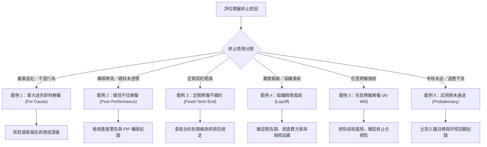

# 解僱通知信範本：人資必備範本、範例與各情境指引
> **原文網址**：https://www.aihr.com/blog/termination-letter-template/  
> **原文作者**：Monique Verduyn  

---

## 📌 英文摘要 (Executive Summary in English)

Handling employee terminations and writing termination letters are routine yet critical responsibilities for HR professionals, especially considering that U.S. Bureau of Labor Statistics data regularly show approximately 1.6 million layoffs and discharges each month. A professionally structured termination letter provides a clear written record of the separation—confirming effective dates, final compensation, benefits continuation, and company property return—thereby mitigating legal exposure and preventing misunderstandings. While federal law does not universally mandate termination letters, various state regulations (such as the WARN Act, New York's 5-day written notice, and state-specific unemployment separation forms like California DE 2320 or Georgia DOL-800) require formal documentation. Employers must balance factual clarity, objective compliance, and empathetic communication across diverse scenarios—ranging from for-cause dismissal and poor performance to fixed-term expiration, layoffs, at-will separations, and probationary exits.

---

## 🔑 核心關鍵字與術語對照 (Key Terms & Glossary)

| 英文術語 (English Term) | 台灣人資繁中對照 (Traditional Chinese) | 實務簡要定義／應用情境 (Context & Definition) |
| :--- | :--- | :--- |
| **Termination Letter** | 解僱通知信／終止聘僱通知函 | 雇主向員工發出之正式書面通知，明確載明終止聘僱關係之決定、生效日期、薪資福利結算與後續交接義務。 |
| **Separation Letter** | 離職證明書／終止聘僱關係函 | 涵蓋所有離職原因（包含自願離職、退休、契約期滿與雇主解僱）之通稱文件，主要證明聘僱關係已結束及交接事項。 |
| **Termination for Cause** | 因重大過失解僱／懲戒解僱 | 因員工嚴重不當行為、重大違紀或嚴重違法而由雇主發起之立即終止聘僱，通常不發放離職補償或預告工資。 |
| **Layoff / Redundancy** | 資遣／組織精簡裁員 | 因企業重組、業務緊縮、預算刪減或策略調整等商業營運因素發起之非自願離職，無關員工個人操守或表現。 |
| **At-will Employment** | 任意聘僱制 | 美國多數州勞動法常見原則，勞雇任一方皆可隨時基於合法理由（或無理由）終止聘僱關係，毋需提前預告。 |
| **Probationary Period** | 試用期 | 新進員工入職初期的評估期間，用以考核工作適任度與團隊文化契合度；未通過時依約終止聘僱。 |
| **Severance Pay / Package** | 資遣費／離職補償方案 | 雇主於非自願離職或組織裁員時，依法規或公司政策額外給予員工之薪資補償及過渡期福利支援。 |
| **Offboarding Process** | 離職與交接流程（員工登出流程） | 員工離開組織時涵蓋系統權限撤除、公物回收、法務簽署、薪資結算及離職面談的標準化管理流程。 |
| **WARN Act (Worker Adjustment and Retraining Notification Act)** | 大規模裁員與工廠關閉預告法 | 美國聯邦法規，規定符合資格之雇主在進行大規模裁員或關廠時，須於 60 天前發出正式書面通知（部分州如紐約州規定 90 天）。 |
| **COBRA Continuation Coverage** | 綜合預算協調法健康保險延續條款 | 美國聯邦法規，要求具備 20 名以上員工之企業，於離職員工失去團保資格時，提供其自費延續團體醫療保險之權利。 |

---

## 📖 專業深度編譯 (In-Depth Translation & Insights)

### 1. 解僱通知信之定義、戰略價值與法規脈絡 (What is a Termination Letter & Legal Requirements)
- **核心主張**：
  - 解僱通知信（Termination Letter）是雇主正式確認聘僱關係終止的書面憑證，具備「記錄決策事實」、「明確關鍵權利義務」與「預防勞資爭議」三大功能。
  - 良好的解僱信能確保離職流程（Offboarding Process）的一致性，並在員工申請失業救濟金或提起勞資仲裁時提供合法且客觀的文字紀錄。
- **實務指標與數據**：
  - 根據美國勞工統計局 (Bureau of Labor Statistics, BLS) 統計，全美每月平均約有 **160 萬人次**面臨裁員或解僱 (Layoffs and Discharges)，顯示雇主發起之聘僱終止極為頻繁。
  - **聯邦 WARN Act**：要求符合規範的雇主進行大規模裁員時，必須至少提前 **60 個日曆天** 提供書面通知。
  - **紐約州 WARN Act**：針對具備 **50 名以上全職員工** 的雇主，要求更嚴格的 **90 天** 提前預告期。
  - **紐約州終止通知規定**：雇主必須在終止聘僱關係後的 **5 個工作天內**，以書面明確通知終止確切日期及各項員工福利截止日期。
  - **失業保險特定表單要求**：例如喬治亞州規定所有離職員工均需填具 **DOL-800 離職通知表**；加州則強制要求雇主向被資遣或遭解僱員工提供 **關係變更書面通知 (Notice to Employee as to Change in Relationship)** 及 **DE 2320 福利手冊 (For Your Benefit pamphlet)**。
  - **COBRA 法規門檻**：適用於擁有 **20 名以上員工** 的雇主，必須在員工離職時提供醫療保險延續方案的書面說明。
- **解僱通知信 (Termination Letter) vs. 離職證明函 (Separation Letter) 辨析**：
  - **發起方**：解僱信純由雇主發起；離職證明函可由雇主或員工發起（含自願離職、退休、約聘期滿）。
  - **核心用途**：解僱信重在記錄雇主終止聘僱之決定與法律依據；離職證明函重在確認聘僱已告終結及後續事務交代。
  - **離職原因揭露**：解僱信在符合公司政策或法律要求時會載明具體終止事由；離職證明函通常僅載明離職類型（如個人因素離職或職缺縮減）。

---

### 2. 專業解僱通知信必備之 9 大關鍵要素 (What to Include in an Employee Termination Letter)
1. **員工與職務基本資訊 (Employee and Role Details)**：完整姓名、職稱、員工編號及發函日期，建立清晰之內部檔案索引。
2. **終止生效日期 (Termination Date)**：清楚載明聘僱關係終止日與最後在職工作日，界定薪資結算與福利存續時間軸。
3. **終止聘僱事由 (Reason for Termination)**：依公司規章與法規評估是否揭露；用語必須客觀中立、陳述事實，嚴禁情緒化或攻擊性言詞。
4. **相關決策脈絡 (Relevant Context)**：簡要綜述導致決策之先前警告紀錄、績效改善會議 (PIP) 或組織策略變更，避免讓通知顯得突兀無因。
5. **最終薪資結算資訊 (Final Pay Information)**：說明未領工資、未休特休假折現 (Unused Leave Payout)、加班費等金額計算方式、發放管道與確切給付日期（遵循各州／各地勞基法規之最終發薪期限）。
6. **員工福利與資遣費說明 (Benefits and Severance Details)**：列出各項團保福利截止時間、資遣方案 (Severance Package) 發放條件，並提供 COBRA 等醫療保險延續申請途徑。
7. **公物繳回與設備回收指引 (Company Property Return Instructions)**：列明應歸還公物清單（筆記型電腦、門禁卡、鑰匙、公司文件等），並指定交回期限、方式與聯絡窗口。
8. **後續義務與法律條款提醒 (Next Steps and Ongoing Obligations)**：提醒員工離職後仍須遵守之保密協議 (NDA)、競業禁止或智慧財產歸屬義務，並提供人資窗口聯絡方式。
9. **簽章與收訖確認 (Signature and Acknowledgment)**：主管或人資代表親筆簽署；建議附上員工簽收確認欄 (Acknowledgment of Receipt)，作為正式送達之書面憑證。

---

### 3. 六大常見終止聘僱情境範本與人資行動方針 (6 Termination Letter Scenarios)

- **情境 1：重大過失即時解僱 (Immediate Termination for Cause)**
  - *關鍵行動*：確認內部調查事實與違紀事證完整；信函中條列過往書面警告與違反規章條款，明確宣告立即生效。
- **情境 2：績效不佳解僱 (Poor Performance)**
  - *關鍵行動*：核對過往績效考核紀錄與改善輔導歷程；用語著重「雖經回饋與輔導，仍未達職務預期標準」之事實。
- **情境 3：定期契約期滿不續約 (Fixed-Term Contract End)**
  - *關鍵行動*：確認原合約到期日與不續約預告規範；信函表達感謝並明確約定離職交接與公物回收期限。
- **情境 4：組織精簡裁員 (Layoff Termination)**
  - *關鍵行動*：強調決策出於商業營運與組織架構調整，完全與員工個人績效表現無關；詳載資遣費方案及保險延續協議。
- **情境 5：任意聘僱解僱 (At-Will Termination)**
  - *關鍵行動*：引用勞雇合約中之任意聘僱條款，確認未涉及歧視或非法報復；文字維持高度簡練客觀。
- **情境 6：試用期未通過解僱 (Probationary Period Termination)**
  - *關鍵行動*：核對入職時訂定之工作目標與期間面談紀錄；說明因職能匹配度未符預期而不予轉正。

---

### 4. 撰寫專業解僱通知信之標準 7 步驟與實務技巧 (Step-by-Step Writing Guide & HR Tip)
- **步驟 1：採用公司正式信頭 (Professional Letterhead)**：附上公司正式名稱、法定地址、聯絡資訊與發函日期，建立正式法律文書規格。
- **步驟 2：載明受文員工資訊 (Address the Employee)**：包含員工全名、職稱與工號，並採用正式敬稱開頭。
- **步驟 3：開門見山表明終止意圖 (State Intent to Terminate)**：直述終止聘僱事實與生效確切日期，杜絕模稜兩可。
- **步驟 4：客觀說明終止原因 (Provide Reason When Required)**：以中立、簡明事實為基礎，排除主觀情緒用詞。
- **步驟 5：列明薪資結算與各項福利 (Outline Compensation & Benefits)**：未領工資、特休折抵、資遣費、COBRA 或延續保險方案。
- **步驟 6：要求歸還公司公物與資產 (Request Return of Property)**：明確列冊並規範交付時間地點。
- **步驟 7：提供後續窗口與簽收欄 (Next Steps & Signature)**：指定專責人資窗口；主管簽字，並保留員工簽收欄位。
- **💡 人資實務訣竅 (HR Tip)**：
  - **嚴禁無預警發信**：若需透過電子郵件寄發解僱通知信，**必須先進行面對面或視訊離職面談**，告知決策後再以 PDF 形式發送至員工的公司與私人信箱。
  - **要求確認回執**：請員工回信確認已收訖，並在人資系統中完整存檔。發信前務必核對所在地法規對於電子送達之法律效力要求。

---

### 5. 發送解僱通知信前之 10 項防呆核對清單 (Pre-Sending Checklist)
1. [ ] 員工全名、官方職稱、工號及終止生效日期是否精確無誤？
2. [ ] 終止聘僱原因是否正確，且與內部考核、懲戒與人資系統紀錄完全一致？
3. [ ] 相關佐證文件（如績效改善計畫、書面警告、調查報告、政策簽署單）是否齊備且具備法律效力？
4. [ ] 最終應發薪資計算（含未付薪資、未休假折算、資遣費、法定補償）是否已核算無誤？
5. [ ] 員工各項福利截止日期與保險延續說明（如 COBRA 方案手冊）是否已正確備齊？
6. [ ] 公物交接清單（筆電、識別證、通訊設備、公司檔案）與繳回截止期限是否明確合理？
7. [ ] 信函中所載內容是否與離職面談（Termination Meeting）中將說明的口頭訊息完全一致？
8. [ ] 是否已載明負責答覆後續問題之專責人資窗口（姓名、電子郵件、分機）？
9. [ ] 全文內容是否已符合內部工作規則、各州勞動法令及聯邦法規之預告義務？
10. [ ] 送出前是否已取得法務部門、人資高階主管及相關部門主管之內部核准？

---

## 📜 全文中文翻譯 (Full Traditional Chinese Translation)

### 解僱通知信：免費範本、樣式與實例指南

處理員工解僱與撰寫解僱通知信，是許多人資從業人員的日常工作之一。在美國，勞工統計局 (Bureau of Labor Statistics, BLS) 的數據經常顯示，全美每個月約有 160 萬人次面臨裁員與解僱，這突顯了由雇主發起之聘僱終止是多麼普遍的現象。

一份撰寫嚴謹的員工解僱通知信，能幫助雇主清楚記錄決策過程、降低產生誤解或引發法律糾紛的風險，並以專業且相互尊重的方式處理整個離職流程。

在本指南中，您將學習如何撰寫一份清晰、專業的終止聘僱通知函、應包含哪些核心內容，以及如何針對不同情境調整內容架構。您還能取得免費的解僱通知信範本（提供 Word 與 PDF 格式）以及實用的示範範例，協助您順利著手進行。

#### 本文重點摘要 (Key Takeaways)
- 解僱通知信為雇主與員工雙方提供一份終止聘僱的明確書面紀錄，內容涵蓋最後在職日、最終薪資結算、員工福利以及後續交接步驟。
- 此信函應當維持專業、尊重且清晰的基調，以減少混淆並支援標準一致的員工離職流程（Offboarding Process）。
- 一份優質的解僱通知信範本應包含各項核心事實，例如員工詳細資訊、終止生效日期、適當情況下的終止事由、最終薪酬、福利配套、公物歸還指引以及專責聯絡窗口。
- 美國聯邦法規通常未強制要求雇主必須提供解僱通知信，但部分州別要求提供書面預告或特定的離職通知表單，因此人資在發函前應先查核公司規章與適用法律。
- 解僱通知信屬於離職證明函（Separation Letter）的一種形式，專門用於由雇主決定終止聘僱關係之情境。

---

### 什麼是解僱通知信？ (What is a termination letter?)

解僱通知信（Termination Letter）是雇主發給員工的正式書面通知，用以確認雙方之聘僱關係即將終止。這份文件亦常被稱為員工解僱信、終止聘僱通知書、解聘通知、解雇函或終止聘僱關係證明信，其核心功能在於以書面形式記錄該項決定，並概述重要細節，例如生效日期、後續流程、最終薪資核算、各項福利處置，以及員工在離職前必須履行的各項義務。

一份職務終止通知函能協助雇主清楚記錄聘僱終止過程，並進行專業的溝通；它同時也提供員工一份關於決策的書面憑證，向員工說明在正式離開組織前需要完成哪些事項。在某些情況下，信函中可能會載明終止聘僱的原因，但雇主在決定信件內容時，應始終遵循公司內部政策以及適用的勞動法規。

#### 為什麼解僱通知信如此重要？ (Why are termination letters important?)
解僱通知信為雇主提供了一份明確的書面紀錄，證明終止勞雇關係的決定。它有助於人資團隊傳達各項關鍵資訊、以更具專業度的方式推動離職程序，並大幅降低產生誤會或法律爭議的潛在風險。

具體而言，解僱通知信對雇主的重要性體現在以下幾點：
- 以書面形式完備記錄終止聘僱之決策事實。
- 正式確認員工的最後在職工作日。
- 清楚說明最終薪資給付、福利處理原則與後續交接步驟。
- 建立一致且標準化的員工離職流程（Offboarding Process）。
- 在員工提出失業救濟金申請時，提供公正清晰的存證紀錄。
- 減少溝通混淆，並提升人事檔案保存的完整度。

#### 解僱通知信是法律強制要求的嗎？ (Are termination letters legally required?)
在美國，聯邦法規一般並未強制規定雇主在任何解僱情境下都必須提供解僱通知信。然而，在以下幾種特定法定情況下，書面通知是法律強制要求的：

- **大規模裁員與關廠 (Mass layoffs and plant closings)**：根據聯邦《勞工調整與再培訓預告法》(WARN Act)，符合規範的受規範雇主必須至少提前 60 個日曆天發出書面通知。部分州別制定了涵蓋範圍更廣的州版 WARN 法規。例如，紐約州的 WARN Act 要求擁有 50 名以上全職員工的雇主必須提前 90 天提供預告。
- **州級解僱通知規定 (State termination notice rules)**：部分州別對解僱行為本身要求提供書面通知。例如，紐約州要求雇主必須在終止聘僱後的 5 個工作天內，以書面形式通知員工確切的終止日期以及各項員工福利終止的日期。
- **州級失業保險離職表單 (State separation notices for unemployment)**：部分州別強制規定雇主必須向離職員工提供專用表格或通知，以利員工向主管機關申領失業給付。例如，喬治亞州規定，不論離職原因為何，雇主皆必須為每一位離職勞工填寫「離職通知書」(Separation Notice, DOL-800)；加利福尼亞州則規定雇主必須向遭解僱或裁員的員工提供書面的「勞雇關係變更通知」(Notice to Employee as to Change in Relationship)，並附發「保障您的權益」(For Your Benefit, DE 2320) 指導手冊。

即便在法律並未強制要求提供解僱通知信的地區，許多企業依然會主動發布該信函，作為聘僱終止的正式書面佐證。由於各州的解僱規範差異甚大，在正式發送任何信件之前，務必仔細審視適用的法規與企業內部規章。

#### 解僱通知信 vs. 離職證明函 (Termination letter vs. separation letter)
離職證明函（Separation Letter，亦稱終止聘僱關係函）是用於確認聘僱關係因「任何原因」而告終的文件；而解僱通知信（Termination Letter）則是專指雇主主動決定終止聘僱時所發出的專用通知。

| 比較項目 | 解僱通知信 (Termination Letter) | 離職證明函 (Separation Letter) |
| :--- | :--- | :--- |
| **發起方** | 雇主 | 雇主或員工 |
| **適用情境** | 懲戒解僱、績效不佳、裁員、任意聘僱解僱或試用期未通過 | 任何離職情境，包含自願離職、退休、裁員、雇主解僱或定期聘僱契約期滿 |
| **主要目的** | 通知員工雇主之終止決定並建立正式書面存證 | 確認聘僱關係已結束並交代後續處置事宜 |
| **離職原因揭露** | 當公司規章或法規要求時通常會列明 | 通常僅載明離職類型，例如主動辭職或職缺縮減 |
| **典型內文要素** | 終止生效日、適當情境下之事由、最終薪資、福利處置、公物繳回指引、人資聯絡人 | 最後在職日、最終薪酬、福利處置、公物歸還指引、人資聯絡人 |

---

### 員工解僱通知信中應包含哪些內容？ (What to include in an employee termination letter)

一份專業的解僱通知信應當清晰陳述該項決策，並向員工提供其離開組織前所需的各項實務資訊。當雇主完整列入各項必要細節時，不僅能提升溝通清晰度、減少疑慮，還能為整個離職作業建立起更為嚴謹完備的存證紀錄。

以下是解僱通知信中應當涵蓋的關鍵項目：
- **員工與職務詳細資訊 (Employee and role details)**：明確記載員工全名、官方職稱，並註明發信日期。這能確立該信函的適用對象與生效時間點，避免內部人事檔案管理產生混淆。
- **終止生效日期 (Termination date)**：清楚載明聘僱關係正式終止的日期。這使員工能準確得知其最後工作日，並為後續薪資發放、福利結算及離職交接劃定明確的時間表。
- **終止聘僱原因 (Reason for termination)**：在適當時機，或當內部政策及當地法律有要求時，應具體說明解僱原因。遣詞用字必須客觀、基於事實，避免帶有情緒化或主觀指責的口吻。
- **相關背景脈絡 (Relevant context)**：簡要綜述導致此項決策的過往背景，例如先前的口頭或書面警告、績效疑慮、違反工作規則紀錄，或是組織架構調整。這有助於更清晰地記錄解僱過程，特別是當該決策並非毫無前兆時。
- **最終薪資結算資訊 (Final pay information)**：詳細說明員工在最後一份薪資單中將收到的款項明細，包含尚未發放的工資以及未休特休假折現（若適用）。同時應註明薪資發放的時間與交付方式。雖然聯邦法律並未規定雇主必須在離職當日立即給付最終工資，但部分州別訂有極為嚴格的發放時限，因此在確認發薪日前務必查核各州法規。
- **員工福利與資遣費說明 (Benefits and severance details)**：概括說明員工福利在解僱後的處置方式；若雇主有提供資遣方案，應一併列出資遣費細節。在適用的情況下，應提及如 COBRA（通常適用於 20 名以上員工之企業）等醫療保險延續選擇方案，並告知員工可在何處查閱更多申辦資訊。
- **公物繳回與設備回收指引 (Company property return instructions)**：條列員工必須交還的所有公司財產，例如筆記型電腦、門禁識別證、辦公室鑰匙或機密文件等，並清楚說明歸還的時間、地點與具體交接方式。
- **後續步驟與離職後義務 (Next steps and ongoing obligations)**：在信末說明員工接下來需要完成的事項，並提醒其在聘僱關係終止後依然生效的各項法定義務，例如保密協議 (NDA) 或營業秘密條款。此外，務必提供專責窗口資訊，以利員工提出後續疑問。
- **簽署與收訖確認 (Signature and acknowledgment)**：由直屬主管或人資部門代表正式簽署該信函。您亦可增加一欄供員工簽名並註記日期，作為確認收訖信件的憑證，這能大幅強化雇主的存證效力。

此外，請時刻記住，解僱通知信的「語氣與基調」至關重要。整體語氣應維持高度尊重且立場明確，既顧全離職員工的人格尊嚴，亦同時維護組織的專業聲譽。一份精心撰寫的信函，正代表著企業對於公平性與透明度 (Fairness and Transparency) 的承諾。

解僱通知信僅是高度敏感的離職作業中的環節之一。唯有深化對於人資規章、員工關係 (Employee Relations) 及職場溝通的宏觀理解，才能確保在處理各類解僱情境時兼顧原則的一致性與人性的同理心。

---

### 免費解僱通知信範本說明 (Free termination letter template)

為了協助人資團隊更順暢地推展解僱作業，AIHR 設計了免費且可高度自訂的員工解僱通知信範本，提供 Word 與 PDF 兩種格式。人資團隊可根據不同的聘僱終止情境彈性調整套用，該範本嚴格遵循人資標準解僱文書架構。

*請特別注意：本範本僅供一般人資實務參考，並不構成任何專業法律意見。若欲確保您的解僱通知信完全符合各地勞動法規，請務必諮詢合格之法律專業人士。*

---

### 六大常見情境之解僱通知信示範範例 (6 termination letter examples and samples)

以下提供適用於不同職場情境的解僱通知信範例。您可以根據貴公司的內部政策與溝通語氣進行修改，亦可在情節單純的案件中將其精簡為簡短格式。

| 情境說明 | 適用範本類型 | 核心人資行動重點 |
| :--- | :--- | :--- |
| 嚴重不當行為或具備書面存證之違規情事 | 因過失立即解僱通知信 (Immediate termination letter for cause) | 核實調查結果與事證，確認是否符合立即解聘標準。 |
| 未達工作績效標準 | 績效不佳解僱通知信 (Poor performance) | 確保信中所述與過去書面期待、回饋及改善輔導紀錄相符。 |
| 定期聘僱契約期滿 | 定期契約期滿終止函 (End of employment letter) | 查核合約到期日、提前預告規範及是否包含續約條款。 |
| 基於營運因素取消該職位 | 組織精簡裁員通知信 (Layoff) | 查核預告期義務、各項福利處置及資遣補償方案。 |
| 任意聘僱關係之終止 | 任意聘僱終止信 (At-will termination) | 確認雙方合約屬性，並排除非法歧視或其他法定限制。 |
| 試用期間終止聘僱 | 試用期終止通知信 (Probationary period) | 核對聘僱合約條款與入職時約定之職位考核標準。 |

#### 範例 1：重大過失即時解僱通知信 (Immediate termination letter for cause)
> **適用時機**：當員工發生重大不當行為、嚴重違反公司政策，或出現其他足以構成立即終止聘僱之行為時使用。

親愛的 [員工姓名]：

我們特此發函通知您，由於 [具體原因，例如：多次違反公司工作規則或嚴重績效缺失]，本公司 ([公司名稱]) 決定終止與您的聘僱關係，此項決定立即生效。

此項決定乃是針對您的 [行為操守／工作表現] 進行全面性評估，並在審慎考量以下事實後所作成：
- [問題之具體詳細範例，例如：儘管我們已於 (具體日期) 提供輔導回饋與支援資源，您仍持續未能達成約定之工作目標]。
- [列舉先前所發布之警告或懲戒紀錄，例如：於 (具體日期) 正式發出之書面警告函]。

您的最終薪資（包含 [若適用，結算之各項應領福利]）將於 [日期] 發放。請於 [歸還期限] 之前，將公司所屬之各項財產設備繳回，包含 [列出應還物品清單]。

若您對本通知有任何疑問，請透過 [電子郵件／電話] 與人資部窗口 [人資窗口姓名] 聯繫。

祝好，  
[主管姓名]  
[職稱]

---

#### 範例 2：績效不佳之解僱通知信 (Termination letter for poor performance)
> **適用時機**：當員工在組織提供多次回饋、輔導資源或發出書面警告後，工作表現仍未達到預期標準時使用。

親愛的 [員工姓名]：

我們特此發函通知您，由於您在擔任 [職稱] 期間之工作績效仍持續未達預期，本公司 ([公司名稱]) 決定於 [終止日期] 正式終止與您的聘僱關係。

在過去的 [時間區間] 期間，我們曾針對 [問題之簡要說明] 與您進行多次面談討論、提供具體改善建議，並給予充分的提升機會。然而，由於預期的改善成效未能達成，我們最終決定終止雙方的聘僱關係。

您的最終薪資單（包含未領之應得薪資以及 [若適用，未休特休假之折現補償]）將於 [日期] 發放。請於不晚於 [歸還期限] 之前，將所有公司財產歸還，包含 [列出應還物品清單]。

若您希望進一步討論最終發薪、員工福利延續或後續交接程序，歡迎透過 [電子郵件／電話] 與人資窗口 [人資窗口姓名] 聯繫。

我們由衷感謝您在職期間為公司付出的努力，並祝願您在未來的職業生涯中一切順利。

祝好，  
[主管姓名]  
[職稱]

---

#### 範例 3：定期聘僱契約期滿不續約通知信 (End of employment letter for a fixed-term contract)
> **適用時機**：當定期聘僱合約即將屆滿，且雇主無意續約時使用。

親愛的 [員工姓名]：

我們特此發函確認，您與本公司 ([公司名稱]) 於 [起始日期] 生效之定期聘僱合約，將依合約約定條款於 [合約到期日] 正式屆滿終止。

由於該合約已達原訂終止期限，除非雙方另行簽署書面協議，否則您的聘僱關係將於該日劃下句點。

您的最後薪資（包含 [若適用，未領薪資或未休特休假折現]）將於 [日期] 完成核發作業。請於 [歸還期限] 之前，將您保管的所有公司財產全數歸還，包含 [列出應還物品清單]。

若您對最終薪資、福利計算或約聘期滿交接有任何疑問，請透過 [電子郵件／電話] 洽詢人資部 [人資窗口姓名]。

感謝您在職期間對 [公司名稱] 所做出的貢獻，祝福您未來的各項事業發展順利成功。

祝好，  
[主管姓名]  
[職稱]

---

#### 範例 4：組織精簡裁員通知信 (Layoff termination letter)
> **適用時機**：當公司因組織重組、業務精簡、營運成本削減或其他商業策略轉變，而非基於員工個人績效或行為而終止聘僱時使用。

親愛的 [員工姓名]：

我們非常遺憾地通知您，由於本公司推展 [組織架構重整／部門縮編／預算縮減／其他業務轉型策略]，您在 [公司名稱] 所擔任的職位將於 [終止日期] 正式取消。

本項決定完全建立於商業經營考量之上，與您個人的工作表現或品德操守完全無關。我們深知這項消息對您而言極為艱難，由衷感謝您過去對組織的各項寶貴貢獻。

您的最終薪資單（包含未付薪資以及 [若適用，未休特休假補償]）將於 [日期] 撥付。同時，您將依據 [公司政策或離職協議] [領取資遣費／符合領取資遣費之資格]。關於員工福利延續事宜（包含 [若適用，COBRA 團保延續保障]）的詳細說明文件將另行提供。在適用情況下，雇主亦可另外發布獨立的資遣權益說明書，詳述協議條款。

請於 [歸還期限] 前繳回所有公司財產，包含 [列出應還物品清單]。若您對資遣方案、福利權益或後續流程有任何疑問，請隨時透過 [電子郵件／電話] 與人資窗口 [人資窗口姓名] 聯繫。

我們誠摯感謝您為公司提供的服務與奉獻，並祝您未來發展一切順心。

祝好，  
[主管姓名]  
[職稱]

---

#### 範例 5：任意聘僱終止通知信 (At-will termination letter)
> **適用時機**：雇主依據公司人事政策及適用法律，依法行使任意聘僱原則終止聘僱關係時使用（在美國除蒙大拿州外均適用任意聘僱制；蒙大拿州法律要求通過試用期的員工必須具備正當理由始得解僱）。

親愛的 [員工姓名]：

本信函旨在正式通知您，您在 [公司名稱] 的聘僱關係將於 [終止日期] 正式結束。

依據雙方簽署之「任意聘僱」(At-will) 原則，在合乎法規的前提下，您或本公司皆有權在任何時間、基於任何理由（或無須說明理由）終止勞雇關係。經審慎評估後，本公司決定於上述指定日期終止與您的聘僱合約。

您的最終薪資（包含尚未結清之工資與 [若適用，未休特休假之折算工資]）將於 [日期] 核發。請於 [歸還期限] 之前，將公司所屬財物完整歸還，包含 [列出應還物品清單]。

若您對本通知函有任何疑問，請透過 [電子郵件／電話] 與人資部門窗口 [人資窗口姓名] 聯繫。

祝好，  
[主管姓名]  
[職稱]

---

#### 範例 6：試用期未通過終止通知信 (Probationary period termination letter)
> **適用時機**：員工在試用期間未能達到該職務之關鍵工作目標，或在評估後發現與組織文化不合適時使用。

親愛的 [員工姓名]：

我們特此發函通知您，您於 [公司名稱] 擔任 [職稱] 之職務聘僱，將於試用期間之 [終止日期] 正式結束。

在試用期間，我們依據您入職時所確立之目標期待（包含 [列舉核心工作期待，如：專案進度之達成或指定培訓課程之完成]），持續檢視您的工作適應與進展情況。儘管我們曾於 [具體日期] 與您就這些工作期待進行過面談與討論，但經綜合評估後，我們決定在試用期結束後不再續聘。

您的最終薪資單（包含 [若適用，未結清工資或特休補償]）將於 [日期] 完成結算。請於 [歸還期限] 之前繳還所有公司財產，例如 [列出應還物品清單]。

若您有任何疑問，請透過 [電子郵件／電話] 洽詢人資窗口 [人資窗口姓名]。

祝願您在未來的職業生涯中一切順利。

祝好，  
[主管姓名]  
[職稱]

---

### 如何撰寫一份標準合規的解僱通知信 (How to write a simple termination letter)

請遵循以下七大標準步驟，撰寫一份格式正規且具備法律合規性的解僱通知信：

#### 步驟 1：使用公司正式信頭 (Use a professional letterhead)
以公司官方信頭為起始，載明組織全名、通訊地址與官方聯絡電話。這是企業落實解僱文書標準化的重要環節。同時，務必在信頭下方清楚標註發信日期，確立正式法律文書的時間軸起點。

#### 步驟 2：明確指名受文員工 (Address the letter to the employee)
完整列出受文員工的關鍵人事資料，包含其法定全名、職務名稱，以及員工工號（若有使用）。接著以正式敬稱開啟正文（例如：「親愛的 [員工姓名]」）。

#### 步驟 3：開門見山宣告終止意圖 (Clearly state the intent to terminate)
在首段以直截了當的語句表明終止聘僱關係之意旨，並清楚指明生效終止日期。例如：「我們特此發函通知您，本公司 ([公司名稱]) 決定終止與您的聘僱關係，此項決定將於 [日期] 正式生效。」這是整份書面通知的法理核心，文字必須清晰無誤、絕無歧義。

#### 步驟 4：適時提供客觀終止事由 (Provide a reason for termination when appropriate or required)
若內部人事規章或當地法規有明文要求，應具體說明解僱事由（無論屬於因過失解僱或非因過失終止）。論述務必客觀中立、簡明扼要，避免使用主觀、推測性或情緒化的字眼（例如：「此項決定係因多次績效未達要求，且在透過建設性面談回饋提供輔導後仍未見改善所作成」）。

#### 步驟 5：詳細列明最終薪酬結算與福利 (Outline the employee’s final compensation and benefits)
清楚說明最後發薪日的結算項目，包含未結算之薪資、未休年假折現、加班費補償等應得款項。若公司提供資遣費 (Severance Pay)，應載明給付金額與發放方式，並說明如 COBRA 等各項員工福利之延續管道與申辦程序。

#### 步驟 6：要求歸還公司財產與設備 (Request the return of company property)
明確列舉員工應交還的所有公物資產，例如筆記型電腦、門禁通行卡、鑰匙或機密文件等。同時指定歸還的最後期限及具體交付方式。例如：「請於 [日期] 之前，將您所保管之全部公司財物（包含筆記型電腦與門禁識別證）全數繳回。」

#### 步驟 7：說明後續交接步驟與聯絡資訊 (Provide information on next steps)
在信末提供員工專責的諮詢聯絡窗口（通常為指定之人資同仁）。若組織有額外提供轉職協助、心理諮商或推薦信等支援服務，亦可一併提及。信末須由權責主管或人資主管簽名，並強烈建議增設一欄供離職員工簽收並註記日期。

#### 💡 人資實務訣竅 (HR Tip)
若因遠距辦公或特殊狀況需要透過「電子郵件」發送解僱通知信，**切記務必先召開面對面會議或視訊通話**，親口告知該項決策。在溝通完成後，方能將解僱通知信以加密 PDF 格式分別寄送至員工的公司信箱與私人信箱，並明確要求其回信確認收訖，同時將通訊紀錄完整封存於人資檔案中。在以電郵寄發具有法定強制效力之通知前，請務必先確認所在地區法律對電子文件送達之合規性要求。

---

### 發送解僱通知信前的必備核對清單 (Checklist before sending an employment termination letter)

在將解僱通知信正式交付員工之前，人資人員必須審慎審查信函內容以及所有相關佐證文件。這有助於人資部門確認資訊精準無誤、確保處理程序的一致性，並為組織留下扎實完整的決策憑證。

在發函前，請逐一檢查以下十項關鍵確認點：
- [ ] **身分資訊核實**：確認員工法定全名、職位名稱及終止生效日期完全無誤。
- [ ] **原因陳述一致性**：檢視解僱事由是否客觀準確，並與內部人事系統存檔紀錄保持高度一致。
- [ ] **佐證文件齊備性**：完整調閱並複查各項佐證紀錄，例如績效考評表、書面警告函、調查訪談紀錄或公司規章簽署收據。
- [ ] **最終薪酬準確性**：核實最終薪資單的所有明細，包含累積工資、特休未休折算、資遣補償金及其他依法或合約應享有之權益。
- [ ] **福利處置完備性**：確認員工各項福利在離職後的變更規範，並檢核是否已檢附如 COBRA 等保險延續指引。
- [ ] **資產繳回明確性**：確保公司設備與公物回收清單完整詳盡，且規範之歸還管道在實務上切實可行。
- [ ] **口頭溝通契合度**：核對信函內容是否與離職面談 (Termination Meeting) 中所口頭傳達的訊息完全一致。
- [ ] **專責窗口正確性**：信末是否已列入正確、可聯繫之人資專責窗口姓名與聯絡方式。
- [ ] **法規政策合規性**：由人資主管或法務審閱全文，確認信函完全符合公司規章、地方勞動法令與聯邦法規之規範。
- [ ] **內部核決授權**：在信函正式發出前，確認已取得所有權責主管與法務單位之正式簽核批准。

透過上述最終覆核流程，人資部門能及時糾正疏漏、確保文件與實質佐證吻合，並維持組織在面對勞雇關係終止時的高標準專業度。同時，清晰透徹的資訊亦能協助離職員工明確理解自身的權益與下一步行動，有效減少在艱難時刻可能產生的焦慮與紛爭。

---

### 常見問答 (FAQ)

#### 什麼是解僱通知信？ (What is a termination letter?)
解僱通知信是雇主發給員工的正式書面通知，用以確認雙方之聘僱關係即將終止。信函通常涵蓋終止生效日期、適當情況下之解僱事由、最終薪資核算、福利銜接安排以及後續交接作業等核心資訊。

#### 什麼才算是一份優質的解僱通知信？ (What makes a good termination letter?)
一份專業且健全的解僱通知信應當立場明確地宣告聘僱終止的事實、明確標註生效日期、在適當時機清楚說明客觀原因，並詳盡條列最終發薪、福利處置與公物回收等實務步驟。全文風格應當開門見山、專業中立且兼具對人格尊嚴的尊重。

#### 解僱通知信中絕對不應該包含哪些內容？ (What should not be included in a termination letter?)
解僱通知信絕對不應包含情緒化字眼、主觀個人臆測、語意含糊的指控或非必要的瑣碎細節，這類內容極易造成認知混亂並衍生重大法律訴訟風險。此外，信中應嚴禁出現侮辱性詞句、自我矛盾的敘述，或雇主在法律或政策上無法兌現的承諾。全公司應維持解僱信格式與語氣的一致性，且所有簽署之正本文件均應安全妥善地存檔於員工個人人事資料夾中。

#### 解聘信 (Dismissal Letter) 與解僱通知信 (Termination Letter) 是一樣的文件嗎？
是的，在人資實務上，解聘信 (Dismissal Letter) 與解僱通知信 (Termination Letter) 本質上指稱相同的文件。兩者皆代表雇主所出具、確認聘僱關係即將結束之正式書面通知。在現代人資領域中，「Termination Letter」更常被廣泛使用於正式檔案；而「Dismissal Letter」則常在部分地區（例如英國或大英國協體系）交替互換使用。

#### 如何有禮貌且具同理心地執行員工解僱？ (How do you politely terminate an employee?)
要以得體且專業的方式執行解僱，關鍵在於「直接溝通但兼具同理與尊重」。溝通時應使用平實清晰的語言，避免相互推諉或進行過度私人化的評價，將對話焦點放在客觀的決策事實上，而非引導出無休止的辯論。

無論在面對面談話或書面解僱信中，都應誠懇地理解這對員工而言是一個艱難的時刻，向其清楚說明隨之而來的實質交接步驟，並給予員工提出實務疑問的空間。一套尊重個人尊嚴且準備充分的應對方法，既能維護同仁的尊嚴，亦能有效確保組織整體離職流程之專業與公正。

#### 員工需要解僱通知信才能申辦失業保險金嗎？ (Does an employee need a termination letter to get unemployment benefits?)
在美國多數州別中，員工通常不需要出具雇主發布的解僱通知信即可申請失業救濟金。州政府的失業救濟主管機關通常會直接發函向雇主端查證終止聘僱的具體原因。

然而，部分特定州別強制要求雇主必須向離職員工提供官方指定的離職通知表單；同時，一份記載清晰嚴謹的解僱通知信，能幫助雇主在面對州政府失業救濟調查時，迅速且精確地回覆事實依據，避免不必要的爭端。
